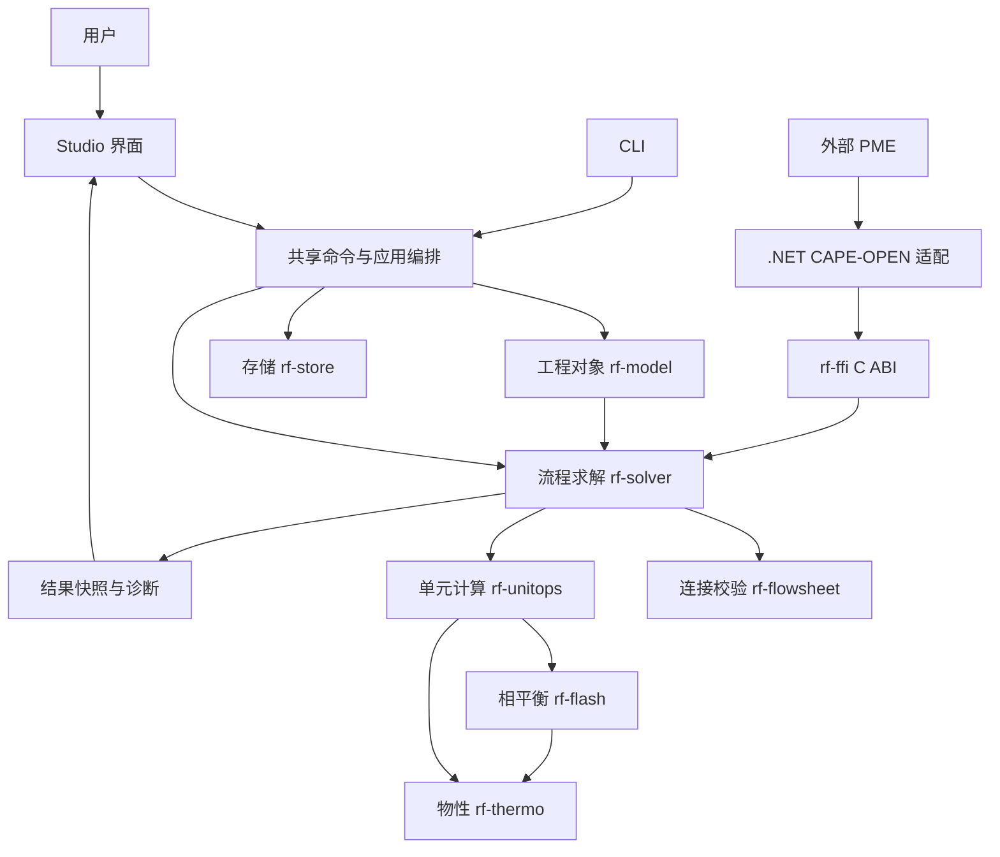

# Architecture Overview

更新时间：2026-10-24

## 用途

用途：说明仓库实际分层、稳定边界、已实现能力与尚未落地的目标边界。
读者：需要定位模块职责、追踪依赖或判断架构现状的维护者。
不包含：逐日开发流水、命令级验证记录、完整接口设计和产品排期。

本文区分架构目标与已有实现，后续开发按稳定分层逐步补齐差异。当前迭代优先级见 [当前状态](../status/current.md)。

长期定位已扩展为覆盖稳态、动态、瞬态与多种求解策略的流程模拟平台。组分、物性分析、画布、单元 / 反应、运行、算法、报告和统一 API 的职责与扩展契约见 [模拟平台长期规划](simulation-platform.md)。本文继续如实记录现有实现，不以目标能力替换当前 crate 职责；近期按基础功能闭环逐步改善依赖与状态边界。

## 系统组成与实际状态

| 部分 | 已有实现 | 能力边界 |
| --- | --- | --- |
| Rust Core | 对象模型、简化物性、TP Flash、受控单元、图校验和顺序模块求解 | 二元 MVP 与无回路小流程；算法收敛不等于物理准确性验证 |
| Rust Studio | `eframe/egui` 桌面壳、草稿与命令、运行控制、结果审阅、项目生命周期 | 受控建模路径，尚非完整自由连线或通用流程编辑器 |
| .NET 10 CAPE-OPEN Bridge | C ABI 调用、PMC、注册工具、contract / smoke 与 SampleHost | 自有 Unit Operation PMC；PME 兼容结论限于已记录的宿主和场景 |
| 外部 Control Plane | 本仓库已有客户端 DTO、HTTP transport、缓存与租约编排 | 服务端未在本仓库落地；客户端测试不代表 OIDC、部署和真实授权闭环已完成 |

已有小流程覆盖 `Feed -> Flash Drum`、`Feed -> Heater/Cooler/Valve -> Flash Drum`、`Feed + Feed -> Mixer -> Flash Drum`。用户路径和验收证据分别见 [Studio 主路径](../topics/studio-main-workflow.md) 与 [MVP β 验收记录](../mvp/beta-acceptance-checklist.md)。

## 用户入口与计算关系

用户通过 Studio 或 CLI 提交操作；应用编排负责命令、工程修订、运行和存储，工程模型描述单元与流股，流程求解器负责依赖和执行，单元调用热力学服务。单位、错误、诊断和存储是横向能力，不必组成只能逐层向下调用的阶梯。账户 / 授权控制能力访问，不拥有物流或设备方程。

图为主要职责 / 数据关系，不是完整依赖图。当前命令和查询分布于 `rf-ui` 与 Studio，尚非独立应用服务包；现有 FFI 求解入口也不代表全部 Studio 编辑动作已对外开放。画布图元、工程中的 `UnitNode`、执行 `UnitOperation` 的计算对象分别承担呈现、持久配置和计算职责。

## Rust 模块职责

| 模块 | 实际职责 | 说明 |
| --- | --- | --- |
| `rf-types` | ID、相标签、错误与诊断上下文、相区容差及量 / 单位目录与转换 | 单位基础无 UI、IO 或 COM 语义；规范 SI 不变 |
| `rf-model` | 组分、流股、单元、端口、flowsheet 及工程基础 / 来源、独立设备任务、有限工况矩阵与固定几何采纳证据 | 不负责求解调度；工程结构解析不证明方法有效性 |
| `rf-thermo` | Antoine、理想 K 值、常热容相焓、泡露点估算、物性 provider | 只接收已解析数值数据，不依赖 store |
| `rf-property-package` | 包发现、资源资格、stored 转换、冻结数据、本地服务装配和来源描述 | Studio / FFI 共享；不拥有应用选包 / 授权与结果发布 |
| `rf-flash` | TP Flash、Rachford-Rice、相分率与相组成 | 数值假设与验证边界见 [热力学模型](../thermo/mvp-model.md) |
| `rf-unitops` | canonical ports、六类单元及规格规则、独立分离器尺寸 / 校核与候选纯映射 | Mixer、Valve 和焓模型使用 MVP 简化假设 |
| `rf-flowsheet` | 端口、流股引用、一源一汇校验及文档侧有来源的入口压力上下文 | 终端产品流可没有 sink；不借用未运行模板伪造压力依据 |
| `rf-solver` | 无回路顺序模块执行、步骤快照、诊断 | 环路报错，不代表已有 recycle 收敛器 |
| `rf-store` | 项目、sidecar、偏好、授权缓存、物性包及完整 v3 设备编解码 / IO | Studio 支持已知 v3，未知设备能力整份只读；旧 CLI 保持 v1/v2，见 [存储专题](../topics/project-lifecycle-storage.md) |
| `rf-ffi` | engine 句柄、JSON 输入输出、错误映射与字符串释放 | 对外只暴露窄 C ABI，不向内核引入 COM |
| `rf-ui` | AppState、草稿、共享输入事务、工程查询、来源与结果 presentation | 只读消费求解结果，不另算热力学 |
| `rf-canvas` | 当前只有占位函数 | 尚未成为实际独立画布实现 |
| `apps/radishflow-studio` | 应用组合、受控动作、CLI 消费者、GUI 渲染与平台 IO | 当前画布代码位于 Studio，而非 `rf-canvas` |
| `tests/rust-integration` | 示例流程与 Studio / solver 的跨层回归 | 结果传递一致性与独立数值准确性是不同验证目标 |
| `xtask` | 仓库治理、文本门禁和 Rust 基线检查 | `.sh` / `.ps1` 是平台包装入口 |

典型计算调用方向为 `Studio 或 rf-ffi -> rf-solver -> rf-unitops -> rf-flash / rf-thermo`；`rf-flowsheet` 提供连接校验，`rf-model / rf-types` 提供领域数据。该描述是职责路径，不是完整 Cargo 依赖图。

`rf-model::equipment` 拥有任务、输入与固定采纳证据；`rf-unitops::separator_sizing` 复用来源绑定，纯函数检查并返回拥有输入 / 来源副本的只读候选，无 UI、IO、COM 或流程求解调用。`rf-ui::engineering` 管理正式事务、独立历史及结果资格，`editor` 管理草稿与影响确认；Studio 设备页消费同一应用状态，并通过 `rf-store::project_v3` 保存正式输入。设备检查 / 计算不依赖流程 Run 或物性包选择；重开后结果 Missing。单行 / 矩阵导出已接通；C1 的 `separator_adoption` 纯映射与应用 / 编辑器原子采纳、v3 保存已实现，局部画板已确认，采纳 UI 与固定证据输出已接通；流程关联未接入。

AF4a 的 `rf-ui::project_query` 从单一工作区只读发现流程、设备、基础和来源，分别校验流程身份与设备 checkpoint。AF5a 保留两类结果载荷，Current 才提供数值；执行来源随已接收结果保留，不由当前选包补填。AF4b 已接通流程 / 设备正式动作及运行回执；AF4c 已通过独立 v3 协议覆盖查询、正式编辑 / 确认、同步计算和 C1 采纳，旧 CLI 适配保持。

Studio 的 `modeling_specifications` 提供只读 A1 报告与会话身份；`modeling_recommendations` 持有同一检查会话，负责候选、预览、忽略和正式接受，GUI 共用该状态。接受经 `rf-ui` 输入 / 连接事务写回，检查与推荐不自动求解、不持久化，也不新增 CLI 协议。共享规则在 UI、预检与 solver 各自阶段消费，保留既有外部失败分类。

后续多策略目标采用“同一工程 → 计算任务 → 能力 / 规格检查 → 问题装配 → 分块执行 → 统一结果”。当前 `FlowsheetSolver` 和 `UnitOperation::run` 不代表已有通用方程装配器；SM、联立模块、EO 的能力与运行边界见 [多策略专题](../topics/modeling/solver-strategies-and-assembly.md)，具体 crate 和接口尚未冻结。

## 模型发现与装配现状

| 方向 | 当前实现 | 限制 |
| --- | --- | --- |
| 内建单元 | `rf-unitops::catalog` 静态描述与工厂统一六类模型、规格和服务需求；solver 委托构造 | 六类固定模型，不扫描插件或加载第三方库 |
| 物性包 | `rf-property-package` 发现 manifest、按需装载指定包并冻结本地上下文 | 现有简化物性 / TP Flash 共用工厂；数据包不是通用可执行插件 |
| 物性绑定 | 流程保存一个 package ID，单次求解注入一套服务 | 尚无完整工段 / 单元多物性绑定 |
| 对外 CAPE-OPEN | 外部 PME 发现和调用自有 Unit Operation PMC | 与 RadishFlow 加载外部 PMC 的宿主方向不同，后者未实现 |

模型定义、工程实例、运行实例及目录 / 工厂的演进和验收见 [模型目录专题](../topics/modeling/model-catalog-and-runtime.md)。静态装配是当前合理起点，但 `UnitOperation` 的固定枚举和温压参数结构尚不是开放模型协议。

## 稳定边界与实现偏移

### Core 与持久化

目标边界仍是：热力学计算与 provider 接口不承担网络、授权流程或文件缓存编排；缓存布局和持久化属于 `rf-store`，应用层负责组合。

AF2b 已将 [CachedPropertyPackageProvider](../../crates/rf-property-package/src/provider.rs)、资格、DTO 转换与服务工厂迁入 `rf-property-package`；依赖方向为应用 / FFI → 包装配 → store + thermo + flash。`rf-thermo` 不再依赖 `rf-store`；运行只装载已选包，独立上下文拥有数据，后续求值不读磁盘或时钟。

包描述区分实现支持与数据缺口，来源证据保存规范化 payload 指纹和实现标识；不承担 entitlement、用户选包或后台任务身份。接口、兼容变化与验收见 [AF2b](../topics/property-basis-and-components.md#af2b-物性装配与运行上下文)。

### 文档、编辑与结果

- `FlowsheetDocument` 是项目语义真相源，字段草稿通过正式 `DocumentCommand` 提交。
- `CommandHistory` 当前保存 before / after flowsheet 快照用于 undo / redo；相同有效输入不新增历史或修订。
- `SolveSnapshot` 与文档分离，按 revision 判断是否过期；UI 和导出不重新计算相态与焓值。
- 项目使用 `*.rfproj.json`，布局使用 `<project>.rfstudio-layout.json`；授权缓存与 token 不进入项目文件。
- Studio 已内嵌 Inter / SourceHanSansSC 字体，不依赖固定的系统 CJK 字体名称。

变量查询 / 写入置于 `rf-ui`，受控创建 / 连接 / 运行调用和本地 CLI 置于 Studio 应用层。CLI 复用现有事务与运行链路，不启动窗口；仍链接桌面依赖。接口范围见 [无界面参考](../reference/headless-cli.md)。 AF4b 的 `Studio::flow_actions`、`rf-ui::EquipmentAction` 与 `Studio::run_actions` 分别承接流程编辑、设备输入 / 检查和计算回执；各自校验领域输入上下文，编辑不需要物性缓存。GUI 复用正式事务与草稿守卫，旧 CLI 适配保持。新版 `headless::v3` 使用专用严格 DTO 和同次原始字节指纹，影响确认在隔离副本准备并按摘要重放；独立设备运行入口不接收流程缓存，仍使用相同运行资格和结果模型。

U1 的公共单位定义与转换位于 `rf-types::units`；`rf-ui` 变量元数据引用量类型。U2 已接通项目呈现保存、个人默认、数值会话及首批控件 / 视图覆盖，剩余交互与验收见 [单位专题](../topics/units-and-quantity-system.md)；CLI 保持规范 SI 契约。

详细状态与交互契约见 [App Architecture](app-architecture.md)；字段与结果语义见 [结果参考](../reference/solve-snapshot-results.md)。

### Rust 与 CAPE-OPEN

Rust 不处理 COM、`IDispatch`、`VARIANT` 或 `SAFEARRAY`。互操作仅通过句柄、基础数值、UTF-8 和 JSON。`.NET` 负责 marshalling、ECape 异常、宿主生命周期与注册。

Bridge 包含 Interop、Adapter、UnitOp.Mvp、Registration、ContractTests、SmokeTests 与 SampleHost。真实注册保持 dry-run / preflight / 显式执行门控。已有 DWSIM / COFE 验证不等于所有 PME 或任意线程调用均已受支持；native 句柄生命周期契约见 [适配层专题](../topics/capeopen-pmc-adapter.md)。官方接口和验证入口见 [CAPE-OPEN 边界](../capeopen/boundary.md) 与 [PME runbook](../capeopen/pme-validation.md)。

### 外部控制面

历史目标采用 OIDC Authorization Code + PKCE、`.NET 10` 控制面和派生物性资产分发，本地求解热路径不改为远端 RPC。已存在的客户端与缓存编排不表示服务端、身份安全存储集成或真实业务授权已经交付。

[认证授权架构](auth-entitlement-architecture.md) 保留目标契约；[控制面专题](../topics/platform/control-plane-service.md) 记录未实现部分。当前不扩展该方向。

## 已确认的规划扩展

[单位系统](../topics/units-and-quantity-system.md)、[规格与建模辅助](../topics/modeling-assistance-and-specifications.md)、[设备工程](../topics/equipment-design-and-rating.md) 于 2026-09-16 纳入规划。单位和规则由可供非 UI 消费者复用的领域边界拥有，设备独立计算与流程集成共用模型；具体 crate、接口和存储在真实切片决定，本表不登记不存在的模块。未来 Agent 复用同一入口，当前不接入 AI。

[UI 功能分区重评](studio-ui-topic-plan.md) 不改变文档 / 命令 / 结果的单一来源；旧主稿不自动授权新设备页面或全界面代码重写。

## 维护性观察

Studio 已形成多层 host / driver / runtime / snapshot / window model，以便测试交互和平台状态。实际仍有大型实现与测试文件，以及同步兼容路径；桌面流程 / 设备已接 AF3 单 worker 后台，不能从层数推导性能保证。

若以后允许调整实现，应先按真实用户行为审查调用链：保留有独立状态、平台隔离或跨消费者契约的层，评估纯转发和重复投影；按领域职责组织大文件与测试，不做机械切片。AF3 已补后台、取消与过期结果隔离；复杂负载与快照成本仍需测量。

## 工程基础链路审计（2026-10-23）

2026-10-24 后续：AF2a 已将六类构造移至 `rf-unitops::catalog`，UI 创建与 solver 共用描述，保留原 kind / 参数 / 诊断；AF2b 另已迁出物性资源职责并接通共享上下文；AF3a—c 已接任务身份、后台流程 / 设备与 GUI 生命周期；AF4a / AF5a 已补工程发现与结果来源，AF4b 已接正式动作和 GUI 消费。2026-10-26 AF4c 已补新版 CLI 的 v3 查询、编辑、运行和采纳消费。下表保留 10 月 23 日审计基线，不作为当前缺口清单；各项状态与验收从 [AF 路线图](../radishflow-mvp-roadmap.md#基础架构优先的实施切片)进入对应专题。

基于 `9fd5650d` 的代码静态核对；本轮只修改文档，没有运行桌面窗口、性能测量或重新验收产品功能。下表的“已有”指代码中可定位的能力，自动测试位置是既有证据入口，不表示本轮重跑。原生保存症状来自 [W43 已有复现](../devlogs/2026-10/2026-W43.md#2026-10-22-原生保存定向复现与-c2-待审方案)。实施顺序和退出标准只在 [AF0—AF6](../radishflow-mvp-roadmap.md#基础架构优先的实施切片) 维护。

| 功能链路 | 代码已有基础 | 断点 / 扩展差距及影响 | 对应切片 |
| --- | --- | --- | --- |
| 编辑 → 命令 → 历史 → 修订 | [输入事务](../../crates/rf-ui/src/state/input_commands.rs) 先验证副本、再提交；无变化不增修订。[建模动作](../../apps/radishflow-studio/src/modeling_actions.rs) 检查文档身份、revision 和草稿 | 事务机制已存在；应用操作分布于 `rf-ui` 与 Studio，不能将其描述为已统一覆盖所有功能的公共应用 API。新入口应复用事务，逐项补能力发现和消费范围 | AF4 |
| 输入 → 保存 → 重开 | [生命周期](../../apps/radishflow-studio/src/document_lifecycle_driver.rs) 支持 v3 与未知设备整份只读；[保存](../../apps/radishflow-studio/src/studio_gui_shell/project_save.rs) 有取消、覆盖、格式升级和失败处理 | [原生 picker](../../apps/radishflow-studio/src/studio_gui_shell/project_picker.rs) 同步调用 `rfd`；已有取消后再次导出无面板、主窗无响应记录，根因未定。Linux 原生 picker 当前返回不可用，不等同文件 IO 不支持 Linux | AF1 |
| 组分 / 物性选择 → 可计算上下文 | [项目组分选择](../../apps/radishflow-studio/src/studio_project_component_selection.rs) 有内置身份和正式选择事务；[solver bridge](../../apps/radishflow-studio/src/solver_bridge.rs) 根据包加载 `ThermoSystem` | Studio 选择目录固定为甲烷 / 乙烷；数据包选择后仍固定构造 `PlaceholderThermoProvider` / `PlaceholderTpFlashSolver`。尚未形成由数据 / 能力驱动的组分和方法装配，包存在不表示任意所需性质已具备 | AF2 / AF4 |
| 物性资源 → 纯计算服务 | [CachedPropertyPackageProvider](../../crates/rf-thermo/src/lib.rs) 检查缓存到期、读取 manifest / payload 并转换 | `rf-thermo` 直接依赖 `rf-store` 和授权缓存类型；加载、资格检查与数值职责尚未分离。影响任务冻结和计算服务复用，但不意味着每次物性求值都访问磁盘 | AF2 |
| 单元定义 → 工程实例 → 计算实例 | [单元契约](../../crates/rf-unitops/src/lib.rs) 定义六类 kind、规范端口及 `UnitOperation::run`；[solver](../../crates/rf-solver/src/lib.rs) 负责执行 | `instantiate_operation` 在 solver 内按 kind 构造；单元 trait 返回固定 `BuiltinUnitKind`。增加模型会继续牵动调度层，尚无定义 / 工厂 / 实例版本的一致装配入口 | AF2 |
| 运行请求 → 执行 → 完成 | [WorkspaceSolveService](../../apps/radishflow-studio/src/workspace_solve_service.rs) 已区分手动 / 自动触发；[桥接](../../apps/radishflow-studio/src/solver_bridge.rs) 同步完成求解后返回 | `Started` 在同步调用完成后才返回，不能解释成后台任务已启动；`FlowsheetSolver::solve` 无任务控制参数。缺不可变输入捕获、取消协议、进度与完成回传边界；`Hold` 不是在途暂停 | AF3 |
| 计算结果 → 当前 / 过期 → 查询 | [UI 快照与会话](../../crates/rf-ui/src/run.rs) 有 snapshot ID、sequence、revision；[变量浏览器](../../crates/rf-ui/src/variable_browser/mod.rs) 过滤过期值 | 快照无显式文档身份，浏览器注释要求调用方保证同工作区；字符串 snapshot ID 不能替代跨会话资格验证。当前同步隔离可用，后台运行前必须防同 ID 重开、旧运行覆盖新运行，并冻结模型 / 参数来源 | AF3 / AF5 |
| 问题 → 定位 → 修正 / 重算 | [solver 诊断](../../crates/rf-solver/src/lib.rs) 已含结构化代码、对象及端口；Run Panel 与 A1 / A2 已提供恢复路径 | `SolveFailureContext::from_error` 仍有从消息解析身份的兼容分支；尚非统一运行事件与过程记录。后续事件需携带结构化身份，不扩张文本解析来承担跨模块契约 | AF3 / AF5 |
| 设备输入 → 计算 → 采纳 / 输出 | [EngineeringSession](../../crates/rf-ui/src/engineering/mod.rs)、[计算请求与结果](../../crates/rf-ui/src/engineering/results.rs) 已有输入冻结、请求身份、代次和结果资格；C1 与矩阵输出已接通 | 设备是独立功能链，尚未和流程结果建立物理工况关联；这部分属于 C3，不能当成本轮应直接修复的普通连线。基础阶段只复用生命周期经验、统一发现与结果来源呈现 | AF3 / AF4 / AF5；物理关联仍属 C3 |
| GUI ↔ CLI ↔ 后续自动化 | [headless](../../apps/radishflow-studio/src/headless/mod.rs) 复用应用动作与变量写入；[动作元数据](../../crates/rf-ui/src/variable_browser/actions.rs) 已描述创建、连接和运行等能力 | CLI 明确调用 `load_legacy_project_app_state`，只读磁盘并限旧工程；v3 设备任务未进入该协议。浏览器对象仅 Unit / Stream，现有有序请求不等于 GUI 录制 / 回放，C ABI / PMC 也不等于完整 App 自动化 | AF4 |
| 画布 → 工程对象 → 其他视图 | Studio 承担实际绘制与交互，正式操作通过模型 / 应用状态；[`rf-canvas`](../../crates/rf-canvas/src/lib.rs) 仅占位 | 功能已在 Studio，缺的是目标职责拆分，不能报告为“没有画布”。按功能联动和复用需要迁移绘制职责，不为补齐目录先整体搬家 | AF4 按实际需要 |
| 工程图 → 执行计划 → 数学问题 | [顺序 solver](../../crates/rf-solver/src/lib.rs) 拓扑执行并拒绝回路；单元接收局部输入 / 服务 | 尚无循环块收敛、EO 残差装配、时间状态或空间离散。当前 `UnitOperation::run` / `ThermoProvider` 不是这些能力的通用接口；先检查边界，再按真实模型增加能力 | AF6；算法实施仍归 QS / P3—P6 |

### 可复用基线与审计边界

- 保留工程对象与结果分离、规范 SI、草稿 / 正式输入分离、正式事务、版本化存储、设备资格检查和 Rust / COM 隔离。参考 [变量写入回归](../../crates/rf-ui/src/tests/variable_commands.rs)、[无界面工作流回归](../../apps/radishflow-studio/tests/headless_cli/workflow.rs)、[v3 存储回归](../../crates/rf-store/src/project_v3/tests.rs)；这些基础无需为新框架重做。
- 将已观察故障（原生保存）、目标实现偏移（装载职责、固定工厂）、能力覆盖差距（v3 CLI、通用任务）和后续领域能力（EO / 动态 / C3）分别处理。后者未实施本身不是现有功能缺陷。
- 基础架构通过的证据是身份、状态、数据传递、失效、错误和恢复正确；科学计算通过的证据是所用模型的守恒、独立基准、适用域与精度。基础贯通可用现有受控模型验收，但不抹掉演示模型标识或工程门禁。
- 不从本次静态审计推导线程安全、性能、平台稳定性或物理准确性结论；未测平台、I5 和原生保存问题继续保留。没有必要新建统一大服务或一 crate 对应一功能，模块拆分必须服务已确认消费者。

维护优先级只由 [当前状态](../status/current.md) 管理。原始里程碑、Studio / CAPE-OPEN 计划演进见 [历史路线图](../radishflow-mvp-roadmap.md) 及 [周志索引](../devlogs/README.md)，不在架构入口重复维护。
