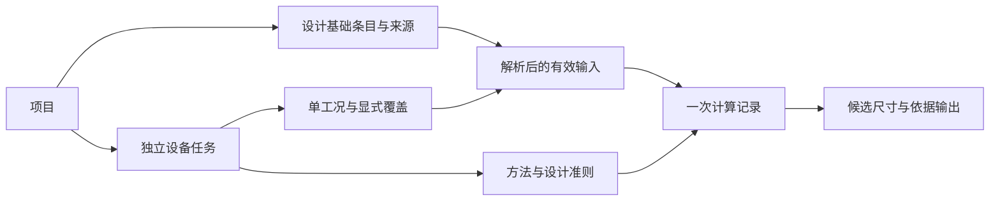

# 工程设计基础、工况与数据来源

更新时间：2026-10-22

## 用途与状态

用途：定义工程共同前提、可追溯输入和工况矩阵，支撑流程、设备、规格求解及工程交付。
读者：维护工程模型、物性、案例、存储、Studio 和结果输出的协作者。
不包含：已经交付的案例管理、固定项目 schema、完整文档审批平台、所有行业设计规范和现场数据连接协议。

- 层级：一级轨道；上位规划：[模拟平台](../architecture/simulation-platform.md)。
- 关联：[单位](units-and-quantity-system.md)、[物性](property-basis-and-components.md)、[设备](equipment-design-and-rating.md)、[建模求解](flowsheet-modeling-and-solve.md)、[结果](results-review-diagnostics.md)、[存储](project-lifecycle-storage.md)。
- 状态：Draft / 方向已确认；2026-10-11 G0 + E0/S0 首批方案已认可；三批独立基础已实现，B04 方法门禁已核销；2026-10-15 G1 / S1 数据与纯计算、正式事务及结果有效性已实现，完整设备保存与最小 Studio v3 生命周期已完成，独立单工况设备编辑 UI 与设备页 Undo / Redo 已接通。U1—U3、A1—A2 首批已接通；本节方案衔接首个独立设备任务，I5 按既定安排。

## 目标与当前基础

用户能够回答：本计算采用哪些共同条件、哪些输入是假设、哪些工况需要验证、哪个工况控制设备设计，以及条件变更影响哪些结果。当前已有稳定对象身份、SI 输入、文档修订、求解快照和参数化 CLI，并已增加轻量工程基础 / 来源及独立单工况设备输入；设备正式事务已接通；完整设备保存与最小 Studio v3 生命周期已接通，独立设备编辑页与设备历史已接通，通用工况矩阵尚未实现。

首版从一个工程中的轻量设计基础表、有限个显式工况和来源记录起步；不因本规划立即增加新 crate、审批服务或空 schema。

## 工程设计基础

| 内容 | 必须表达的语义 |
| --- | --- |
| 处理与进料条件 | 正常 / 最小 / 最大负荷、组成变化及其允许组合；处理量的质量 / 摩尔等基准 |
| 环境与公用工程 | 环境条件、冷却水、蒸汽等级及其他供用条件；带稳定身份、单位、来源和适用范围 |
| 操作与设备设计条件 | 操作温压与设备设计温压分别记录，不能将操作值直接当作机械设计限值 |
| 产品与工程约束 | 产品指标、允许压降、性能要求、设计裕量与采用依据 |
| 假设及待确认项 | 采用原因、来源、适用工况、确认状态、需要补充的数据与关联对象 |

共享条件由工程设计基础拥有，设备 / 工况引用稳定身份。允许显式局部覆盖，但必须显示覆盖值、理由与来源，解析出唯一有效条件。禁止把公共冷却水温度复制到多台设备后各自漂移，也不建立隐式多级 fallback。

修改共享物理条件前后可查看受影响工况 / 设备；相关运行输入变化后结果失效。早期无法精确追踪依赖时可以明确采用保守的案例级失效，不能漏掉受影响计算。仅补充说明或调整显示单位与物理数值 / 方法变化分别处理，具体保存修订和计算输入身份在实现时确定。

## 输入来源与不确定度

来源类别至少区分实测、供应商提供、文献 / 数据库、关联式估算和用户假设；类别不代表自动评定的可信等级。记录可核对的来源标识 / 版本或日期、原始值与单位、采用值与基准、转换 / 估算方法、适用范围及确认状态。派生值保留其依赖关系，不重新标成实测。

未知来源、未知不确定度和已超范围分别显示，不能填零或伪造置信度。若有不确定度，记录其类型、覆盖因子 / 置信水平（如适用）、相关性假设及来源；输入上下界、设计裕量、仪表精度、概率分布和求解容差不能互相代替。数据来源和不确定度的重要性可参考 [NIST 化工制造说明](https://www.nist.gov/programs-projects/artificial-intelligence-chemical-manufacturing)；具体数值处理仍由所选方法定义。

初期只建立来源 / 适用范围 / 待确认状态与轻量提示；敏感性、不确定度传播、数据协调和现场标定后续按真实数据与方法推进。已有旧工程未携带来源时标为未记录，仍按原能力打开，不凭空补出已验证标签。

## 工况矩阵与结果有效性

工况是完整、物理一致的条件组合。支持正常、最大 / 最小负荷、原料变化、季节变化、清洁 / 结垢等标签，并说明其用途是设计、校核、运行研究或其他任务；同一标签不保证模型支持该场景。

- 每个工况具有稳定身份，引用明确版本的设计基础与模型，并声明覆盖项；运行前形成可复现的有效输入，不依赖界面当前选择。
- 不把各输入最大值机械组合成最坏工况；约束或相关关系必须在工况定义中保持。不合理组合应明确拒绝或标为待确认。
- 对同一已选设备几何逐工况校核，汇总每项约束的控制工况。多个工况分别推荐尺寸，不等于同一台设备已通过全部工况。
- 汇总同时显示成功、失败、缺数据、未运行、过期和不支持行；不能删掉失败行后声称覆盖全工况。有限工况通过不证明整个连续操作范围均可行。
- 修改基础、覆盖项、几何或模型后，当前结果与冻结的历史记录分别管理；历史记录保留当时来源和条件，不被当前值覆盖。
- 工况表可先支持逐行手动运行，批量、并发和调度随后接入任务管理，不要求首先交付完整调度器。

## 装置配置与运行场景规划

2026-09-26 确认 [装置工程与数字孪生愿景](../architecture/simulation-platform.md#装置工程与数字孪生愿景)。本专题继续拥有工程条件、来源、工况及覆盖语义；装置工程可组织多个模型和任务，不把工程、流程图、工况和一次运行合并成同一身份。以下为尚未实现的关系要求，随 G0 / G3 及后续孪生切片设计。

- 设计、竣工、改造及当前运行配置保留版本与适用关系；工况引用明确配置。设备更换或拓扑改造需更新对应关系，单纯位号相同不能证明仍为同一设备。
- 设计条件、实际几何、观测值、标定参数与假设覆盖分别表达来源和用途；配置采纳经过正式变更，现场数据或拟合不能静默改写共同基础。
- 正常、低负荷、原料变化等工况可用于稳态或时间相关任务；开停车、扰动与间歇场景还需操作方案、初值及时间 / 事件规则。软件脚本的执行顺序不代替物理操作方案。
- 从相同配置建立独立试算案例，明确基线或 warm start；试算状态与现场跟踪状态隔离，计算失败不污染其他案例。动态初始化和模型间参数映射由所选模型检查，不能因设备身份相同推导模型可直接互换。
- 未来数据驱动运行冻结观测时间窗、质量、转换 / 协调依据、配置和参数版本；保留测量、估计与预测的区别。历史记录保持当时事实，缺少外部资产或版本时明确复现限制。

近期 G0 应在关系设计中容纳上述概念，但不因此实现完整配置管理、现场连接或运行方案编辑器。后续验收覆盖配置切换、设备替换、错误模型映射、观测更新与设计基线隔离、试算不影响现场状态，以及历史证据不随现值漂移。

## 用户路径与 UI

建立设计基础→记录输入来源与假设→创建若干工况并显式覆盖→检查→选择流程 / 设备任务→运行→查看结果及各约束控制工况→修改条件并审阅影响→保存并输出。

UI R0 必须明确项目、工况、设备和结果的关系：项目层查看共享基础，字段就近查看来源，工况表切换案例，设备页查看同一几何的跨工况表现，结果页定位来源及变更。允许摘要和详情渐进展开，不把所有来源字段堆在普通输入首屏。布局见 [UI 计划](../architecture/studio-ui-topic-plan.md)。

## 身份、存储与复现边界

设备工程位号（如 `V-101`、`E-101`）与内部稳定 ID 分开；位号的项目内唯一性、修改规则及与显示名称的关系在首个采用切片明确。更名或改位号不能破坏连接、来源和结果引用，保存 / 导出保留可读位号与可追踪身份。

未来运行记录至少定位工程 / 工况 / 设计基础版本、有效输入、模型与物性数据版本、求解器及关键设置、计算结果与诊断。字段定义与持久化位置由生命周期 / 结果专题落地；本轮不把快照写回当前项目格式。来源只存 URL 或版本号而资产不可获得时，应显示复现条件缺失，不能保证精确重跑；保留资产还需符合许可和访问边界。

比较案例前检查组分、模型、单位 / 基准和参考态兼容性；不兼容时仍可展示差异说明，不无条件给出具有误导性的数值差。报告显示展示精度，记录保留计算精度；变更说明不能暗中重算旧结果。

## 切片与验收

| 切片 | 内容 | 退出标准 |
| --- | --- | --- |
| G0 概念与交互 | 共同条件、来源、覆盖规则、工况用途、身份和 UI 关系 | 设计基础 / 工况 / 设备 / 结果各有明确所有者；不与现有单位、文档和任务状态重复 |
| G1 轻量设计基础与来源 | 首批共享条件、来源 / 假设、引用和影响提示 | 修改公共条件影响相关输入；显式覆盖可解释，旧工程可读，未知来源不冒充验证 |
| G2 有限工况矩阵 | 创建工况、逐行运行、同一设备跨工况校核和汇总 | 条件组合合理，失败 / 未运行行保留，各约束能定位控制工况，源变更后正确失效 |
| G3 复现与工程比较 | 基础版本、输入差异、方法 / 数据身份和输出记录 | 保存重开不漂移，缺资产或不兼容基准明确说明；与结果交付专题共用记录 |

G0 在近期设计中优先，G1 随单位 / 规格基础按依赖切片；G2 随可信稳态与设备任务进入，不将完整矩阵设为首个单工况模型的前置门禁。G3 先支持轻量记录，完整报告和不确定度传播按后续范围推进。

最小验证包括公共条件引用与局部覆盖、物理变更失效、来源未知、非法组合、单行失败、不同约束由不同工况控制、同几何校核、工况切换无串值、位号更名引用不变以及保存重开 / 导出。相关领域实现执行定向和正式仓库基线；GUI 路径按告知后的实窗验收，模型准确性另用独立基准。

## G2 有限工况数据与事务方案（2026-10-20，已确认）

本节配套已确认的 [S2-D01—05](equipment/separator-sizing-and-rating.md#已确认决策)。S2-A1 已实现独立几何 / 工况记录、有类型任务和纯计算；S2-A2 已接入应用集合、事务及单行资格，有限矩阵已由 G2-B 接入；既有 S1 对象、方法与持久化含义保持。

| 所有者 | 目标责任（按批次接入） |
| --- | --- |
| 项目工程区 | 来源 / 基础表及有类型的设备任务集合；只支持已实现的 Sizing / Rating 变体，不引入插件注册表或通用任务框架 |
| Rating 任务 | 任务 ID、位号、方法与有序非空工况集合；持有一套几何，工况通过所属任务引用这套几何，不各复制可编辑尺寸 |
| 几何记录 | 任务内固定所有权与单调 revision；结构声明、带来源的内径 / 工作高度及可选轴向段。首批不独立分配资产或几何方案 ID；结果用任务 ID 和几何捕获版本定位 |
| Rating 工况 | 项目内唯一 case ID、单调 revision、标签 / 用途、九项工况输入及适用性来源；S2-A 仅一行，G2-B 才允许多行及复制 / 删除 / 排序 |
| 应用会话 | 正式事务、几何 / 工况影响、草稿与历史；结果按 `(task_id, case_id)` 保存，执行凭据绑定会话、方法、共享几何及该行输入 / 证据代次 |
| 汇总 | 当前成员与逐行结果的只读投影；不拥有第二份输入或可编辑控制工况，不以当前 UI 选择作为成员集合 |

`rf-model` 继续只承载记录和结构不变量；`rf-unitops` 执行来源 / 适用性检查与固定几何计算；`rf-ui::engineering` 持有资格和事务；`rf-store` 按类型编解码；shell 消费 DTO。需要共用的气速关系与来源解析按实际重复拆到设备同域模块，不改变纯计算无 IO / COM 的边界，也不借此提前引入全局案例管理。

事务继续 prepare→确认影响→commit，一次正式变更对应一条设备历史；几何 / 工况使用显式更新目标和当前 revision，旧草稿或迟到确认拒绝整体提交。数值量种、绑定、来源引用、位号、全部 case ID 的检查覆盖 Sizing / Rating 两种任务。删除仍被引用的来源 / 基础必须先解绑；删除或撤销创建过的 case ID 在本会话不复用。

| 变更 | 保存、结果与汇总影响 |
| --- | --- |
| 几何值、结构声明、方法或几何依赖依据变化 | 正式输入变脏；该任务全部工况失效，汇总失效；更改前展示受影响行 |
| 单行数值、绑定、物系或适用声明变化 | 该行失效，其他无依赖行保持；汇总重新评估覆盖状态，不偷偷重算 |
| 共享基础 / 来源及观察依赖变化 | 对前后引用并集做追踪，失效所有受影响行；Override 保守包含原基础证据依赖，几何依赖扇出全部行 |
| 新增 / 复制 / 删除工况 | 成员 checkpoint 改变；新行 Missing、删除行不再属于当前覆盖，汇总和待确认矩阵输出撤销资格；未改内容的其他行仍可用 |
| 名称、位号、用途或排序 | 保存版本更新，数值 / 证据资格不变；排序改变矩阵呈现捕获，已捕获文件可保留发起时顺序；删除与排序不可混淆 |
| Undo / Redo | 恢复内容并重新计算影响，记录 revision 与执行代次不倒退；恢复的旧结果不复活，新增 / 删除行的历史恢复也产生新资格 |
| 重开、工程切换、显式重算或清结果 | 新会话结果 Missing；同 ID 不授权旧执行；重算替换该行执行身份，旧导出不可复用，失败不回退到上次成功 |

仅记录 revision 改变不自动表示数值过期；资格使用语义变化生成的代次和不可复用身份。相关草稿的范围随消费者确定：逐行检查 / 计算 / 输出阻挡该行、共同几何及依赖的草稿；不相关行草稿不阻挡。矩阵输出须处理整个成员集合的相关草稿。切行保留各自草稿、错误和焦点；保存只写正式输入，离开保护覆盖全部行，不因切行隐式应用或舍弃。

矩阵完整性与工程结论分开：失败、未运行、过期、不支持行保持可见；控制项可显示“已完成子集”，只有全部必要行有效才具备完整覆盖。比较阈值与并列控制规则使用已审定的方法语义，不能只取一个最大值标签。几何及各行结果捕获同一版本才可汇总。

S2-A2 已接入单行资格与共享几何：显式几何 / 工况 revision、相关草稿阻挡计算、原子历史恢复、迟到执行拒绝及跨任务依赖失效已有回归；标签变更保留 Current，失败重算不恢复旧成功。G2-B 的 UI、能力版本和矩阵导出已按下节合同实现并验证。测试至少覆盖一行修改不污染其他行、几何全行失效、依赖跨行传播、复制新身份、删除后重建 / Undo、切行草稿隔离、成员变更与迟到汇总 / 导出。

## G2-B 有限矩阵决策（2026-10-21，已确认）

项目所有者已认可 G2-D01—06。本轮授权同步方案、完成 B1 模型 / 逐行纯计算 / 汇总及测试，并补六类 Pencil 代表画板；六类画板已获认可，B2 验证与文档同步后已完成 B3。B2 / B3 的下列合同已确认，实施状态另行记录，不把 B1 算术能力宣称为产品矩阵能力。

| 决策 | 正式合同 |
| --- | --- |
| G2-D01 范围 | 现有立式两相方法、同一给定几何、显式有限工况。新增空行、复制正式输入、删除、排序、逐行检查 / 校核和汇总；至少保留一行。复制保留基础引用与明确覆盖，生成新 ID 和 Missing 结果，相关草稿未处理时不复制。无批量执行、参数扫描、流程关联或自动选型 |
| G2-D02 版本 | 保留 v3 外层与方法 ID，以 Rating method version 2 开放非空多行；新建采用 v2，旧 v1 打开 / 普通编辑不自动升级，首次新增 / 复制明确确认并原子升级。方法变化撤销原结果资格；删除至一行不自动降级。保存兼容提示与原文保护见生命周期专题 |
| G2-D03 并列 | 气相 / 液体分别取当前有效行的最大未舍入负荷；`abs(load - max_load) <= 1e-10` 为数值并列，统一锚定最大值，不链式比较。保留精确最大值及全部并列 case ID；阈值不是工程容差，并列不覆盖各行准则结论 |
| G2-D04 输出 | 独立矩阵 CSV / JSON 身份为 `radishflow.separator-rating-matrix` / `1`。允许覆盖不完整或无 Current 行的审阅输出，但必须列全体成员、状态与缺失 / 失败 / 过期原因；旧数值不进入当前汇总。单行表仍仅 Current。相关草稿阻挡整个矩阵，写入前重验全部成员资格与项目单位 |
| G2-D05 UI | 工况列表、共享几何、行详情及矩阵汇总渐进展开；区分当前工况 / 矩阵导出。F5 仅运行所选行。宽区并列列表 / 详情，窄区分页面返回定位；六类局部画板另审，认可后接线 |
| G2-D06 批次 | B1 模型、逐行纯计算及汇总；B2 成员事务、资格、草稿和保存；B3 UI、输出、原生代表验收及正式基线。I5 和未验平台沿用原节点 |

### 逐行输入与汇总边界

模型继续保存任务内的一套几何与有序非空工况；逐行计算使用显式 case ID，捕获任务身份 / 方法、共同几何、目标行和实际依赖证据，不携带其他行的可编辑输入。v1 的恰一行规则保持；v2 仅增加输入集合能力，不更改既有公式、适用域或单项 `abs(load-1) <= 1e-10` 边界语义。未知方法、空集合、重复身份或不存在的目标拒绝；另一行的物理缺项 / 域外条件不阻挡目标行计算。

纯汇总只处理调用方提供的合格结果与明确必需成员，核验任务 / 方法、共同几何及行输入对应关系；不拥有会话 Current / Stale 判定权，不自行执行工况。B2 应用层先按会话、代次和执行身份筛出 Current，再调用纯汇总并与全部成员状态合并。Failed / Missing / Stale 保留；域外是 Failed 的具体原因，不增加第五种执行状态。

覆盖完整与工程结论分开：只有全部必需行 Current 才完整；完整但含边界仍待复核。已完成子集可显示控制项 / 超限，不能冒充全工况结论；没有有效行时没有控制项。各行 K、f、时间和条件式限值独立可追溯，不把最大负荷换算成连续操作包络。未知总高仍按单行规则保留。

### 事务与输出资格补充

既有局部 / 共享依赖失效规则保持。新增 / 删除改变不可复用的成员 checkpoint，撤销待确认矩阵输出，其他未改行继续有效；首次 v1→v2 因方法身份改变须重新计算。切行保存各自草稿、错误、检查资格、焦点和滚动位置，无关行编辑不撤销其他行的检查。删除确认说明覆盖减少及待丢弃草稿；不能删除最后一行。Undo / Redo 恢复内容但不复活旧执行或输出。

矩阵输出捕获会话、成员集合、共同几何 / 方法、逐行状态与执行身份、项目单位及不可变内容。写入前新增 / 删除、Missing→Current、失败重算、几何 / 依赖变更、同 ID 重开等均须重验，不能只检查成功行。无关任务编辑不阻挡；名称 / 用途 / 排序允许保留发起时捕获，不能把全局文档 revision 当作数值资格。正式输入保存不携带结果、草稿或汇总。

### 分层验收

- B1：R03 / R04 同几何分别控制气液；并列阈值内外、行序不影响结果、显示舍入不参与判定；边界 / 超限 / 无有效行 / 子集、非 SI、未知总高、缺相 / 域外 / 溢出、v1 / v2 能力与目标行隔离。
- B2：复制新身份、最后一行保护、删除 / 恢复 / 排序、局部与共享依赖、检查 / 草稿隔离、迟到计算和导出、升级原子性；v1 / v2 / S1 混合、未知能力原文保护、兼容确认、失败写入与重开 Missing。冻结 S2-A 旧读者实测 v2，不只做新读者自往返。
- B3：六类画板及双语 400 / 常规宽度、100% / 200% 字体、键盘 / F5 选中行 / 来源返回；CSV / JSON 独立读回全成员、负余量和证据；macOS 隔离实例验证成员操作、失效、导出取消 / 覆盖、保存重开；阶段收口执行 `check-repo`，不替代 I5 或未验平台。

### G2-B1 实现与验证（2026-10-21）

- [模型](../../crates/rf-model/src/equipment/rating.rs)新增 `SeparatorRatingCaseInput`，按显式 case ID 捕获任务身份 / 标签 / 方法、唯一几何与目标工况，不复制其他行。非空、唯一身份仍由模型校验，方法能力由纯计算层检查。
- [纯计算](../../crates/rf-unitops/src/separator_rating/mod.rs)新增 `matrix_method()`（version 2）、`check_case` / `calculate_case`；旧 `check` / `calculate` 仍严格接受 v1 单行。复用同一来源检查与算术内核；每行使用自身物系、温压、K、f、时间及依赖证据。
- [纯汇总](../../crates/rf-unitops/src/separator_rating/matrix.rs)新增 `summarize`，保留全体必需身份及已完成子集，分别求气液最大负荷和全部数值并列工况；完整性、子集结论和全部准则内判定分开。拒绝重复 / 外来 / 非成员结果、方法 / 几何 / 工况内容不匹配及不同解析几何；标签与显示排序不改变数值。调用方仍须先校验会话 / 执行 / 来源资格，纯汇总不证明 Current。
- 新增模型 1 项、纯计算 / 汇总 10 项回归；校核定向 29 项、既有设备 shell 37 项及正式仓库 1,577 项测试通过，格式 / 构建 / 严格 clippy / 治理通过，详见 [W43](../devlogs/2026-10/2026-W43.md)。
- [六类矩阵画板](../architecture/designs/studio-client-main-brief.md#g2-b-矩阵局部评审输入2026-10-21)已完成并获所有者认可。B1 时现有单行 UI / 导出仅适配捕获记录，应用与存储仍限 v1；后续 B2 状态见下节。本批没有新增产品实窗验收，Pen 原生复核仅是设计静态证据。

### G2-B2 成员、资格与保存（2026-10-21）

- 成员增删 / 排序及方法升级进入既有 prepare / commit 事务。编辑器新增空行、复制正式输入，首次 v1→v2 另确认并原子提交；删除确认覆盖变化与该行草稿，最后一行受保护。ID 退休及 revision 单调，Undo / Redo 不复活旧执行；v2 删除至一行仍为 v2。
- 逐行执行使用显式 case ID；检查资格绑定会话和该行输入 / 证据代次，不再依赖全局 checkpoint。无关行编辑保留原检查与结果，几何及来源按依赖失效。草稿与错误按目标保留，切行不隐式应用；来源页发起动作的错误仍立即显示。焦点 / 滚动由 B3 按目标与页签接入。
- 应用层 `RatingMatrixCapture` 保存全部成员状态、Current 结果、有效失败原因及过期原因，并调用 B1 汇总。成员 checkpoint 在增删及历史恢复时不可复用；捕获重验所有行执行 / pending / 资格及会话。标签和排序保留发起时内容；消费者还须检查相关草稿与输出单位。
- 新建任务采用 v2，旧 v1 普通打开 / 编辑保持版本。v3 codec 严格读写非空多行及混合 S1 / v1 / v2；能力比较覆盖已加载基线与实际另存为目标。兼容提示区分首次 Rating 与矩阵 v2；失败不清脏，重开全 Missing，详见[保存合同](project-lifecycle-storage.md#s2-校核任务保存扩展方案2026-10-20已确认)。
- 定向回归覆盖成员 / 迟到执行 / 矩阵捕获、逐行检查 / 错误 / 草稿、删除确认与历史、严格混合读写及保存失败。冻结 S2-A 读者实测新 writer 输出及超大未知数字原文保护；证据见 [W43](../devlogs/2026-10/2026-W43.md)。B2 当批不含产品实窗验收；B3 接线与证据见下节。

### G2-B3 UI 与矩阵输出（2026-10-21）

- 列表保留全部必需成员及四种资格，覆盖与子集结论分开；宽区矩阵加详情，窄区列表 / 单编辑器往返。选择按 case ID，F5 只执行所选行；逐行草稿、错误、页签、字段焦点及滚动隔离，切行不隐式提交。
- 新增 / 复制 / 排序 / 删除消费 B2 正式事务。删除确认说明覆盖缩小和目标草稿；v1 首次增行显式升级 v2，旧读者整份只读，保存另验实际目标兼容性。
- 单行表继续使用独立格式，只允许 Current；矩阵使用 `radishflow.separator-rating-matrix` / `1`，CSV 在共用字段前增加 `caseId`，JSON 行携带相同身份。完整成员、资格 / 原因、共同几何、正式绑定 / 基础 / 来源、覆盖、两项控制集合及原始阈值始终可审阅；仅 Current 行含计算证据和数值，零 Current 也能导出。
- 矩阵捕获全体成员的资格、代次、执行身份、相关草稿和项目单位，写入前重验；单行只看自身依赖，其他行草稿不阻挡。标签 / 排序不改计算资格，输出保留捕获时快照。
- 8 项新增回归及 macOS 代表路径通过，正式基线 1,597 项；覆盖独立 CSV / JSON 读回、覆盖不完整与超限、迟到写入拒绝、焦点与双语窄区。实际文件、保存重开及验证边界见 [W43](../devlogs/2026-10/2026-W43.md)。I5、Windows / Linux 和 S2-C 沿用原节点。

## S2-C1 候选采纳决策（2026-10-21，已确认）

项目所有者认可 C-D01—06，授权先同步文档并实现 C1 数据映射、事务和保存兼容，完成验证后提供 Pencil 局部画板；六图已于同日获确认，2026-10-22 获准并完成 UI / 证据输出及代表验收；C2 / C3 暂不实施。

| 决策 | 正式合同 |
| --- | --- |
| C-D01 顺序 | C1 先完成 S1 候选显式采纳；C2 单独审定物性 / 来源能力；达标后再实施 C3 流程关联 |
| C-D02 目标 | 新建 Rating 或更新明确选中的已有 Rating；已有工况不改，新建时显式选择复制源工况或保留空行 |
| C-D03 尺寸 | 默认采用未舍入 SI 直径、计算所得 LLL→NLL 高度及有效轴向段；圆整记录原值 / 采用值 / 理由，缺项保持未知，采纳不自动校核 |
| C-D04 来源 | 任务内保存固定的结构化采纳证据；源任务修改、重算或删除不改已采纳几何，再采纳另走事务 |
| C-D05 兼容 | 保留外层 v3，采纳记录放 Rating 任务内并增加能力版本；共享 SourceWire 不扩展，物理算法不变；冻结当前旧读者验证整份只读及原文保护 |
| C-D06 流程首批 | 后续 C3 只关联同项目单台 Flash Drum 同次执行的气液条件，显式刷新；跨工程、批量刷新及流程压降 / 出口回写不在首批 |

### C1 数据与映射

- 几何来源明确为“由初步尺寸候选采纳的设计几何”，不冒充实测 / 供应商几何。采纳不把候选中未审阅或假设来源升级为已审阅。
- 采纳记录归目标几何，捕获源 document / task / case、方法与修订、原始输入和绑定、相关基础 / 来源副本，以及字段原值、采用值和调整理由；这是持久化设计决定的依据，不是恢复 Current 的计算缓存。会话与执行 token 只参与提交资格，不写盘。
- 内径来自 `minimum_diameter_m`，工作液层高度来自 `working_liquid_height_m`，不得复制 `MaximumWorkingLiquidHeight` 作为给定高度。轴向段仅采用本次有效捕获；缺失 / 无效段仍缺失，总高不倒推补项。替换已有几何时完整预览旧段被移除的影响。
- 显式调整仅改变指定尺寸，不能随直径圆整暗改液层高度。调整值须有限、为正并有非空理由；没有调整时保持原始值，不经过显示值往返。
- 新建时若选择复制工况，将对应九项有效值、适用声明与来源捕获为新身份的独立工况；最大工作高度不迁入九项工况。引用 / 覆盖的原始关系留在采纳证据中，复制后的有效输入和来源不追随源任务或源基础变化。
- 新建未复制工况时保留一个可保存的不完整工况。更新已有 Rating 只替换共同几何和其来源记录，不改成员、顺序或工况输入。

### C1 资格与事务

- 发起时源候选须 Current，无相关草稿或进行中的重算；既有目标的相关草稿须先处理，不隐式丢弃。预览呈现目标、几何差异、缺项、来源与审阅状态、能力升级及影响范围。
- 提交时重验源会话 / 执行身份、输入与证据资格、相关草稿和目标状态；同数值重算也撤销旧预览。创建来源、能力升级、创建 / 更新几何及可选工况复制在一个正式事务中发布，失败不部分落地。
- 取消不改正式状态；一次 Undo / Redo 覆盖整次采纳，恢复输入但不复活旧执行或预览。更新已有几何按既有依赖使全体工况结果过期；新任务全部 Missing。
- 源任务重算、删除及重开不改变已经采纳的数值和历史证据；只有目标自己的正式输入 / 来源变化影响其资格。普通几何编辑保留采纳时原始证据，实际字段可与当时采用值不同，不能篡改历史；再次采纳替换本次几何来源，旧版本仍由会话 Undo 保留。

### C1 保存与验证

Rating 能力 version 3 承载采纳记录，保留 v1 单行 / v2 矩阵含义及同一计算关系。普通新建与打开仍保持现有版本，只有采纳显式升级；v3 降到一行或后续手改几何不降级。旧外层文件按既有生命周期升级，旧 v3 首次写采纳能力须确认，另存为核查实际目标。

严格 codec 校验采纳记录内部身份、绑定、来源闭包、有限数值与字段映射；已知格式不吞未知字段。冻结 `5e0d940d` 读者读取新 writer 输出，必须整份原文保留、不可重新序列化或覆盖；未知能力原文保护与 S1 / v1 / v2 混合回归保持。

测试覆盖未舍入映射、工作高度语义、有效 / 缺失轴向段、显式调整与理由、可选复制工况及来源隔离、新建 / 既有矩阵、迟到重算 / 草稿 / 目标变化、原子失败、Undo / Redo、源删除、混合保存 / 写入失败 / 重开 Missing。原样采纳最小尺寸后的边界待复核属于预期，不把“全部准则内”设为成功条件。

C1 按“模型 / 纯映射 → 应用事务 / 保存 → 局部画板确认 → UI / 输出与原生验收”推进。2026-10-21 模型 / 纯映射、应用 / 编辑器事务和保存兼容已实现，18 项新增回归与 1,615 项正式基线通过；冻结旧读者验证通过。六张 [Pencil 局部画板](../architecture/designs/studio-equipment-adoption-brief.md)静态复核完成并获所有者确认；2026-10-22 UI / 输出及自动、macOS 代表验收完成，证据见 [W43](../devlogs/2026-10/2026-W43.md)，I5 与未验平台不变。

实现由 `rf-model::equipment::SeparatorGeometryAdoption` 保存固定证据，`rf-unitops::separator_adoption` 负责纯映射，`rf-ui::engineering` 的 prepare / commit 及编辑器草稿检查负责原子发布。新来源仅声明设计采用，原来源副本保留种类 / 审阅状态；复制工况时重映射来源及观察依赖身份，捕获有效值，原引用 / 覆盖留在证据中。普通几何更新强制保留已有采纳记录，再采纳使用独立正式命令。新建首次 Missing；历史恢复保留旧证据时为 Stale，均不恢复旧 Current。

### C2 / C3 进入条件（本批不实施）

2026-10-22 所有者确认 C2-D01—05，仅授权 C2-A 独立验证包；首轮已认可提交，[第二轮补证](../thermo/mvp-model.md#c2-a-实测结论结果待审)已完成、待审。PR76 液体密度与参考可信性未达标，尚无工程有效域；C2-B / C3 保持未实施。

流程目前具备温压、总摩尔流量、相分率与组成，缺相质量密度、实际相体积流量及完整方法 / 数据版本。C2 须先选择可验证物系与工况域，建立来源、适用范围和独立预期，再在计算层物化并沿正式快照链传递。UI / 单位层不猜密度或分子量，不把演示 golden 当工程依据。

C3 需同一当前执行的明确气液输出，缺相 / 零流量 / 域外 / 缺性质明确拒绝；仅关联 T/P、两相实际流量与密度，K / f / 时间继续显式给定。源 document / unit / stream / snapshot / revision、会话及物性版本共同约束资格，无流程 case 时不虚构。刷新先预览再原子提交；源变化撤销关联资格，解除关联保留值时形成带捕获证据的独立输入，保存重开不恢复旧运行资格。C1 的固定设计决定与 C3 的持续关联资格分别建模。

## G0 首批数据契约（2026-10-11，已认可）

项目所有者已认可五项方案及 B04 门禁调整；单位 / 存储基础已完成，工程方法验证允许标准算例和明确设计条件，不再要求真实工厂数据。方法包与 Pencil 局部画板已认可；2026-10-15 恢复并实现数据 / 纯计算及第二批中的正式事务与结果有效性，完整设备保存与最小 Studio v3 生命周期随后获准并完成，独立单工况设备编辑 UI 与设备页 Undo / Redo 已接通。与 [E0/S0 场景](equipment/separator-sizing-and-rating.md#e0s0-首批方法方案2026-10-11已认可)及 [局部 UI](../architecture/designs/studio-client-main-brief.md#g0--e0s0-局部-ui-方案2026-10-11已认可)共同约束本批范围。G0 定义概念和行为，后续 G1 首批仅实现 S1 必需的设计基础 / 来源与单工况；完整 G2 / G3 不随之开工。

### B04 未通过期间的基础实施范围（2026-10-11，已认可）

项目所有者批准按“单位兼容 → G0 数据基础 → v3 基础存储”三批实施，每批验证并同步文档。B04 方法包与六张局部画板已认可。此节保留 10 月 11 日三批基础的历史范围；10 月 15 日新增实现范围见下方说明，完整设备保存与最小 Studio v3 生命周期随后完成，I5 不变。

- 第一批：统一量目录 / 换算与旧格式 7 类量隔离；现有界面不自动新增设备单位入口。
- 第二批：来源、基础、ID / revision、三种绑定、一层覆盖和结构 / 引用校验；不接设备任务、数值方法或结果生命周期。
- 第三批：按完整 v3 契约实现基础存储子集，先覆盖 `tasks=[]`；非空任务保留原始数据且禁止覆写，CLI 与产品既有入口继续拒绝 v3，不启用 Studio 升级。不是另一种简化 v3。

三批基础中的构造数据只验证单位、引用和存储，不能单独核销 B04 或宣布 G0/G1、v3 产品整体完成；B04 另以有来源的工程方法验证包审定。下列设备与应用契约继续作为后续目标，不因基础实现自动启用。

第二批实现位于 `rf-model::engineering`：`EngineeringBasis`、`SourceRecord`、`BasisEntry`、`InputBinding` 与借用的 `ResolvedBasisValue`；ID 复用 `rf-types` 的强类型 ID 机制，revision 使用非负整数。结构校验提供字段路径及分类错误，来源观察引用使用迭代拓扑检查，不递归执行来源表达式。ISO 日期只表达记录日期，T/P 成对且正有限；unknown / 缺文字资料可作为不完整数据保留。解析成功仅确定数值 / 来源 / 覆盖路径，既不升级来源可信度，也不授权计算。

2026-10-15 已恢复并完成 G1 / S1 数据与纯计算第一批：`rf-model::equipment` 增加独立任务、单工况、十项绑定、适用性来源及可选轴向区段；`rf-unitops::separator_sizing` 解析 Direct / BasisRef / Override、验证来源并形成拥有独立副本的条件式候选。方法、缺项 / 适用性和数值验证见 [S1 实现](equipment/separator-sizing-and-rating.md#g1--s1-第一批实现2026-10-15)。来源未变可信等级；覆盖不写回基础；原基础来源仅供追溯时不阻挡已明确采用的新覆盖来源。

模型记录保持无事务策略；应用层的第二批子集见下节。完整设备保存、数值草稿及独立设备编辑 UI 已完成；G0-V01—06 按实际子集留证，不将整张验收矩阵标为完成。

### 正式事务与结果有效性实现（2026-10-15）

项目所有者先恢复第二批中的正式事务与结果有效性，随后恢复完整设备保存与最小 Studio v3 生命周期；随后接通独立单工况设备编辑 UI。`WorkspaceState.engineering` 持有 `rf-ui::engineering::EngineeringSession`，与流程文档、求解和显示配置分开。

- `EngineeringCommand` 覆盖来源、基础条目和设备任务的创建 / 更新 / 删除，绑定与覆盖随任务原子更新。`prepare` 校验完整副本，给出 `TaskImpact`；`commit` 重验会话及编辑 checkpoint 后一次发布。结构错误、旧 revision、迟到提案和计数溢出均保留原状态。允许缺项及有限但超出方法范围的正式输入，计算另行阻挡。
- 引用按稳定 ID 解析；删除仍被引用的基础 / 来源返回具体引用位置。允许在同一批命令中显式解绑与删除，只生成一条历史；不补默认值。任务、工况、基础及来源身份在本会话删除或撤销后不复用，位号按既有规则查重。创建赋 revision 1，更新须携带当前 revision；实际更新及历史恢复使用单调记录 revision。
- 输入与证据代次按任务独立维护，纯任务数值变更只推进输入代次。共享基础值变化保守失效全部引用任务（含 Override）；来源影响追踪适用性来源及观察依赖链，前后引用关系都参与检查。来源审阅 / 引用定位变化推进证据代次，原值 / 转换 / 适用条件变化同时推进输入代次；纯名称、位号、工况名称 / 用途、来源标题不推进计算代次。
- `undo` / `redo` 恢复一条输入快照，代次和已分配身份不回退，不自动复活旧候选；空操作保留 redo。该历史由设备应用 API 独立拥有；设备页按钮、命令面板及非文本输入的全局快捷键已接入，草稿需先确认舍弃，输入框使用本地撤销。离开设备页后仍按原 screen 路由流程历史。
- `begin_calculation` 捕获工程 / 会话、任务 / 工况、方法、输入 / 证据代次及不可伪造的执行身份；纯计算完成后由 `complete_calculation` 重验，拒绝迟到、乱序、清缓存后、重开及分叉会话的旧凭据。同步 `calculate` 复用同一路径，不增加调度器。显式新计算失败会替换旧候选，不回退为成功。
- 结果分为 Missing / Current / Failed / Stale；`staleness` 区分输入、证据变化及任务缺失，`current_candidate` 仅返回当前可用候选，历史捕获保持原值。更名后标签从当前输入读取，捕获仍保留当时标签。清候选不创建输入历史，不改保存脏状态；流程 Run 与设备计算互不更新结果。
- 设备脏状态按正式内容与已保存基线比较（忽略记录 revision），纳入项目离开保护；撤销到相同内容可清脏，但旧结果仍过期。离开确认额外核验运行时 checkpoint，旧保存记账不会清掉设备修改。完整持久化已启用：写入成功后以捕获输入更新基线、保留历史及后续修改，取消或失败不清脏；重开新会话、候选 missing、历史为空。详见 [保存边界](project-lifecycle-storage.md#完整设备保存与最小-studio-生命周期2026-10-15)。

自动测试覆盖 G0-V01 / V03 / V04 与 S1-V07 的内存事务、引用、身份及结果资格子集；随后新增保存 / 重开、升级及保存后历史回归；随后新增设备草稿及 UI 回归；导出不据此核销。验证流水见 [W42](../devlogs/2026-10/2026-W42.md)。

### 设备草稿与 UI 事务（2026-10-15）

`WorkspaceState.equipment_editor` 保存独立的 `EquipmentEditorState`；按任务 / 来源 / 基础稳定 ID 保存编辑副本、generation、错误及确认状态。`EquipmentEditorCommand` 从 Studio bootstrap 正式派发，克隆 editor 与 session 后原子发布；失败保留输入。草稿不写项目文件，保存 / 离开 checkpoint 同时核对设备正式状态和草稿状态。

数值草稿复用量种解析与单位目录；未编辑的精确 SI 不因显示往返变化。检查 / 计算仅消费正式输入；相关草稿先处理，共享变更影响确认在应用层准备并重验。shell 仅拥有页签、返回字段与焦点导航，结果只读消费 `EngineeringSession` 的候选与有效性。具体 UI 及本批范围见 [独立设备 UI](equipment/separator-sizing-and-rating.md#独立单工况设备-ui2026-10-15)。

### 范围与所有权

首个消费者是独立立式气液分离器初步尺寸任务。一个项目可保存设备任务，每个任务首批只有一个显式工况；支持共享基础引用与一次局部覆盖，不做工况复制、矩阵、批量运行或配置分支。项目可没有流程单元，设备计算不要求选择演示物性包，也不以创建虚构流程满足旧 readiness。

下列为逻辑字段契约，名称不宣称已有 Rust 类型或冻结外部 DTO。

| 记录 | 最少字段与所有者 | 约束 |
| --- | --- | --- |
| 项目工程区 | `project_id` 复用现有 document ID；基础条目、来源表、设备任务表 | 与现有 flowsheet 并列的项目语义；不是 sidecar 或 UI 缓存 |
| 设计基础条目 | 稳定 `basis_entry_id`、量种、SI 值、`source_id`、适用条件及版本 | 同一量种不代表同一条件，操作 P 与设计 P 不互相替代；首批只启用 S1 消费字段 |
| 来源 | 稳定 `source_id`、记录版本、类别、外部引用 / 日期或版本、定位、原值 / 单位、采用与转换说明、适用范围、审阅状态 | 类别为实测 / 供应商 / 文献数据库 / 估算 / 用户假设 / 未记录；分类不自动等于可信等级 |
| 设备任务 | `equipment_task_id`、位号、名称、类型、`case_id`、方法 ID / 版本、准则 | 设备任务 ID 不等于流程 unit ID；本批不绑定 Flash Drum，不预建空的流程连接对象 |
| 单工况 | 稳定 `case_id`、名称 / 用途、物系说明、操作 T/P、相流量 / 密度、字段绑定 | 名称为正常 / 最大等不证明其物理组合有效；每个输入绑定必须显式 |
| 字段绑定 | `Direct(value, source)`、`BasisRef(id)` 或 `Override(basis_id, value, source, reason)` 三选一 | 不允许“有本地值就覆盖”的隐式优先级；Override 不改基础原值，只允许一层覆盖 |
| 有效输入 | 字段 SI 值、解析路径、源条目版本、任务 / 工况身份、方法版本、计算输入代次 | 是运行时不可变捕获；来源归原记录，捕获保存当时版本，不成为另一份可编辑真相 |
| 计算记录 | `calculation_id`、身份与输入代次、完整有效输入 / 来源捕获、方法、结果 / 失败、适用性与未检查项 | 设备结果不放入流程 `SolveSnapshot`；只记录本次，不冒充持久历史库 |

位号首批在项目设备任务内唯一，去除首尾空白后按 ASCII 不区分大小写比较；可选空位号不参与唯一性。更名不改变 ID；删除同位号重建使用新 ID。另存为延续现有项目身份语义，重开仍创建新会话代次，跨会话执行令牌不可复用；“复制为新工程”不随本批增加。

### 来源与适用性

数值、来源充分性和适用性分别判断。记录来源是用户对依据的声明，不是软件核实实验、供应商或工程精度。非未知来源须有可定位引用或假设理由；派生数据还须保留依赖和计算方法。第一批只引用资料，不抓取网页、不下载附件，不保存凭据；无引用资产时提示复现限制。

- `未记录`、缺必需字段、来源条件不匹配或明确超出方法范围：允许保存草稿 / 已提交的不完整任务，阻止生成可用候选并定位缺项。
- `用户假设`或尚待外部复核的完整依据：用户显式采用后可计算“条件式候选”，始终显示假设与待复核项；不能因点击采用变成实测或供应商保证。
- 有可核对资料且用户已审阅：说明依据已审阅，仍只声称所选计算准则下的结果。物性 / 方法专业有效性由 S0 独立基准验证，不由来源徽标证明。
- 密度与实际体积流量必须对应同一操作 T/P 和物系；不具备组成模型时记录物系 / 组成依据及两相存在声明，不能声称软件已进行相平衡检查。

### 变更、事务与结果身份

沿用正式输入事务、草稿保护和单位体系，新增设备语义须由领域 / 应用层拥有，shell 只呈现。设备纯计算不依赖 COM、网络或求解器，不为此引入通用规则引擎或独立任务调度器；具体模块落点在实施设计中以已有依赖约束确定。

| 变更 | 保存与计算影响 |
| --- | --- |
| 数值、绑定 / 覆盖、物系、方法 / 版本、有效准则改变 | 项目变脏；受影响任务计算输入代次增加，旧候选过期；不自动重算 |
| 共享基础改变 | 提交前列出影响任务；按反向引用失效。首批可保守失效全部引用任务，包括保留 Override 的任务，但不得漏失效 |
| 来源原值、转换、适用条件或审阅状态改变 | 证据代次增加，旧记录保留当时依据并标证据过期，显式重算生成新记录后才可当前输出。影响有效数值或计算前提时也推进计算代次 |
| 纯名称、位号、说明拼写或显示单位改变 | 保存脏标记按所属记录更新；不推进数值计算代次，不改流程求解资格；导出明确捕获当时标签与单位 |
| Undo / Redo | 恢复一条正式输入事务，代次单调推进；旧执行凭据不得复活，不自动恢复旧候选为 current |
| 删除被引用基础 / 来源 | 显示引用者并拒绝删除；先显式解绑为带来源的 Direct 或逐项清理。不静默复制 / 取默认值 |

新增工程内容不能借用 `FlowsheetDocument.revision` 使无关流程结果全部过期。现已在应用层独立管理设备输入 / 证据代次与保存脏状态，复用项目离开保护；流程输入仍沿用现有 revision。计算前捕获工程 ID、会话、任务 / 工况 ID、输入代次、证据代次和方法版本；完成或导出时重新核验，不匹配只能作为历史 / 过期证据，不能覆盖当前结果。同步计算首批无需伪造异步进度或取消能力。

有待处理数值草稿时不启动计算 / 导出当前计算表，提供返回字段入口，不顺带应用或丢弃；普通保存仍只写正式输入并保留草稿。清除候选、浏览说明和选择字段不产生输入历史。设备计算不触发流程 Run，反之也不刷新设备结果。

### 保存提议与兼容边界

现有外层 v2 严格拒绝未知字段，不能直接追加工程区并声称兼容。现已实现 **外层 v3 的可选工程区**：含稳定 ID、基础 / 来源、任务 / 单工况 / 方法参数；既有 `document` 和 `presentation` 语义保持。无工程内容的旧项目继续走既有 v1 / v2 路径；首次保存工程内容须明确升级或另存为，旧程序不能读取新格式，不静默回降或丢弃未知任务。

首批保存正式输入与来源，不保存活动候选、草稿、执行凭据或问题缓存；重开校验方法支持情况，结果为 missing，用户显式重算。方法版本不支持时保留原始任务数据、禁止执行，提供只读说明，不用新方法自动替换。冻结的计算表导出包含有效输入、依据、方法和结果，供审阅，不承诺可导入回放；持久多版本记录归 G3。

完整基础 / 来源 / 任务 / 绑定编解码及 Studio 打开、保存、升级、整份只读已实现；case 保存逐项适用声明，缺项和超范围输入不补默认值。旧 CLI 仍拒绝 v3，现有旧文件不自动升级，具体覆盖与未验项见存储专题。生命周期真相源见 [工程内容保存提案](project-lifecycle-storage.md#g0s1-工程内容保存方案2026-10-11已认可)。

### G0 首批验收标准

| 编号 | 独立样本 | 必须观察到的结果 |
| --- | --- | --- |
| G0-V01 引用 / 覆盖 | 两任务引用同一准则，一项 Override；修改基础、撤销覆盖 | 唯一有效值、来源路径可见，基础不被覆盖反写；影响清单与重检一致 |
| G0-V02 来源 | 未记录、用户假设、带页码文献、来源 T/P 不符 | 未记录 / 不符被阻挡；假设仍为条件式候选；“审阅”不变成精度认证 |
| G0-V03 历史 / 失效 | 修改物理值、仅更名、改来源状态、Undo / Redo | 数值 / 证据 / 保存身份分别变化；设备旧结果不能当前导出，流程结果不被无关设备编辑改变 |
| G0-V04 身份 | 改位号、重复位号、删除同名重建、重开同 ID、删除被引用条目 | 引用不按名称漂移；冲突明确；旧会话拒绝，引用不会静默悬空 |
| G0-V05 保存 | 旧 v1/v2、首次工程内容升级、取消、失败、未知方法、重开 | 旧语义保持，取消 / 失败不丢输入；未知数据不丢弃；候选 missing 且无自动重算 |
| G0-V06 草稿 / 单位 | 非 SI 输入、`1e-`、单位切换、跨页面、计算 / 保存 / 导出 | 草稿保留，计算 / 导出阻挡明确；正式 SI 与一次 Undo 一致，不靠显示值重建输入 |

上述为完整验收要求；已完成的数据 / 计算、事务、保存与独立设备 UI 及代表验证子集见前文；S1 / S2-A / G2-B 输出与代表路径已验证，未验平台仍缺证据，不能标为完整产品通过。有限矩阵不等于完整 G2；I5 未验项和对外候选前限制沿用已确认安排。
