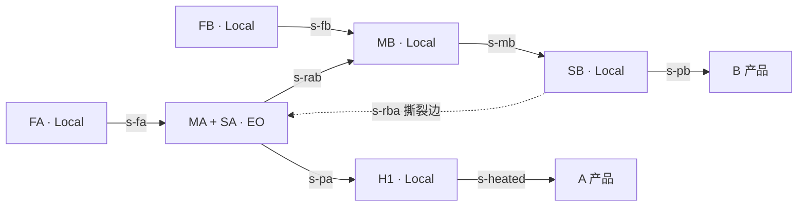

# QS4：混合分区执行方案

更新时间：2026-11-17

用途：定义混合分区案例、块边界、跨层影响、实施切片与验收出口。
读者：维护 solver、工程配置、运行资格、存储、Studio 和 CLI 的协作者。
不包含：自动策略选择、通用多撕裂循环、热 / 相平衡 EO、多变量反算、动态、插件或 COM 自动化。

父专题：[多策略求解与装配](solver-strategies-and-assembly.md)。本文是 QS4 实施切片的附属设计，不新增专题层级。

**方案状态：QS4-D01—D05 已批准；执行状态：首片 QS4-A—D 已完成本机实现与阶段验证。** 2026-11-04 所有者批准连续实施，六张局部画板随后明确认可。前置验收 / 方案提交为 `787609e0`；Local＋正向 EO 的 DAG 组合、工程 v4、GUI / CLI v7 已接通，正式 2,051 项、独立历史读写器与 macOS 代表路径通过，证据见 [W45](../../devlogs/2026-11/2026-W45.md)。首片完成不关闭后续混合策略、平台或发布门禁。

**M2 已验证内存执行、共享运行接收、v4 保存和 CLI v9。** 见 [算例与验收](#m2首个跨块回流算例与验收)、[工程保存](#正式计划与工程保存)和 [CLI 接入](#m2-cli-首片评审)。Studio 界面接入另审。

## 用户价值与首批出口

同一流程中，一组单元可提供物料方程，另一些单元只有局部求值。用户应能明确指定组内使用 EO，组外继续使用已有局部模型，而无需为每个下游单元新增方程表达，也无需切换整个工程的物理模型。

首批交付一条完整链路：配置固定温压混合计划 → 检查分区与能力 → 原 Run / F5 后台执行 → 按块审阅真实输入输出与残差 → 编辑后 Stale → 保存重开 Missing → 显式 rerun。GUI、CLI 共享正式配置、资格和结果。本片不承诺性能提升，不把有向无环块组合称作已经实现跨块循环收敛。

## M1：交叉回流 EO 组与局部 Heater

复用 QS3-E1 的公开合成工况：methane / ethane，300 K、650000 Pa；FA、FB 分别为 2、3 mol/s，组分流量分别为 `(8/5,2/5)`、`(3/5,12/5)`；SA、SB 的固定分流比例分别为 `3/5`、`1/4`。

```text
FA（局部求值） ──fa──→ MA.inlet_a
FB（局部求值） ──fb──→ MB.inlet_a
                     ┌──── EO 组：MA、MB、SA、SB ────┐
                     │ MA.out → SA.in               │
                     │ MB.out → SB.in               │
                     │ SA.a → MB.b，SB.a → MA.b      │
                     └── SA.b / pa ───── SB.b / pb ─┘
                             ↓               ↓
                    H1（局部 Heater）       终端产品
                             ↓
                        heated-product
```

H1 显式出口仍为 300 K / 650000 Pa。它用于检验现有无方程能力的局部模型与 EO 组组合；不宣称新增加热负荷、能量闭合或物性精度。全部模型仍标识为现有受控模型。

### 独立期望与现有能力对照

按 `(methane, ethane)`、单位 mol/s：

| 流股 | 独立解析期望 |
| --- | --- |
| MA.out | `(35/17,20/17)` |
| MB.out | `(156/85,264/85)` |
| SA.a / ab | `(21/17,12/17)` |
| SB.a / ba | `(39/85,66/85)` |
| SA.b / pa、heated-product | `(14/17,8/17)`，总量 `22/17` |
| SB.b / pb | `(117/85,198/85)`，总量 `63/17` |
| 两股最终产品合计 | `(11/5,14/5)`，总量 `5` |

2026-11-04 的[边界测试](../../../crates/rf-solver/src/strategy_acceptance.rs)已确认：现有 QS2 可计算上述完整七单元流程且符合分数基准；整图 QS3 在 H1 返回 `UnsupportedModel`，没有局部计算调用。此项建立实施前的参考边界；混合执行的独立分数及跨层验收见 W45。

现有 QS1 不支持该四成员交叉 SCC，因此不为此例伪造 QS1 对照。QS2 作为同物理模型的整流程对照；独立分数解仍是验收依据，不能只让两个产品求解器互相证明正确。

## D01：分区与能力边界

首批支持两类显式块：单个现有单元的 Local 块，以及 Feed / Mixer / Splitter 的固定比例物料 EO 组。M1 的 FA、FB、H1 各为 Local 块，四个循环单元组成一个 EO 块。块 ID 属于模拟计划，成员引用现有 UnitId；工程连接、画布分组和工程对象身份保持原义。

每个单元必须且只能归属一个块。缺成员、重叠、空块、重复 ID、无效成员、无能力模型及已绑定对象被删除 / 重建都明确诊断，不静默补成员或按显示名重绑。工程图和数学结构分别验证；不得把 SCC 当作 EO 自由度分析。

按真实连接建立块间依赖，首批要求收缩图为 DAG；所有跨块边保留 StreamId、source / sink UnitId、端口和组分身份。跨块环直接拒绝，并定位相关块 / 流股；不执行一遍后返回成功，也不暗中合并分区或改用 QS2。局部 SCC 必须完整留在一个有能力处理它的块内。

首批不提供 QS1 / QS2 块内选项、反算 / 采纳或自动分区；后续按真实组合场景另扩展。它们已有整图方法及验收事实保持。

## D02：块输入、外部边界与所有权

QS3 原 `EquationOrientedSolver` 整图入口只接受整图，要求存在正 Feed、全部单元从 Feed 可达；现有 QS1 / QS2 虽有内部块执行，也没有对外接收其他策略块结果的通用入口。本片新增有明确外部边界的块装配 / 执行接口，不能把整图求解器依次跑一遍，或向工程中插入假 Feed。

批准的边界职责包含：冻结工程中的成员与端口引用、已解析的完整组分目录、固定 T/P、不可变物性上下文、带实际生产者 / 本次执行身份的输入流股，以及块内选项。每个输入必须来自本次已验证上游输出或本次真实 Feed 求值；工程中故意错误的出口模板不得成为边界输入。接口名称与 Rust 签名在批准此职责后细化，不提前作为公共稳定 ABI。

运行任务拥有边界流股、数学索引和可变工作区；`rf-model` 只保留工程对象。组合层持有本次不可变输入与边界输出，不读 GUI、磁盘或网络；包资源仍由现有组合根解析。Local 块复用真实目录工厂和局部求值，不复制 Heater 或 Feed 的物理实现。

EO 组以外部输入的实际组分流量建立固定边界方程，不要求在组内再造 Feed。M1 的四成员组共 12 个物料端口、24 个组分流量未知量；Mixer 衡算 4 条、Splitter 分流 8 条、组内四条连接等式 8 条、两股外部输入边界 4 条，共 24 条方程。外部边界行使用原连接身份，不能又把它当组内连接重复施加。

旧 `assemble` / `solve` 入口继续按原整图规则工作，新增块装配复用同源方程与数值实现。原 QS3 的正向 / 反算、契约版本和已支持范围不因此放宽。数学 / 模型有效域仍受原 128 维、双尺度、残差、条件指标及 SI 门槛约束。

## D03：执行、复核、失败与取消

运行顺序由 DAG 决定，不由计划条目顺序决定。FA / FB 真实求值 → EO 组装配、结构检查、求解及实际局部复核 → 传递 pa → H1 真实求值 → 全局复核 → 一次提交整流程结果。

块接口中各组分固定尺度以该块本次实际外部输入总量确定，M1 的 EO 输入为 5 mol/s；零总量不能默认替换为 1。允许显式完整双尺度映射时须对确切领域绑定校验，沿用既有默认 / 显式方案和合法性规则，不引入不同容差的隐藏分支。

所有边界都记录生产者值、消费者实际使用值、组分 SI / 缩放残差与固定 T/P 检查。Local 边界应直接消费本次生产者快照；EO 内部假设与真实输出仍分别保留，不事后改写 I/O 制造零残差。成功必须同时满足块内、跨块、单元与全局物料核对；M1 还逐股对照上表，组分误差 <=1e-9 mol/s、组成 <=1e-10，使用原双残差门槛，不把流量相对误差当守恒证据。

任一块失败、取消、输出缺失 / 身份错配、实际 T/P 漂移或全局复核失败都不产生正式部分结果；已完成上游块只留在本次诊断证据中。失败携带块、单元、流股、端口和阶段，加载失败不伪造求解器 / 包来源。

复用现有单 worker、Ready / 完成时输入＋计划双资格、协作取消与 join。增加块前后、边界传递及全局复核安全点；不承诺强行中断 thermo / flash 调用。输入或计划 A→B→A、重开、迟到成功 / 失败、重复或错载荷仍不能发布为 Current。

## D04：正式计划、结果与持久化

已在既有模拟计划中增加独立 Mixed 变体，包含固定边界、版本化验收契约、完整块分配及 EO 块尺度。块与成员按稳定 ID 规范化；块顺序不改变计划含义或摘要。独立计划事务、历史、草稿、no-op、simulation_dirty、ID 保留及结果 Stale 复用现有机制。

已新增独立混合结果 / 失败载荷：顶层生产者 streams 与全局验收；各块的类型化 Local / EO 证据、实际 I/O、跨块边界、方法与成本。结果查询和输出消费同一来源；不把 EO 证据扁平化为旧 SM steps，也不把所有领域结果合成巨型 DTO。子成本按真实调用累加且覆盖失败 / 取消；顶层总耗时独立计时，嵌套阶段耗时不盲目求和。

已保留工程外层 v4，新增独立 method / capability / acceptance version 1；方法与能力分别为 `radishflow.fixed-tp-mixed-material/1`、`radishflow.solver.fixed-tp-mixed-material:1`。命名已随 D04 批准落地。保存完整计划但不持久化结果、边界数值、迭代工作区；重开 Missing，显式运行重建执行计划。

旧 v4 读者不认识新能力时整份只读；旧 CLI 在可编辑装载之前拒绝。继续覆盖同版本能力升级确认、Save As 取消 / 失败 / 目标变化、只读底层 writer 与原字节保护。旧方法不改词义、不自动换策略；切回旧方法不自动降版或删除已有工程内容。

## D05：GUI 与 CLI 消费者

GUI 沿原运行页增加分区成员 / 方法配置、DAG 与能力错误定位、块及边界审阅。UI 展示领域 ID 对应的名称、实际方法和错误，不要求用户理解数值矩阵。局部画板先评审再接线，保留旧 `.pen`；不连带启动全局 R0。

独立 CLI v7 已增加混合计划、块查询、运行及结果投影；复用正式动作、引用、期望输入 / 计划身份和现有资源装载。继续仅操作请求内存、stdout 输出，工程 / 缓存 / sidecar / 偏好均不写盘。旧 v1—v6 保持原词汇、错误和能力边界；不增加 Save、后台取消协议或 COM。新版本只为新增严格词汇服务，不能把它等同工程格式 v7。

## 实施切片与验收

以下已按整份范围获准连续实施；内部验证不重复请求批准，实质性扩张再确认。

| 切片 | 交付 | 必须获得的证据 |
| --- | --- | --- |
| QS4-A 分区 / 边界 | 显式分配、DAG、带原身份的边界输入、EO 块装配 | M1 24×24；缺 / 多 / 重叠成员、错连接 / 组件 / T/P、跨块环拒绝；未知 / 相关方程不假报就绪；旧整图装配回归 |
| QS4-B 核心执行 | Local＋正向 EO、逐块真实复核、跨块与全局核对、typed 成败 / 成本 / 取消 | 逐股分数 oracle 与整图 QS2 对照；非解模板无影响；上游失败不调用下游、H1 晚失败不发布上游；边界污染、错身份、重复生产、全局不守恒与取消拒绝 |
| QS4-C 工程 / 运行 | v4 能力、正式配置 / 保存、冻结 / worker / 资格、结果与输出 | 完整往返、升级 / 只读 / 目标变化及历史独立 reader；Ready / join、输入与计划 ABA、重开 / 迟到 / 错载荷、输出捕获后变化 |
| QS4-D 消费者 / 收口 | CLI v7、获认可局部 GUI、公开案例与模板 | GUI 配置→Run→块 / 边界→改计划 Stale→保存重开 Missing→rerun；中英窄区 / 草稿 / 键盘、真实 CLI 全目录不变；定向后正式 check-repo 与必要实窗 |

本片只完成 QS4 的首个 DAG 组合范围。跨块回路、更多块内策略、逆向规格及不同热边界各自新增案例 / 切片；不能把本片成功升级为完整混合分区算法、工业物理或全平台 / 发布通过。

## 已落地接口与消费约定

- `rf-solver::mixed::{MixedOptions, MixedBlock, MixedBlockId}` 表达完整显式分区；`assemble` 验证成员、模型参数、尺度键与 DAG。`MixedPlan::equation_layout` 只返回原身份的符号布局，GUI / CLI 明确标注数值可解性尚未证明，不用模板流量伪装真实边界。
- `equation_oriented::EquationBlockInput` 借用冻结工程、成员与本次实际输入；`assemble_block` / `EquationOrientedSolver::solve_block_controlled` 复用整图同源方程、数值算法及实际单元复核。`EquationBinding::Boundary` 记录原生产者、消费者、流股和组分；外部端口保留原名。本次执行资格由父工作区任务拥有，不在 `rf-model` 或每个数值流股内另建任务状态。
- `MixedSolver` 保留 `MixedResult` / `MixedFailure`，结果按 Local / EO 类型分块。真实热物性 / flash 调用由外围计数；不把嵌套 EO 的计数再累加一遍。边界与全局复核通过后才发布顶层流股，失败 / 取消的已完成块只供诊断。
- 正式配置按块 ID、成员及尺度绑定规范化；重排为 no-op，改变块 ID 仍是计划变更。工程 v4 保存 `blocks[].method.kind = local | equation_oriented`，EO 块自带 `equationContractVersion=1` 与完整尺度。未知正版本 / 方法只读；缺失、零版本、重复身份和无效尺度拒绝。新程序对原 v4 增加 Mixed 能力也要求升级确认。
- CLI v7 使用 snake_case，`blocks[].members`、变量与边界引用沿用 `IdentityRef`；EO 块配置为 `equation_contract_version=1`。显式 `boundary` 方程绑定包含原 stream / source / sink / component。旧 v1—v6 不扩词汇；v3 保持不支持工程 v4，v4—v6 可查只读元数据，execute 在资源 / 步骤前拒绝新 Mixed 工程。
- [公开 M1 工程](../../../examples/flowsheets/fixed-tp-mixed-material-binary-hydrocarbon.rfproj.json)、[查询](../../../examples/automation/query-mixed-material-v7.request.json)、[运行](../../../examples/automation/run-mixed-material-v7.request.template.json)和[建图运行](../../../examples/automation/build-mixed-material-v7.request.template.json)已提供；资源路径指向已有有效缓存。协议与磁盘边界见 [CLI 参考](../../reference/headless-cli-v7.md)。

## 已确认的影响

| 决策 | 已确认范围 | 涉及变化 |
| --- | --- | --- |
| QS4-D01 | M1，Local＋固定比例正向物料 EO，块间 DAG | 首批产品与算法边界；跨块环明确拒绝 |
| QS4-D02 | 原领域身份的外部边界与 EO 块装配；保留旧整图入口 | solver 的装配 / 执行接口和运行所有权，不向 rf-model 加求解语义 |
| QS4-D03 | 逐块 / 跨块 / 全局复核与独立混合成败证据 | 结果、诊断、成本和控制接口增量；单 worker / 取消 / join 语义保持 |
| QS4-D04 | 正式 Mixed 计划、工程外层 v4＋独立能力 / 方法 | UI / store 配置与兼容边界；同版本升级和旧读者保护 |
| QS4-D05 | 经局部画板认可的 GUI 与独立 CLI v7 | 跨端新增词汇 / 投影；旧协议与磁盘不变 |

不新增数值依赖或改 lockfile；Rust / COM 隔离、C2-B / C3 停止线保持。AF1、I5、Windows / Linux、PME 与发布前门禁不随本片自动核销。D01—D05 已于 2026-11-04 批准；A→B→C→D 已完成本机实施 / 验证，GUI 在局部画板认可后接通。

2026-11-14 的 macOS 实窗补验中，1,024 块算例的取消任务未接收，原 Current 保留，显式重跑得到新 Current。另一次代表运行采到 Mixed 求解线程；取消轮未直接采到线程，回收时序由共享 owner 的终态与 join 顺序及自动回归支持。Mixed 各块内安全点的逐项原生覆盖仍待补。见 [W46 实窗记录](../../devlogs/2026-11/2026-W46.md#2026-11-14qs3qs4-与-af3-macos-实窗补验)。

## 局部画板（2026-11-04，已认可）

在既有主稿保留旧画板，新增以下六张 QS4 局部图；静态截图与裁切 / 尺寸检查通过，画板认可与运行态验收分别留痕，后者见 W45。

- [配置与成员](../../architecture/designs/reviews/2026-11-04-qs4/x1zeaJ.png)
- [Current 块与边界](../../architecture/designs/reviews/2026-11-04-qs4/l6BHpL.png)
- [失败 / 取消](../../architecture/designs/reviews/2026-11-04-qs4/ijALb.png)
- [中文 400 px](../../architecture/designs/reviews/2026-11-04-qs4/d4rksL.png)
- [English 400 px](../../architecture/designs/reviews/2026-11-04-qs4/dGkuP.png)
- [保存 / 只读](../../architecture/designs/reviews/2026-11-04-qs4/ZMCgJ.png)

## M2：首个跨块回流算例与验收

### 工程、分区与撕裂边

沿用 [M1 公开工程](../../../examples/flowsheets/fixed-tp-mixed-material-binary-hydrocarbon.rfproj.json)的七个单元及原物流连接。固定 300 K、650,000 Pa，组分按 `(methane, ethane)` 表述。两股 Feed 的组分流量分别为 `f_A = (8/5, 2/5)`、`f_B = (3/5, 12/5)` mol/s。SA、SB 将各自入口等组成分流，`outlet_a` 的固定比例分别为 `a = 3/5`、`b = 1/4`。

| 分区 | 成员与外部边界 |
| --- | --- |
| EO A | MA（`mixer-1`）、SA（`splitter-1`）。`s-ma` 为组内连接，入口为 `s-fa`、`s-rba`，出口为 `s-rab`、`s-pa`。预期 12 个组分流量未知量和 12 条方程，其中 Mixer 衡算 2 条、Splitter 分流 4 条、组内连接 2 条、固定入口 4 条 |
| Local | FA、FB、MB（`mixer-2`）、SB（`splitter-2`）和 H1 各占一个单元块。MB 消费 `s-fb`、`s-rab`，经 `s-mb` 供给 SB。H1 消费 `s-pa`，以相同温压产出 `s-heated` |



显式指定唯一撕裂流股 **`s-rba`（`splitter-2.outlet_a → mixer-1.inlet_b`）**。冻结流股、源 / 汇端口、块成员和组分身份。在运行依赖图中切开这条边并实际校验切后为 DAG，工程仍保留原连接。FA、FB 在循环外各真实求值一次。每次循环按 EO A → MB → SB 执行，`s-rab` 取当次 EO 实际输出，`s-rba` 的试值只注入 MA 的原汇端，SB 的实际输出作为回流返回值。H1 在最终回流复核通过后才执行。

建议范围为固定温压下的一个跨块循环，显式撕裂从 Local Splitter 的 `outlet_a` 到 EO 组内 Mixer 的 `inlet_b`。`s-rab` 指向 Local 块，超出本轮支持的撕裂方向。缺撕裂、未知流股、端口错配分别定位，其他撕裂角色、多个撕裂或切后仍成环均明确拒绝。试值属于本次求解任务，记录为运行期假设边界，工程模板按原工程状态保留。

### 分量守恒、收敛与最终复核

- **试值与尺度。** 只迭代完整、有限且非负的逐组分摩尔流量向量 `r`，总量和组成由它派生。默认初值为 `(0, 0)`，验收另用显式 `(10, 1)` mol/s。零总量时使用本次实际 `s-fa` 的有效组成为零流量边界提供组成，前提是该新鲜料为正流量。外层撕裂和全局残差尺度按本次两股实际新鲜料总量固定，各组分均为 5 mol/s。EO 块内部继续按该次实际外部输入应用现有双尺度规则。
- **映射与预算。** 以各块真实计算得到 `r_returned = H(r_assumed)`，直接代入作为下一轮试值。建议沿用 QS1 的 500 次候选评价上限，并为候选通过后的最终复核另计一次。复核以候选轮的 `r_returned` 重新执行整个循环，记录复核当轮的 assumed、returned、逐组分残差和实际 I/O。 [QS1 验收口径](recycle-and-block-execution.md#局部求值迭代与成功条件)
- **双门槛。** 候选和最终复核均令 `g_i = r_returned,i − r_assumed,i`，要求 `max |g_i| ≤ 1e-10 mol/s` 且 `max (|g_i| / 5 mol/s) ≤ 1e-10`。边界实际值须有限、流量非负。固定温压输出复核沿用 `1e-9 K`、`1e-6 Pa` 的最大偏差。残差取同一轮回流的实际闭合差。
- **独立守恒复核。** 沿用块内与普通跨块边的现有双残差门槛，按各单元实际输入、输出逐组分核对，检查每条非撕裂跨块边的生产值和实际消费值。最终以 `s-fa + s-fb − s-heated − s-pb` 独立计算全局每个组分的残差，逐组分按上述外层尺度通过绝对与缩放门槛，总摩尔流量残差上限为 `2e-10 mol/s`。`s-pa` 与两条回流均为内部物流。最终流股使用本次复核的实际生产者输出，撕裂汇端保留实际 assumed 值和验收通过的闭合差。

解析对照为 `H(r) = b[f_B + a(f_A + r)] = (39/100, 33/50) + (3/20)r`，固定点 `r* = (39/85, 66/85)` mol/s。全图与 [M1 逐股分数解](#独立期望与现有能力对照)相同，复用整图 QS2 作为同一物理问题的第二份对照。验收要求各股组分流量对解析解的误差 `≤ 1e-9 mol/s`、摩尔分率误差 `≤ 1e-10`。独立分数运算得到零初值和显式初值分别为 13／15 次候选评价加 1 次复核，复核最大绝对残差分别约 `1.28e-11`／`3.55e-12 mol/s`。这些数值为方案核对，实施仍需真实块调用、边界及结果证据。

### 结果接收、取消与验收矩阵

整次运行复用共享 worker、输入与计划双资格、会话与任务身份及一次性接收。候选试值、已完成块和残差轨迹可作为诊断，只有全部复核通过且对应回执仍合格时，才一次性发布整份 `Current`。运行终态和接收处置各自留证。 [结果资格](../../reference/solve-snapshot-results.md#当前资格来源与动作守卫) · [AF3 验收](../runtime-messages/scenarios-and-acceptance.md#af3-专项验收边界)

| 验收场景 | 最小通过条件 |
| --- | --- |
| 两个初值、刻意偏置的非进料流股模板 | 收敛到相同分数解，EO、MB、SB 真实重复调用，Feed 各一次，H1 在复核后一次。切后拓扑、最终 I/O、守恒和既有整图 QS2 对照均可核查 |
| 缺失 / 错配的撕裂、不支持的图或非法试值 | 就绪性阶段定位流股、端口或块，拒绝启动。M1 的 DAG 契约继续拒绝跨块环 |
| 零初值、预算仅 1 次 | 第一次返回约 `(0.39, 0.66) mol/s`，以未收敛结束，保留最后的闭合差与预算，H1 不运行 |
| 注入块错误、温压漂移、复核闭合差超限、下游或全局失败 | 分别记录失败阶段及相关身份。合格的当前任务失败发布 `Failed` 和诊断，正式结果查询无数值。循环复核失败时 H1 不运行 |
| 取消与终态接收竞争 | 在候选轮边界、块调用和边界传递前后、最终复核、H1、全局检查及发布前用确定性门控测试。取消先于接收时，拒收随后抵达的成功或失败载荷。输入和计划有效时保留既有合格 `Current`，原为 `Missing` 的会话仍为 `Missing`。已接收后收到取消时保留已接收结果。worker 退出并回收后才释放名额 |
| 输入或计划 A→B→A、切换工程 / 同 ID 重开、旧回执或重复回执 | 已失效结果保持 `Stale`，新会话为 `Missing`。迟到、重复或错身份回执不能改变新会话或覆盖较新结果。当前任务的错误载荷类型按既有基础设施失败处理 |

**批准的实施出口。** 用内存算例交付核心执行和共享运行接收的定向验证。正式工程能力版本、保存兼容、CLI 词汇和 Studio 交互在接入前另审。M1 文件与现有求解契约继续作为回归基线。

### 内存执行已验证

- `MixedOptions::recycle` 冻结唯一撕裂及预算，运行方法为 `radishflow.fixed-tp-mixed-recycle/1`。共享结果来源携带实际方法和含撕裂、初值、预算的配置摘要。M1 与 M2 的载荷交叉交付按现有基础设施错误拒绝。默认工程投影对 M2 显式报错，M2 专用写入使用下述正式字段。
- 两组初值在真实块求值中分别经过 13／15 次候选和一次复核，全部流股与独立分数解及整图 QS2 对照一致。预算耗尽、温压漂移、复核拒绝、下游和全局不守恒失败均有定向证据。完成和取消继续用同一个共享 worker。 [实现与验证记录](../../devlogs/2026-11/2026-W47.md#2026-11-17-qs4-m2-内存实现与验证)

### 正式计划与工程保存

项目所有者于 2026-11-17 确认 **正式应用 M2 计划 → 能力确认 → 保存 → 重开 → 显式重跑**。这批的消费者是显式支持 M2 的应用层工程生命周期，使用临时工程文件做验收。CLI 的请求与结果投影、Studio 的打开入口与交互随各自切片评审。现有 `read_studio_project` 及 CLI v7／v8 的混合方法支持上限仍为 M1。 [v4 能力保护](recycle-project-and-consumers.md#qs1-c01项目-v4-与能力保护)

#### 版本与正式字段

工程外层使用 `schemaVersion: 4`。M2 的独立方法为 `radishflow.fixed-tp-mixed-recycle`，必需能力为 `radishflow.solver.fixed-tp-mixed-recycle`，两者版本均为 `1`。`acceptanceContractVersion: 1` 对应已验证的撕裂、直接代入、固定尺度和复核口径。M1 继续以原方法和能力标识表达 DAG。v4 writer 按实际选用方法推导必需能力，reader 核对标记与内容一致。

| 工程字段 | 契约 |
| --- | --- |
| `fixedBoundary`、`blocks` | 复用 M1 的 SI 边界、Local／EO 块成员及 EO 的尺度字段。稳定 ID 和既有排序规则用于规范化 |
| `maxIterationEvaluations` | 必填整数，范围 `1…500`。候选通过后的独立复核另计 |
| `tears` | 复用 v4 的现有撕裂列表字段，M2 必须恰好一项。保存稳定流股 ID、源／汇单元 ID 和规范端口。初始化使用 `zero_component_flows` 或 `component_flows`，显式值单位为 mol/s。残差尺度固定声明 `evaluated_fresh_total` |

代表工程使用 `s-rba`（`splitter-2.outlet_a → mixer-1.inlet_b`）及已有 M2 块分配。writer 持久化已应用的正式初值、预算及尺度规则。实际运行的 5 mol/s 尺度、候选试值、快照、工作区运行身份和草稿留在会话内。相同正式配置重开后继续得到相同配置摘要，实际运行获得新会话和新回执。

#### 读取、保存与资格

- **显式能力。** 应用层通过 `read_studio_project_with_support(..., FlowPlanSupport::MixedRecycle)` 打开工程，通过 `prepare_mixed_recycle_save` 读取兼容性确认信息，再用 `commit` 写入。默认读写入口及 v7／v8 的混合方法上限为 M1。旧 reader 依能力标记或方法探测进入整份只读，保留原字节。旧 writer 拒绝覆盖 M2。M2 writer 同样检查目标能力与原字节指纹。 [应用层保存](../../../apps/radishflow-studio/src/document_lifecycle_driver/mixed_recycle.rs)
- **格式与运行就绪性。** 已知方法的缺项、显式 null、重复键、重复绑定、非法预算或非有限／负初值按格式错误处理。未知能力或未知的正方法、验收及块契约版本保持整份只读。图上绑定因后续编辑失效时保留计划和原引用，工程可保存及重开，运行前明确定位缺失流股、端口错配、组分不匹配或切后仍有环。沿用计划引用保留规则，避免删除和重建同名对象后意外重绑。
- **应用与保存事务。** 复用 `FlowPlanState`、正式 Apply／Undo／Redo、已保存基线与 `simulation_dirty`。正式变化更新计划代次并使旧结果 Stale，计划重排或相同配置是 no-op。首次为来源工程保存 M2 时触发能力确认，包括外层已为 v4 的 M1 工程。提交时复核正式输入、计划代次、准备时的目标路径和原字节指纹。取消、写入失败或目标变化时保留既有文件与工作区保存基线。已保存的 M2 重开后结果为 Missing，显式重跑生成 Current。 [QS1 正式计划事务](recycle-project-and-consumers.md#qs1-c02工作区计划事务与保存状态)

| 验收场景 | 最小通过条件 |
| --- | --- |
| M1 与受支持 M2 的严格读写 | M1 原工程和方法词汇通过原回归。零初值与显式 `(10, 1)` 的 M2 配置往返一致，重排后规范字节一致。物性和组分、设备区、显示单位及已有对象身份／关注清单字段沿原工程契约保存 |
| M1 reader／writer、v7／v8 及能力错配 | 用本批实施前固定构建复核整份只读与覆盖拒绝，包含移除 M2 标记的反例。新 reader 针对已知 M2 拒绝缺失／不匹配标记；旧 M1 方法携带回流字段时仍返回格式错误 |
| 新能力确认、目标变化与写入故障 | 覆盖 M1 来源的 Save／Save As、取消、确认、批准后目标更换、可恢复写入失败及重试。取消和失败时逐字节比较原文件，核对当前路径和保存基线 |
| 已应用计划、草稿和重开运行 | 保存只使用已应用计划，未应用草稿仍留在原会话。重开恢复块、绑定和初值，旧结果为 Missing；旧回执拒收，显式运行核对同一解析解和含 M2 方法的来源。失效绑定往返后仍可定位 |

**应用层验收通过。** 实际写出的工程经固定的实施前构建复核只读与拒绝覆盖。M2 重开后须显式重跑，配置摘要与保存前相同，新运行通过闭合残差、解析解和全局分量衡算。 [实施与验证记录](../../devlogs/2026-11/2026-W47.md#2026-11-17-qs4-m2-工程保存实现与验证)

### M2 CLI 首片评审

**项目所有者于 2026-11-17 确认独立 v9。** 本批把已保存的 M2 工程接到 CLI，形成「查询已保存计划 → 显式运行 → 复核结果」路径。以 `e33b009a` 的 v4 工程保存为起点，复用共享应用执行、资格与本地物性缓存。后续 Studio 接入可用同一工况和结果资格验收。

#### 协议范围

| 入口 | 首片词汇 |
| --- | --- |
| `--headless query` | `schema_version: 9`。顶层使用 `project`、`queries`，允许空查询读取工程头。`results` 仅开放 `scope: flow_plan` 和 `scope: flow`。查询从一次读取的 v4 文件建立会话、返回同一原字节的 SHA-256。 |
| `--headless execute` | 同样只消费已应用的 M2 v4 计划。要求 `expected_project.document_id`、`expected_project.file_sha256`、`flow_resources` 和至少一个按序执行的 `run_flow` 步骤。每步用无符号整数 `expected_revision` 与 `expected_plan_revision` 核对两个修订。末尾 `queries` 使用同一查询词汇。 |

- 复用现有响应外层、严格 JSON 校验、唯一且非空的步骤／查询 ID 和以请求文件为基准的相对路径。步骤仅在本次会话运行已保存配置。建模、计划编辑、采纳、保存、后台取消、稳定变量查询和 Studio 界面均各有现行入口或独立评审范围。
- 先校验请求和资源字段，再读取工程。execute 按工程 ID、原字节指纹、只读保护、M2 方法、两个修订和图就绪性的顺序检查，最后读取物性索引并装配选定的已授权包。已知格式错返回 `invalid_project`；未知必需能力由工程保护处理，query 只给安全元数据，execute 在执行步骤前返回 `read_only_project`。有效 M1 工程在 v9 返回 `unsupported_capability`，工程头仍按实际文件标为可编辑。
- 支持已知对象身份和关注清单存在的 M2 工程。v7 继续按 M1 词汇解析，v8 继续按稳定变量的只读词汇解析。v9 进程只从本地读取请求、工程和包资源，结果通过 stdout 返回。

#### 查询与结果投影

- `results(flow_plan)` 返回计划修订、M2 方法与验收版本、规范配置摘要、就绪状态及可定位诊断。配置包含固定温压、块及其成员、候选评价预算、唯一撕裂流股的源／汇端口、初值和残差尺度规则。字段采用现有 CLI 的 snake_case 与 SI；撕裂绑定使用工程的流股／单元 ID 和真实端口名。就绪性由共享计划检查提供。
- `results(flow)` 在新进程重开时返回 `missing`；成功且被接收时返回 `current` 和独立辨识值 `execution_kind: mixed_recycle`，含已复核的流股、块和边界、全局分量衡算。回流证据来自本次实际求值，包含固定尺度、候选与独立复核的残差轨迹、最终复核的假设值及实际返回值。来源带 M2 方法／验收版本、配置摘要、本请求执行步骤及实际物性包来源。
- 就绪性门禁返回 `blocked`／退出 3，并随步骤错误返回与 `flow_plan.not_ready` 相同的定位数据。修订不符返回 `record_conflict`／退出 2。预算耗尽等已接收的数值失败返回 `failed`／退出 4，步骤回执和最终查询共享失败投影。最后一次试值、返回值、残差和已完成块仅在 `diagnostic_evidence` 内。当前结果拒绝非有限数，诊断用现有 `non_finite` 标记记录。失败后的后续运行步骤停止，最终查询沿用原失败优先级。

| 验收场景 | 通过条件 |
| --- | --- |
| 查询与显式运行 | 由显式工程 writer 生成代表工程。查询在缺省物性资源条件下得到同一配置摘要、`ready` 和 `missing`。真实进程运行两组初值，核对 13／15 次候选加一次复核、各流股解析解、撕裂双残差和全局分量守恒。再启动 query 仍为 `missing`。 |
| 失败与拒绝 | 预算 1 的已保存工程返回失败证据且无当前流股。缺失撕裂、修订不符和错误工程 ID／指纹早于资源 IO 阻断；非法请求、错配能力和未知版本分别用对应错误或只读保护。 |
| 兼容与磁盘 | 当前及固定旧构建复跑 v7／v8 的 M1 和 M2（含移除能力标记的对照），覆盖 M2 正常、失败和早期拒绝的真实进程。比较临时目录清单与工程、包缓存、索引及偏好文件的原字节。通过定向检查与锁定离线 `check-repo`。 |

批准范围为独立 v9 的已保存 M2 查询、显式运行及结果投影。Studio 界面接入另审。 [既有 M1 CLI 契约](../../reference/headless-cli-v7.md)

#### v9 请求示例

先执行 `radishflow-studio --headless query query.json`。查询请求可使用下面的 `schema_version`、`project` 和 `queries` 三项，工程路径相对请求文件。将响应中的 `project.document_id` 和 `project.file_sha256` 填入执行请求，使用工程头的 `flow_revision` 和计划查询的 `plan_revision`。把资源路径指向已有的本地已授权物性包，再执行 `radishflow-studio --headless execute run.json`。

```json
{
  "schema_version": 9,
  "project": "saved-m2.rfproj.json",
  "expected_project": {
    "document_id": "example-qs4-fixed-tp-mixed-material",
    "file_sha256": "<query 响应中的 file_sha256>"
  },
  "flow_resources": {
    "cache_root": "./property-package-cache",
    "auth_cache_index": "./auth-cache-index.json",
    "package": {"kind": "preferred"}
  },
  "steps": [
    {"id": "solve", "action": {"kind": "run_flow", "expected_revision": 0, "expected_plan_revision": 0}}
  ],
  "queries": [
    {"id": "plan", "query": {"kind": "results", "scope": "flow_plan"}},
    {"id": "result", "query": {"kind": "results", "scope": "flow"}}
  ]
}
```

成功回执和同请求的结果查询都带 `origin.execution.step`。在 `recycle.residual_trace` 中，候选轮为 `iteration`，独立复核为 `verification`，各轮给出 `evaluation`、`max_absolute_mol_s` 和 `max_scaled`。`recycle.last_sweep` 记录撕裂汇端的 `assumed` 和源端的 `returned`。后续独立查询重新打开工程，结果为 `missing`。

**本机验收通过。** 两组初值、预算耗尽、早期拒绝、v7／v8 兼容和文件原字节保护均经真实进程验证。 [实施与验证记录](../../devlogs/2026-11/2026-W47.md#2026-11-17-qs4-m2-cli-v9-实现与验证)
