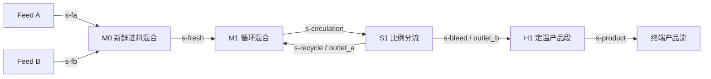

# 分块序贯模块与回流求解（QS1）

更新时间：2026-10-31

用途：承载 QS1 的工程案例、依赖分块、撕裂边界、循环求值、独立基准与分期实施范围。
读者：负责模型、流程图、solver、运行资格、项目兼容与验证的协作者。
不包含：完整能量 / 压流网络、相平衡回流、反应器、通用自动撕裂优化、EO / 联立模块后端或动态积分。

- 父专题：[多策略求解与问题装配](solver-strategies-and-assembly.md)；阶段归 P3 / QS1。
- 状态：2026-10-31 所有者确认 D01—D05；QS1-A/B 核心已实现并补齐数值、边界与故障验证。版本化保存、正式任务资格及 GUI / CLI 接入的 [QS1-C](recycle-project-and-consumers.md)已按 C01—C06 和认可画板实现，阶段证据见该专题。最新基线见[当前状态](../../status/current.md)。
- 本篇长期承载 QS1 的案例与执行契约。总纲保留策略分工；新增子专题为避免继续将已有 AF6 / QS0 和回流细则堆入同一篇，并非一次性讨论记录。

## 审查基线与实现落点

| 位置 | 审查基线事实（a23c6f79） | QS1-A/B 实现职责 |
| --- | --- | --- |
| [模型与参数](../../../crates/rf-model/src/lib.rs) | UnitNode.kind 是字符串；UnitOperationParameters 只有可选出口温度 / 压力 | 分流比例是物理模型参数，应进入模型，不能放到迭代选项中成为第二份输入 |
| [目录 / 工厂](../../../crates/rf-unitops/src/catalog.rs) | 六类内建；没有 Splitter；Mixer 局部 run 需要 thermo | 增加规范分流单元；继续调用真实局部模型，不把手写固定点映射当产品实现 |
| [连接检查](../../../crates/rf-flowsheet/src/lib.rs) | 规范端口、一流一源一汇、缺引用与孤立流股可复用；未提供 SCC 计划 | 保留完整物料连接身份，另外构造依赖图与块计划；撕裂不修改工程连接 |
| [现有 SM](../../../crates/rf-solver/src/lib.rs) | sequential_execution_order 直接拒绝自环 / 两单元回路及未解依赖；solve_controlled 一次顺序执行 | 增加显式分块 SM 路径；既有无回路入口不自动改为循环求解 |
| 旧拓扑计数 | incoming_counts 按每条物流增加，但 downstream_units 按 UnitId 去重后只递减一次 | 平行物流存在计数不一致：Flash 两个出口同时接同一 Mixer 时，合法无环图可能被误判未解依赖；需修正为一致的单位依赖计数，同时保留两条物流绑定 |
| [QS0](../../../crates/rf-solver/src/component_balance/assembly.rs) | 闭合模板仅支持两个 Feed 与一个终端 Mixer；下三角直接求解不支持循环 | 复用组分流量与领域绑定原则，不能直接放宽该模板的拓扑门禁冒充 QS1 |
| [存储](../../../crates/rf-store/src/project.rs) / [v3](../../../crates/rf-store/src/project_v3/mod.rs) | 模型参数未 deny_unknown_fields；旧格式的文档校验不提供通用流程能力版本保护；v3 的只读保护主要针对未知设备能力 | 新参数并不天然获得旧读者安全性；应先有明确写保护，再单独审定新格式和跨端消费 |

平行边问题已由静态代码、小图计数及链接本机已有编译产物的临时 Rust 程序共同复现：合法 Feed → Flash → Mixer 的两条并行相流股被 sequential_execution_order 报为 `solver.topological_ordering`，未解单位为 Mixer。现已由共享单位依赖视图修正，并加入正式拓扑回归；完整物流身份仍保留，旧自环 / 两单元循环诊断码与原无回路顺序均有回归。

## 首个工程案例：带产品支路的循环混配

这里的“真实回流”指有产品出口、明确设备响应、实际局部重复求值及闭合残差的工程拓扑；数值是公开合成工况，不声称工厂实测或工业精度。选择这条流程是为了先验证循环执行，不把新反应器、真实 EOS 或能量模型作为基础分块的前置。

[IDAES HDA 教程](https://idaes-examples.readthedocs.io/en/latest/docs/tut/core/hda_flowsheet_doc.html)提供 Splitter 的 purge / recycle 组织实例；本案例只借鉴分支与回流角色，不复刻其中反应、压缩或相平衡过程。[IDAES Separator](https://idaes-pse.readthedocs.io/en/stable/reference_guides/model_libraries/generic/unit_models/separator.html)区分总流量、相及组分分流；本片选各组分相同比例的非选择性分流，不能拿 Flash 的液 / 汽出口替代。



P 是终端流股标记，不新增 Product 单元。H1 使用已有 Heater，出口 T/P 与入口相同，用于验收循环后的下游块执行；不代表已经求热负荷。

### 已给定条件与范围

| 项目 | 冻结基准 |
| --- | --- |
| 公共温压 | 300 K、650,000 Pa；所有循环入口 / 出口固定相同 T/P |
| 组分 | A / B 为算术别名；实际局部模型对照使用现有受控包的 methane / ethane ComponentId |
| FA | 2 mol/s，组成 A/B = 0.8/0.2 |
| FB | 3 mol/s，组成 A/B = 0.2/0.8 |
| M0 / M1 | 两入口 Mixer；显式出口压力 650,000 Pa |
| S1 | outlet_a 回流比例 α = 0.6；outlet_b 比例为 1−α |
| H1 | 显式出口 300 K、650,000 Pa，流量与组成透传 |
| 物性 | 同次冻结的 binary-hydrocarbon-lite-v1 上下文，用于既有局部 run 所需热状态；不增加物性或参数数据 |

这是理想等温、等压、无反应的物料核算；循环量由分流比例给定，不求泵扬程、压降或由压力驱动的流量。不证明 Mixer 焓平衡、真实热负荷、相平衡精度或实际管路可运行性。不同温压、额外流量 / 温度目标、能量 / 压力耦合和外部黑箱不在首批能力内，应明确拒绝。私有 KBC 数据不参与公开基准。

### 独立解析解

令新鲜组分流量 `f=(11/5,14/5)=(2.2,2.8) mol/s`，循环混合出口 m、回流 r、产品 p 满足：

```text
m = f + r
r = α m
p = (1−α) m
r* = α/(1−α) f,  m* = 1/(1−α) f,  p* = f
```

| 位置 | A mol/s | B mol/s | 总量 mol/s | A/B 摩尔分率 |
| --- | ---: | ---: | ---: | --- |
| M0 / s-fresh | 2.2 | 2.8 | 5 | 0.44 / 0.56 |
| M1 / s-circulation | 5.5 | 7 | 12.5 | 0.44 / 0.56 |
| S1 / s-recycle | 3.3 | 4.2 | 7.5 | 0.44 / 0.56 |
| S1 outlet_b、H1 / s-product | 2.2 | 2.8 | 5 | 0.44 / 0.56 |

每个组分的三个方程独立，系数行列式为 `1−α`；二组分六未知量在 α=0.6 时 rank=6。α=1 且存在正新鲜进料时，rank=4、增广 rank=5，没有有限稳态解；不能靠迭代上限或默认零流股假装收敛。α 不能作为无规格的自由未知量；若以后增加循环量或产品目标，需另做规格与自由度设计。

## 依赖图、块计划与撕裂

### 图与块的职责

1. 先完成规范连接与能力检查。连接层保留每条 StreamId、源 / 汇 UnitId 与端口；单位依赖层把同一有向单位对去重，入度与后继必须采用同一口径。终端流不新增图节点，平行物流也不凭空变成循环。
2. 用强连通分量 SCC 识别循环，将 SCC 缩并为有向无环图，按依赖顺序形成计划。节点用稳定领域身份；同层顺序明确以 UnitId 排序，不能依赖 HashMap / 插入顺序。分块不表示多线程并行。
3. 本例得到 `{FA}`、`{FB}`、`{M0}`、`{M1,S1}`、`{H1}` 五块：先 FA / FB，再 M0，再循环块，最后 H1。上游块一次求值；循环只重复其成员；循环未通过时不执行下游。
4. 首批执行能力为已支持无环块，以及由两个规范单元 Mixer / Splitter 构成、具有固定温压与外部正进料的单回流块。允许此类块沿缩并图串联。复杂多撕裂 / 嵌套循环、跨块反馈、控制或共享规格边，需重新分析 / 明确拒绝，不能仅凭物流 SCC 宣称通用递归分块或 EO 结构分析完成。

SCC 次序与撕裂求值的组织参考 [Pyomo Sequential Decomposition](https://pyomo.readthedocs.io/en/stable/explanation/modeling/network.html#tear-convergence)。这里只参考职责和算法分类；不引入其运行时或复制实现。

### 首批显式撕裂边

- 指定 `s-recycle: S1.outlet_a -> M1.inlet_b`。源 / 汇身份、端口与组分表在任务中冻结；不凭流股名称、画布位置或初始流量选择撕裂。
- 从依赖视图切除此边后，循环内部顺序为 `M1 -> S1`，全图成为 DAG。必须实际检查切后无环；缺撕裂、重复撕裂、不存在的流股、块外边或仍有循环分别诊断。首批不求全局最优撕裂集，不增加 MIP / 图依赖。
- `M1 -> S1` 从数学上也可能成为撕裂边，但不属于本片已声明的 Splitter 回流出口边界；如果配置该边，返回能力不足，不能把“切后无环”当作所有状态表达均已支持。
- 工程图保持不变。worker 中仅对该汇端口注入本次 TearGuess；其余输入从本次已求出的生产者解析。不得删工程连接、添加假 Feed、覆盖正式物流或把出口模板流量当作回流初值。
- α=0 时回流实际为零，结构图仍保留该连接；不能根据当前数值删边而改变计划身份。

### 撕裂变量与零流边界

独立未知量为按冻结 ComponentId 排序的回流组分摩尔流量 `r_i >= 0`，单位 mol/s。总量与组成由其派生；不同时迭代 F、全部 z 和全部组分流量，不迭代已固定的 T/P、焓或相分率。

默认初值 `r=(0,0)`，也允许显式有限非负组分初值，例如 `(10,1) mol/s`。零总量时无法从 `r/F` 定义组成，故计划明确记录零流组成规则：使用上游 M0 已求出的新鲜进料组成作为该零流试值的组成，T/P 使用固定边界。它是公开的零流边界约定，不是对缺失数据的通用兜底；M0 求值失败、基准组成无效或新鲜总量非正时直接失败。正总量使用 `z_i=r_i/sum(r)`。

## 局部求值、迭代与成功条件

### 执行算法

- 每次循环评价真实调用 M1、S1 的局部实现并物化所需状态，得到 `r_returned=H(r_assumed)`。解析式 `H(r)=α(f+r)` 只用于独立 oracle，不进入产品执行器替代单元调用。
- 首批采用直接代入 `r_next=H(r)`；不自动添加松弛、Wegstein、Newton、AD 或静默改后端。对本例映射收缩率为 α；这个性质不能推广到任意单元组合。
- 迭代预算默认 500 次循环评价；候选收敛后另做一次最终复核评价，单独计数并允许取消。因此最多是 500 次迭代评价加 1 次复核，不混淆调用预算。若复核失败，不输出成功，保留本次复核残差与失败阶段。
- 默认各组分残差尺度为本次新鲜总量 5 mol/s，装配时固定；正有限且可显式配置。不得使用迭代中不断膨胀的回流量作为尺度来掩盖误差。

### 验收门槛

令 `g_i=H_i(r)-r_i`。候选与最终复核均要求所有值有限、组分流量非负，并同时满足：

- `max |g_i| <= 1e-10 mol/s`；
- `max |g_i|/s_i <= 1e-10`；
- 所有局部 Mixer / Splitter 组分衡算，以及新鲜进料到最终产品的整体各组分残差通过相同原始 / 缩放门槛；总流量残差容限按组分绝对容限之和传播，本例为 `2e-10 mol/s`，不能另用更松的未声明百分比；
- 下游 H1 完成后再次检查产品衡算、固定温压与领域身份；所有块成功且运行资格有效，才允许整次结果发布。

固定 T/P 不参与迭代；声明值与任务边界必须一致。对局部计算输出另设浮点复核门槛：温度偏差 `<=1e-9 K`、压力偏差 `<=1e-6 Pa`，用于识别数值舍入与越界，不直接套用相区分类容差，也不把可变温压问题伪装成固定边界。

默认案例的所有最终组分流量与解析值误差须 `<=1e-9 mol/s`、出口摩尔分率误差 `<=1e-10`。高回流时残差会放大为状态误差，本映射可用 `||g||∞/(1−α)` 估计输入回流误差界；不得把小残差或产品组成正确单独当作循环量正确。

达到上限、局部错误、超域、非有限、数值分辨率不足及取消均不是成功。预算不足的结果不得回退成“无回路运行成功”或借上次已接受的数值补齐。残差停滞不能被相邻两次试值变化小所替代。

### 最终状态与证据

最终复核保留 `assumed`、`returned`、两者残差、尺度 / 容差，以及该次真实局部输入 / 输出。发布流股值以生产者本次输出为准；循环汇端实际消费的 assumed 可能与 returned 相差一个已验收残差，必须如实保留，不能事后改写 consumed_streams 制造精确闭合。

已新增 typed `PartitionedSolveResult` / `RecycleBlockReport`：最终流股、块成员与顺序、撕裂绑定、复核状态、累计调用 / 耗时及标量残差轨迹；实际契约见下方核心接口。全量试算流股不逐次复制到结果历史，只保留复核详态和有界标量轨迹。既有 SolveSnapshot.steps / sequence 不承载循环次数或时间，不把反复执行的成员摊平成一次虚假的单元顺序。

报告迭代评价次数、复核次数、实际单元 / 物性 / flash 调用和初始化成本。主案例要求 FA / FB / M0 / H1 各执行一次，M1 / S1 各执行“迭代评价 + 复核”次；独立 oracle 的 48 + 1 次循环对应 102 次单元调用，现已由实际调用计数回归核实；该计数不构成耗时或工业性能承诺。上游或局部状态复用只能复用本次冻结上下文内有资格的数据。所有统计必须覆盖失败和复核，不由外层迭代数推导计算更快。

取消安全点包括装配前后、完整单元调用前后、循环评价与最终复核；仍不承诺中断内部 thermo / flash。部分成功块只作诊断，后续块失败或任务失效时不发布为整次成功。

## 模型与接口决策

| 决策 | 推荐方案 | 影响与当前授权边界 |
| --- | --- | --- |
| QS1-D01 分流模型 | 新增内建 Splitter：`kind=splitter`，`inlet / outlet_a / outlet_b`；唯一物理参数为 `outlet_a_split_fraction`，量类型复用 DimensionlessRatio，局部允许有限 `[0,1]` | 已扩展 rf-model 参数、BuiltinUnitKind / 目录 / 工厂及规格元数据。a / b 是规范口名，回流 / 产品角色只由连接决定；不改名 Flash 或增加伪 Recycle 设备 |
| QS1-D02 计划与图 | rf-flowsheet 保留连接 / 单位依赖事实；rf-solver 拥有不可变块计划、SCC 缩并、撕裂变量 / 注入与局部调度。同时修复平行物流的旧拓扑计数 | 不把求解策略放入 rf-model。旧 SequentialModularSolver 继续拒绝回路，保留既有循环诊断；修复只让合法无环平行连接得到正确顺序 |
| QS1-D03 数值范围 | 固定 T/P、一个显式回流边 / 循环 SCC，支持此类 SCC 串联；直接代入、500 次迭代及独立复核，采用前述双残差 / 整体衡算门槛 | 已实现 typed RecycleSolveOptions、初值 / 零流规则和控制 / 错误接口；不自动扩展到多撕裂、热状态迭代或通用加速算法 |
| QS1-D04 执行结果 | 引入块级结果与真实复核 / 调用证据，保留 assumed / returned；失败与发布资格分离 | 已有独立 solver 结果 / 进度接口；不能直接沿用 QS0 的单 Mixer 表示或旧 steps 承载循环。既有无回路结果保持原义 |
| QS1-D05 工程兼容 | 先实施核心及明确的旧格式写保护；含新 Splitter / 新分流参数的工程不得写成声称可兼容的 v1 / v2 / v3 文件。新格式 / 能力标记、旧读者拒绝与完整保存重开在产品接入前另审 | 历史版参数反序列化会忽略未知字段，仅加 Option 字段不足以保护旧读者。核心案例先用类型化工程构造验证；不生成误导的旧版 JSON，不让新模型自动出现在尚不支持保存的 GUI / CLI 创建入口。目录创建 / 历史与旧格式 roundtrip 测试需按能力区分，六类旧模型覆盖不得删除 |
| QS1-D06 后续应用接入 | 核心通过后，将 Acyclic SM / Partitioned SM 作为显式稳态计划，经既有 Flow 运行入口与单 worker 执行；计划身份独立于工程编辑上下文，来源记录实际算法与包；再审 GUI / CLI 和版本化保存 | A/B 当时只形成设计；QS1-C 已按独立确认契约接入 StudioSolveRequest、F5、CLI v4 与工程 v4，FFI 保持原边界。不能仅撤销在途接收而让旧结果保持 Current，也不能把计划变更并入所有 FlowEditContext 的输入身份而误伤无关编辑 |

Splitter 的局部输出按 `n_a,i=α n_in,i`、`n_b,i=(1−α)n_in,i`；首批入口应为有限非负流量、规范组成和固定正 T/P。两出口保持相同 T/P/z；若入口带同次上下文的相 / 焓 / 窗口则按强度量透传，缺项保持缺失，不从旧出口模板补数据。整体 / 相焓是摩尔强度量，不能乘 α；流量广延量才按比例分配。零流出口保留已定义的组成，不虚构新 flash。模型自身允许 α=0/1；含正新鲜进料的闭环 α=1 由任务层识别无有限稳态。

D01—D05 已获所有者明确批准并实施；本轮没有新增依赖或工程格式。D05 提供新增能力写保护，不通过删除新字段降级保存；D06 的新格式、旧读者能力拒绝与正式消费者仍另审。

## 验证基准与实施顺序

### 验证矩阵

| 编号 | 场景 / 基准 | 核心验收范围 |
| --- | --- | --- |
| Q1 | 规范 Splitter，α=0、0.6、1；零出口 | 局部各组分 / 总量守恒，T/P/z 与强度量正确，比例非法 / 缺省明确拒绝；不会把缺参数默认为 0.5 |
| Q2 | 主案例、零初值与 `(10,1)` 初值 | 与解析流量 / 组成一致，循环成员真实重复求值；M0 不跟随循环重复，H1 仅在循环通过后执行 |
| Q3 | 删除 s-recycle、重复 / 块外 / 不支持撕裂，切后仍有环 | 缺连接、错误配置与能力不足分别定位；不补假 Feed 或隐式改图 |
| Q4 | α=0；单个新鲜进料为零；登记但不进料的第三组分 | 零回流组成规则可重复；缺省组分为零，维度 / 身份稳定；两股新鲜进料总量为零明确拒绝 |
| Q5 | α=0.9 / 0.95 / 0.99，预算 500 | 前两者在双残差门槛内；回流解析误差分别冻结为 `1e-9 / 2e-9 mol/s`。0.99 必须返回迭代上限失败，无当前成功值 |
| Q6 | α=1、额外回流量 / 产品目标、非有限或负初值 / 尺度 | 无有限解、过规格、能力不足和非法数值分开；不调整模型或舍弃约束隐藏异常 |
| Q7 | 两个串联循环 SCC：α1=0.6，α2=0.25 | 第二段新鲜输入为第一段产品 f；第二回流 `(11/15,14/15)`、总量 `5/3 mol/s`，最终产品仍为 f；块序正确。第二块失败时第一块不得单独发布 |
| Q8 | Flash 两条相出口同时入同一 Mixer 的合法无环结构；自环 / 两单元旧拒绝 | 平行流股绑定全保留，入度正确；旧无回路顺序与循环诊断回归，不能为支持新块弱化连接规则 |
| Q9 | 改 UnitId / 插入顺序、流股重命名、错误显式 tear | 计划对集合 / 边语义稳定，展示名不充当身份；不同合法同层顺序不改变物理解 |
| Q10 | 各核心安全点取消、局部 / flash / 物性、复核及下游失败 | 核心仅全部通过才返回成功；失败保留实际调用 / 阶段与诊断块。后发 / 重复回执、会话 / 计划身份、worker 名额等应用验收归 QS1-C |
| Q11 | 类型化 Splitter 参数、旧格式写保护、六类原模型历史 / roundtrip | 新比例是唯一物理参数；v1 / v2 / v3 和直接文件 serde 拒绝新能力。GUI 创建明确拒绝，原六类创建 / Undo / Redo / 往返保留；新模型交互与新格式归 QS1-C |

Q7 将 S1.outlet_b 接至第二段 M2，新 H1 位于第二段 S2.outlet_b 下游；其余进料保持主案例。Q7 是多块执行与失败传播的验收，不表示已支持单个 SCC 内的嵌套 / 交错循环；一旦存在反向跨块边，须重新求 SCC，不能沿用旧分区。

### 方案阶段的独立核对证据

方案阶段使用 Python 标准库 Fraction 和逐点互达的小图 oracle，独立核验解析解 / 矩阵秩、SCC、撕裂后无环、串联 SCC 与平行边计数。没有导入产品求解器、实现新的 Rust SCC / recycle 或运行积分 / 真实回流产品链。

| α / 初值 | 候选评价次数 | 复核次数 | 复核最大原始残差 mol/s | 最终 returned 回流最大解析误差 mol/s |
| --- | ---: | ---: | ---: | ---: |
| 0.6 / `(0,0)` | 48 | 1 | 3.77197929484e-11 | 5.65796894225e-11 |
| 0.6 / `(10,1)` | 49 | 1 | 3.61032303934e-11 | 5.41548455901e-11 |
| 0 / `(0,0)` | 1 | 1 | 0 | 0 |
| 0.9 / `(0,0)` | 229 | 1 | 8.37404330390e-11 | 7.53663897351e-10 |
| 0.95 / `(0,0)` | 469 | 1 | 9.48970074084e-11 | 1.80304314076e-9 |
| 0.99 / `(0,0)` | 500 后未收敛 | 不执行 | 最后迭代 0.0183973525188 | 不发布 |

上表为方案阶段的精确算术 oracle，不是产品耗时证据。实施阶段另以 f64 的真实局部调用验证解析流量 / 组成、双残差、整体衡算与调用数量；既核对评价次数，也核对最终残差。此前 QS0 的实窗证据不作为 QS1 GUI 通过依据。

### 分期状态

1. **QS1-A 已完成：领域模型、兼容保护与依赖计划。** Splitter 与物理比例、现有格式写保护、统一单位依赖、SCC / 显式撕裂及结构回归均已实现；原有六类消费者边界保持。
2. **QS1-B 已完成：循环执行与数值 / 故障验收。** 固定温压下的真实局部调用、直接代入、独立复核、串联回流、结果证据和取消 / 故障隔离已验证。
3. **QS1-C 已按确认范围实现。** [C01—C06](recycle-project-and-consumers.md#确认项与实施边界)展开原 D06：项目 v4 / 能力保护、独立计划、typed 运行 / 结果及双资格、正式建模 / readiness、局部 GUI 与 CLI v4。已完成存储、共享应用、消费者及 macOS 代表验证；GUI 五张局部画板已认可。最终门禁与未测平台在 C 专题和 W44 单独记录。

## 核心接口与验证落点（2026-10-31）

- [rf-unitops Splitter](../../../crates/rf-unitops/src/splitter.rs)按规范端口执行，强度量直接继承本次入口；不调用 thermo / flash，不读取出口数值模板。比例的量类型为 DimensionlessRatio，零 / 全分流均合法，缺省比例拒绝。
- [rf-flowsheet dependencies](../../../crates/rf-flowsheet/src/dependencies.rs)保留完整连接，另提供去重后的单位后继；旧 SM 与新分块计划共用事实视图。SCC、缩并排序、切后无环及首批能力识别由 [solver plan](../../../crates/rf-solver/src/partitioned/plan.rs)负责，使用迭代图遍历避免递归调用栈限制。
- [rf-solver::partitioned](../../../crates/rf-solver/src/partitioned/mod.rs)公开 `assemble_partitioned_plan`、`RecycleSolveOptions` 和 `PartitionedSequentialSolver::solve / solve_controlled`。计划拥有工程 / 选项副本，公开只读查询；求解通过 `Result<PartitionedSolveResult, Box<PartitionedSolveFailure>>` 区分全部成功与诊断失败，取消也是独立失败种类，不返回可发布的半成品流股。
- `TearSpecification`绑定流股及源 / 汇端口；显式初值 / 尺度必须完整绑定登记组分。worker 将未进料的登记组分补为零，仅修改本次副本；Feed 模板旧相态 / 窗口不具本次资格，先清除再由真实局部模型计算。默认零初值按已求新鲜边界组成重建，不借旧回流模板补值。
- `BlockReport`保留最终真实局部输入 / 输出；`RecycleBlockReport`记录固定温压、零流规则、新鲜源身份、assumed / returned、实际残差、尺度 / 容差与最多 501 个标量轨迹点。最终生产者返回值进入结果流股表，实际消费试值保持原样。
- `SolveCosts`分别记录实际构造、局部 / thermo 数值方法 / flash 调用、迭代 / 复核次数及装配 / 初始化 / 总耗时（system 元数据读取不计为物性数值调用）。计数覆盖失败调用，不从迭代数推导；`PartitionedSolveFailure`保留已完成诊断块、活动块最后完成评价、实际阶段 / 迭代或复核类别和活动局部证据。`RfErrorContext`增补结构化 ComponentId 定位，不解析消息字符串恢复身份。
- [核心测试](../../../crates/rf-solver/src/partitioned/tests.rs)覆盖默认 / 非零初值、高回流及 500 次失败、零分流、单零进料 / 全零拒绝、稀疏登记组分、固定边界、非法初值 / 尺度 / 溢出、两段串联与晚失败、撕裂诊断、重命名和旧 SM 回归。QS0 仍拒绝这类循环图；不以新目录扩宽其模板。
- [故障注入](../../../crates/rf-solver/src/partitioned/execution/faults.rs)另用异常局部操作证明：候选通过但复核残差失败时不能成功，缺输出 / 错身份 / 负值 / 非有限 / 温压漂移 / 局部不守恒均拒绝。公开入口测试覆盖各取消安全点、实际物性 / flash 故障、失败调用计数与下游晚失败；不把这些核心验证冒充应用层晚回执资格验证。
- [存储保护回归](../../../crates/rf-store/src/project_capabilities.rs)验证无比例的 Splitter、正常比例及错误附在其他 kind 上的比例均拒绝写入 v1 / v2 / v3；直接 `StoredProjectFile` serde 同样受守卫约束。现有 reader 的共享校验也会拒绝此能力，但不声称已保护历史发行版读者。CLI v3 仍只有原六类词汇，GUI 正式创建入口拒绝 Splitter。

正式检查、测试数量与本机耗时归[当前状态](../../status/current.md)和 [W44](../../devlogs/2026-10/2026-W44.md)。本轮未执行新回流 GUI、远端 CI、Windows / Linux 或 COM / PME；AF1、I5、C2-A 原结论、C2-B / C3 与发布边界保持。
