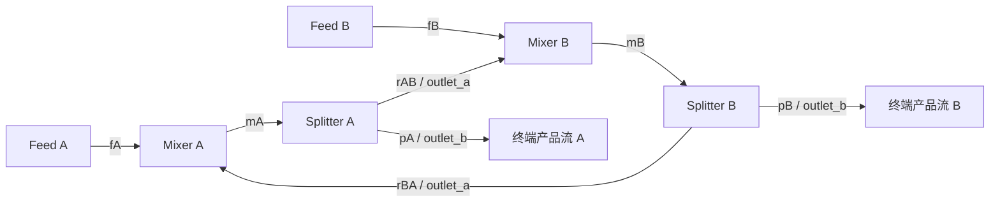

# 首个联立模块块（QS2）

更新时间：2026-10-31

用途：定义 QS2 首批案例、耦合变量 / 残差、模块响应、数值后端、独立基准和实施决策。
读者：负责 unitops、solver、问题装配、运行计划、结果与验证的协作者。
不包含：通用非线性求解框架、热 / 相平衡耦合、EO 内部方程、自动策略选择、动态、插件或新物性。

- 父专题：[多策略求解与问题装配](solver-strategies-and-assembly.md)；阶段归 P4 / QS2。
- 状态：**所有者已确认 D01—D05，QS2-A/B 核心与验证已完成，正式门禁通过 1,954 项。** [QS2-C / D06](simultaneous-project-and-consumers.md)六项已批准，存储配置、运行结果、CLI v5 与经画板认可的 GUI 已实现。A/B 实施提交 `8c18f223`，实施前方案提交 `8f2d267d`。
- 本篇是后续实现与验收的长期真相源；总纲只保留策略分工，源码接口签名在批准范围内据所有权与错误类型细化。

## 核对事实与首批选择

| 现有位置 | 实施前核对事实 | QS2 应补的边界 |
| --- | --- | --- |
| [UnitOperation / Mixer](../../../crates/rf-unitops/src/lib.rs) | `run(&self, services, inputs)` 提供局部输出；Mixer 重算组成和热状态，需要 thermo；没有模块响应接口 | 对选定独立输入的选定输出提供有单位、固定条件和有效域的响应；仍实际调用局部 run |
| [Splitter](../../../crates/rf-unitops/src/splitter.rs) | 同比例改变广延流量，强度量从入口复制；比例已为物理参数 | 只声明固定比例的组分流量响应，不能推导不存在的热力学导数 |
| [目录](../../../crates/rf-unitops/src/catalog.rs) | 七类局部模型；另有 QS0 有限物料能力 | 新响应能力单独声明；不扩大 QS0 的模板或暗称所有模型可联立 |
| [QS1 装配](../../../crates/rf-solver/src/partitioned/plan.rs) / [执行](../../../crates/rf-solver/src/partitioned/execution.rs) | SCC / 缩并 DAG 和真实局部调用已实现；循环能力限定两成员 Mixer / Splitter、单条显式 tear | 共用依赖事实与必要的图分析；增加联立模块块，原循环入口保持原拒绝和算法语义 |
| [计划](../../../crates/rf-ui/src/flow_plan.rs) / [结果](../../../crates/rf-ui/src/flow_results.rs) | 当前仅 Acyclic / Partitioned，计划资格独立；分块结果有真实局部 I/O | 核心结果须表达耦合边 / 响应 / 线性求解及复核；应用变体与消费者另审 |
| [v4](../../../crates/rf-store/src/project_v4/plan.rs) | 方法、验收契约与能力保护已版本化 | 不借原 partitioned-sm 方法偷偷保存新算法或多边计划 |

建议首批实现**固定温压、组分流量响应为仿射关系的联立模块块**。支持已有 Mixer / Splitter；两个对照拓扑为 QS1 的二成员单回流，以及本篇四成员双向交叉回流。后者在当前 QS1 中明确不支持。

这是一项有限但真实的联立模块能力：各模块内部仍由本身的 `run` 求解，联立未知量只在模块连接边界；不展开热状态内部未知量。首批关系是仿射的，可以直接联立校正，不为算法名称增加不必要的外层迭代。它不证明非线性模块、相界、热 / 压力耦合或任意网络已支持。

## 案例与物理边界

### 主案例：两股新鲜进料、双向交叉回流与两个产品出口



PA / PB 为终端流股标记，不新增产品设备。各 Mixer 的 `inlet_a` 为外部新鲜进料、`inlet_b` 为另一 Splitter 的回流，`outlet` 接本侧 Splitter 的 `inlet`。所有边以真实 StreamId、UnitId 和规范端口绑定，图上名称只用于说明。

| 项目 | 主基准 |
| --- | --- |
| 组分 / 包 | methane / ethane；既有 `binary-hydrocarbon-lite-v1` 同次冻结上下文；A / B 是算术别名 |
| T / P | 300 K / 650,000 Pa；全部入口、试算与出口固定同一边界 |
| Feed A | 2 mol/s，组成 (0.8, 0.2)，`fA=(8/5,2/5)` mol/s |
| Feed B | 3 mol/s，组成 (0.2, 0.8)，`fB=(3/5,12/5)` mol/s |
| Mixer A / B | 明确出口压力 650,000 Pa；不带出口温度规格 |
| Splitter A / B | `outlet_a_split_fraction` 分别为 α=3/5、β=1/4；无 T/P 目标 |
| 图分块 | `{FA}`、`{FB}`、`{MA,SA,MB,SB}` 共三块；两股产品为终端流 |

首批每个循环块都须精确匹配上述四成员拓扑或既有二成员单回流拓扑；允许已支持块沿缩并 DAG 串联，以及既有合法无环上下游。四成员构成一条有向循环，两条交叉回流不表示两个独立循环，也不能拆成两个能各自独立完成的 QS1 块。可识别所有内部物料边并形成联立边界，不把两条回流依次运行一次当作解。

每个循环 Mixer 的外部新鲜总流量须正且有限，全部登记组分在 worker 向量中补齐显式零；保留原文档。全零外部进料、有非物料耦合、额外自由规格、不同固定 T/P、复杂多入口或其他循环设备均明确拒绝。非进料工程模板不作为试值或已解结果。既有局部模型的物性失败仍失败，不能因为物料有解析解而绕过 thermo。

物理意义限于等温、等压、无反应的循环混配 / 排出物料网络。没有管网压流、泵功、焓平衡求温、真实热负荷或相平衡回流精度结论；不使用私有 KBC 数据或引入新包。

### 兼容对照案例

复用 [QS1 已公开案例](recycle-and-block-execution.md#首个工程案例带产品支路的循环混配)及其包、边界、规格与解析解。α=0.6 时比较 QS1 / QS2 的同模型结果、残差和实际成本；α=0.99 时记录 QS1 在原 500 次预算失败，QS2 可独立求解的候选预期，**不修改 QS1 的预算、容差或默认算法**。主案例尚无现存 QS1 解，不能伪造跨策略通过；采用下文独立算术基准。

## 耦合变量、残差与领域身份

每个内部连接只有一份被消费的假设组分流量向量；连接生产者另给实际输出。每项绑定 `(StreamId, source UnitId/port, sink UnitId/port, ComponentId)`，数值索引只属于本次冻结计划。以端口 / 流股身份稳定排序，不依赖 HashMap 或 GUI 位置。

主案例按说明顺序记 `z=(mA,rAB,mB,rBA)`，每项均含登记组分的 mol/s 分量；二组分共八未知量。运行时的稳定排序可以不同，须通过领域映射对应。固定的 fA / fB、T / P、α / β 不是自由变量；F、全部摩尔分率、组分流量不能重复作为独立未知量。

在同一个 z 下，各模块只读它被分配的入口假设与外部实际边界，分别求值：

```text
uMA = G_MA(fA, rBA)         uSA_a, uSA_b = G_SA(mA; α)
uMB = G_MB(fB, rAB)         uSB_a, uSB_b = G_SB(mB; β)

R_mA  = mA  - component_flows(uMA)
R_rAB = rAB - component_flows(uSA_a)
R_mB  = mB  - component_flows(uMB)
R_rBA = rBA - component_flows(uSB_a)
```

一次残差评价中，SA 消费 z 中的 mA，不能偷偷改用刚算出的 uMA；MB 同样不能消费本轮 SA 生产值。各模块可串行调用以保持现有线程 / 服务边界，但数值上使用同一捕获的 z。这正是本例与 QS1 一次顺序遍历 H(r) 的区别。

产品 `pA=component_flows(uSA_b)`、`pB=component_flows(uSB_b)` 由局部输出产生，不新增无约束产品变量。固定 T/P、相态 / 热字段检查仍执行，但其导数与残差不冒充本片能力。

在本物料模型中，对每个组分的独立算术表达及 Jacobian 为：

```text
R = [mA-fA-rBA, rAB-α*mA, mB-fB-rAB, rBA-β*mB]

             mA   rAB    mB   rBA
J =          [1     0     0    -1]
             [-α    1     0     0]
             [0    -1     1     0]
             [0     0    -β     1]
```

此式用于解析核对；产品残差必须消费真实局部 `run` 的输出，而非在 solver 复制一份 Mixer / Splitter 模型。跨组分偏导在此选定量与固定条件下为零，不推广到焓、温度或选择性分离。

## 模块响应与试算状态

建议在 `rf-unitops` 新增同域的固定温压组分响应能力，目录以类型化查询声明 Mixer / Splitter 支持；不增加适用于全部模型的默认导数，不把 COM 或 solver 索引加入 `rf-model` / `UnitOperation::run`。

响应必须给出输入 / 输出规范端口与 ComponentId、导数单位、固定规格、能力版本和有效域：

| 模块 | 独立量 / 输出 | 首批响应 |
| --- | --- | --- |
| Mixer | 各入口 n_i → 出口 n_j；T/P 与参数固定 | 同组分为 1，跨组分为 0 |
| Splitter | 入口 n_i → outlet_a / outlet_b 的 n_j；T/P / 比例固定 | 同组分为 α / (1−α)，跨组分为 0 |

导数单位 `(mol/s)/(mol/s)=1`。这是所选完整组分流量映射的响应，已包含局部组成 / 总量重建对所选输出的影响；**没有声明温度、焓、相分率或 thermo 的导数**。已存在的 Mixer 加法物料关系继续共用；Splitter 若需提取比例物料关系，局部 run 和响应必须共同使用同一关系 / 参数校验，避免两套物理真相。

首批响应为解析、固定条件下的仿射能力；遇到缺响应或非仿射能力直接拒绝，差分不作生产 fallback。未来非线性、局部隐式迭代、AD / 差分和相界另审。当前局部模型没有可调内层迭代容差；不能伪造一个内层精度选项，需以局部输出衡算、固定边界与独立扰动检验实际精度。

试算流股从本次 n_i 和固定 T/P 重建，F=sum(n)、正 F 时 z_i=n_i/F。零 F 采用该连接目标 Mixer 对应外部已求新鲜进料组成；mA 侧以 fA、mB 侧以 fB 为来源，回流按其流向目标侧对应。此约定须写进计划证据，不从旧模板或上一轮相态兜底。被 Splitter 接收的零流入口也给规范组成；Mixer 的外部正流保证其总入口正流。n_i 负值、非有限、总和溢出或组成失效均拒绝，不裁剪负数、重归一化修补坏输出或回写工程。

局部 run 按真实服务需求处理热状态。入口假设可能尚未满足另一生产者的热字段，所以结果说明只验证选定物料边界；不可把复制的相态 / 热字段提升为已闭合能量证据。全部试算、缓存与响应只归 worker / 数值计划；重复同一 z 不应污染模块输入、其他任务或 Undo 历史。

## 数值后端选择

### 首批：仿射响应装配与缩放稠密 LU

建议使用**一次仿射线性化、带行主元的稠密 LU 求解、独立模块复核**。不使用 QS0 的下三角前代冒充循环耦合；不需要外部数值库、BLAS / LAPACK 运行时或 lockfile 变化。后端限本片的小型方阵，单块最多 128 个耦合未知量（四成员块最多 32 登记组分）；超限以能力 / 容量错误拒绝，不截断组分。

理由：已审查模块的所选响应是常数，R(z) 是仿射映射；直接解联立系统即可。一般非线性 Newton 需要重复残差 / Jacobian 与全局化选择，PETSc 的 [SNES 文档](https://petsc.org/release/manual/snes/)说明这种分工；本片没有相应非线性案例，不提前引入线搜索或信赖域框架。这里选择仿射后端是基于当前模型的工程判断，并非从 PETSc 得出所有模块都线性的结论。

求解线性系统采用主元 LU 的算法依据见 [LAPACK DGESV](https://netlib.org/lapack/explore-html/d8/da6/group__gesv_ga831ce6a40e7fd16295752d18aed2d541.html)。条件数、后向误差和缩放需与成功返回分开，参考 [LAPACK 驱动说明](https://netlib.org/lapack/lug/node26.html)。仅参考公开算法职责，不复制其实现或宣称与 expert driver 等价。

### 冻结的数值流程与成功条件（已确认）

1. 完成连接、规格、身份、支持拓扑和响应能力检查；形成缩并 DAG。冻结包上下文、物理快照、响应版本、完整组分表与耦合映射。计算外部进料，不从循环模板估计其边界。
2. 将各耦合边默认变量尺度与残差尺度固定为该块外部新鲜总流量（主例均 5 mol/s）。核心可接受完整显式正有限尺度映射，缺项 / 多项拒绝；不随试算值膨胀。`x=D_x^-1 z`，`R_hat=D_r^-1 R`，`A=D_r^-1 J D_x`。
3. 以内部组分流量全零作**确定性仿射锚点**，每个模块各真实调用一次，得到 R(0) 和局部输出；分别核查局部物料衡算。锚点连接残差允许非零，不能因它不满足全局闭合而提前失败。调用解析响应装配 J；不要求先获得完整 QS1 收敛解，也不提供无实际用途的用户初值迭代选项。
4. 保留原 A / b，以带部分行主元 LU 求 `A*x=-D_r^-1 R(0)`。相同绝对主元以稳定行序选取；禁止显式形成矩阵逆来解主问题。维度、非有限值与算术溢出均显式拒绝；记录实际换行、分解与求解次数。
5. 枢轴阈值采用 `64*n*epsilon*||A||∞`；零范数 / 小于等于阈值的主元为数值奇异，不从失败主元数虚报领域自由度或精确 rank。用同一 LU 对每个单位基向量解一次，逐行累计绝对值和得到 `||A^-1||∞` 的计算值（不存逆矩阵），记录 `rcond_indicator=1/(||A||∞*computed_inverse_norm)`；这受浮点计算影响，不是严格误差界。`rcond_indicator<=1e-12` 作为首批不可可靠求解的拒绝门槛。
6. 原矩阵复核后向误差 `eta=||A*x-b||∞/(||A||∞*||x||∞+||b||∞)`，分母和分子都零时定义 eta=0；其他零 / 非有限分母拒绝。要求 `eta<=64*n*epsilon`。不得用修正后的因子矩阵自证残差，不静默切换伪逆 / 正则化 / QS1，也不以条件指标替代物理复核。
7. 重建候选 z；非负且有限后，在相同 z 下重新真实调用所有模块，**不复用锚点局部结果**。检查每条连接所有组分 `|R_i|<=1e-10 mol/s` 且 `|R_i|/s_ri<=1e-10`；并核验每单元及整块每组分衡算，同样满足绝对 / 缩放双门槛。总量绝对缺陷不超过 `N_components*1e-10 mol/s`，同时满足对应固定尺度门槛。T/P 继续用 QS1 的 1e-9 K / 1e-6 Pa 边界。
8. 所有成功条件通过后才向下游传播生产者的实际输出；整次成功才发布正式结果。假设入口与对应生产者出口的容差差异留在连接报告，不能把假设值覆写为“实际输出”制造零残差。产品和全图流股表来自最终实际生产者，保留每个模块真正消费的入口；下游失败则已完成块仅作诊断。

全零锚点是仿射映射的基点评价，不是未知物理稳态，也不等于省略初始化成本。一次分解成功不保证模块复核成功；复核失败明确返回失败，不能追加隐藏循环直到碰巧通过。全零锚点 / 一次解 / 最终复核对应真实阶段，不借用 QS1 的 48 次迭代字段表示本方法。

对 `(α,β)=(1,1)` 且正外部进料，本拓扑没有有限稳态；按已识别拓扑和物料关系给出有领域依据的诊断。其他后端奇异只报告数值 / 能力结论；不把矩阵失败泛化为所有工程都无解。单独 α=1、β<1 或 β=1、α<1 仍可由另一产品出口排出，不能照搬 QS1 单循环的 α=1 拒绝规则。

### 候选方案比较与后续条件

| 候选 | 本轮决定与原因 |
| --- | --- |
| QS1 直接代入 / 撕裂加速 | 保持原能力；单条 tear 上换 Newton 不能代替本片的多模块边界装配 |
| 仿射响应 + 主元 LU | 推荐首批；正好匹配已审物理能力，解析基准与残差 / 响应职责清楚 |
| 差分 Newton / Broyden | 后续真实非线性响应场景再审扰动、内层误差、全局化与初值；首批只做独立差分验导 |
| 通用稀疏 / 外部库 | 超过本片规模或出现真实稀疏非线性问题后据成本选择；本轮不增加依赖 |
| EO / 自动混合分区 | QS3 / QS4 另行细化；本片只用现有局部模块，不提前展开设备内部方程 |

## 独立参考解与验证门槛

### 主案例精确算术

每个组分满足：

```text
mA = (fA + β*fB)/(1-α*β)       rAB = α*mA
mB = (fB + α*fA)/(1-α*β)       rBA = β*mB
pA = (1-α)*mA                 pB  = (1-β)*mB
pA + pB = fA + fB
```

| 流股 | A mol/s | B mol/s |
| --- | ---: | ---: |
| mA | 35/17 | 20/17 |
| rAB | 21/17 | 12/17 |
| mB | 156/85 | 264/85 |
| rBA | 39/85 | 66/85 |
| pA | 14/17 | 8/17 |
| pB | 117/85 | 198/85 |
| pA+pB | 11/5 | 14/5 |

每组分 4×4 矩阵行列式为 `1−αβ`；主例 rank=4，双组分整体 rank=8。α=β=1 时每组分 rank=3、正进料下增广 rank=4，双组分整体 rank=6、增广 rank=7；后者是对共用一列 RHS 的整体增广矩阵而言，不能将两个独立增广 rank 相加。主例默认相同尺度下 `cond∞=128/17`、`rcond=17/128`；α=β=0.99 时 cond∞=400、rcond=0.0025。

高回流 `(0.99,0.99)` 的 mA 为 `(21940/199,27760/199)`，mB 为 `(21840/199,27960/199)` mol/s；pA 为 `(1097/995,1388/995)`、pB 为 `(1092/995,1398/995)`，总产品仍为 `(2.2,2.8)`。`α=β=0.999999999999` 的精确 rcond 为 2.5e-13，预期按首批门槛拒绝，不能因原始残差看似小就宣布可信。

该闭式关系、精确分数消元、条件范数与逐点互达图核对相互独立于未来产品 LU / SCC / 局部执行器；实施时将冻结期望值与由来放进测试，而非调用产品求解器生成 golden。高回流另用标准库 Decimal 70 位闭式结果交叉核对。上述仅为本合成物料模型的独立算法基准，不是实验 / 工业物性依据。

### 实施验证矩阵

| 组别 | 必须验收 |
| --- | --- |
| 主例数值 | 8 未知量、8 连接残差、三块和真实四模块复核；主例全部组分流量误差 <=1e-9 mol/s、摩尔分率 <=1e-10，兼顾原 SI / 缩放双残差与局部 / 整块衡算 |
| 高回流 / 尺度 | (0.99,0.99) 各组分误差 <=1e-8 mol/s，组成 <=1e-10；显式固定尺度与默认尺度得到同一解范围，错误 / 缺失尺度拒绝；近奇异按 rcond 门槛拒绝，不能只验解的相对误差 |
| 独立扰动验导 | 直接调用局部 run 的输出差分，对照独立手算系数，不经产品响应函数生成期望；在正分量使用中心差分，零边界使用单边差分；h 为 `s_x*{1e-3,1e-4,1e-5}`，至少两个步长导数绝对 / 相对混合误差 <=1e-7，记录舍入 / 域边界，不把某个差分点通过当全域证明 |
| 后端数值 | 非单位主元、必须换行、零 / 非有限矩阵、近奇异、维度 / 容量、极端尺度和溢出；对照独立已知解与原 A 后向误差；条件指标对照精确范数；结构性欠规格与数值奇异不混淆 |
| 组成 / 边界 | α 或 β=0、单侧比例=1、登记但不进料第三组分、单个组分为零；零流保留结构与约定组成；α=β=1 无有限解、全零外部进料 / 负值 / NaN / Infinity / 额外规格 / 非固定 T/P 明确拒绝 |
| 结构 / 身份 | 独立逐点互达得出三块；二成员、四成员、两个合法块串联与晚块失败；缺边 / 重边 / 错端口 / 身份重绑 / 不支持拓扑 / 不支持响应分别定位，不把 SCC 当作方程独立性的证明 |
| QS1 对照 | 原单循环 α=0.6 对齐同模型解、残差 / 衡算；α=0.99 保留 QS1 原失败并记录 QS2 结果；QS1 的全部旧门禁与直接代入测试不改；四成员不伪造 QS1 比较结果 |
| 状态 / 故障 | 同一 z 重复求值与调用顺序变化不污染输入；注入坏响应、局部不守恒、包 / thermo 失败、候选过但最终复核失败、下游晚失败；均无部分正式结果 |
| 取消 | 依赖装配、模块调用前后、响应列、LU 每列、条件范数各 RHS、最终复核前后可观察；不承诺强行中断内部 thermo；已发生的失败调用和成本仍保留 |
| 成本 / 复现 | 统计初始化 / 锚点、响应、分解、条件指标求解、候选 / 复核、各单元 / thermo / flash 调用、总耗时与成功率；相同机器 / 包 / 版本 / 门槛下与 QS1 比较，不承诺提速比例 |

对主例计划，正常路径候选预算为四成员各 1 次锚点 + 1 次最终复核，即块内 8 次局部调用，加 FA / FB 各一次共 10 次；一次 LU 分解、主 RHS 一次和条件指标 n 次三角求解，n=8 时共 9 次。解析响应次数与模块调用分列；若实现引入额外真实调用必须计入，不为符合预测隐去。没有外层迭代计数，最终复核次数应为 1。

首批确定性仿射锚点无需用户初值，但需测试多个非零可行锚点下 `R(z)=R(0)+Jz` 和独立线性校正的一致性；这属于响应 / 状态验证，不把这些测试选项偷偷变成工程格式字段。支持范围内的非线性或状态依赖证据一旦违背仿射声明，应停止扩张并重新审定能力，不靠增加修正次数掩盖。

## 分层接口、证据与批准项

核心计划建议拥有冻结图、包所需边界、响应版本、变量 / 残差映射、初始外部边界和固定尺度。`rf-model` 继续只拥有设备 / 参数 / 连接，α / β 读取现有 Splitter 参数；不新增物理种类、自由比例或 solver 工作区到工程图。

结果须类型化区分已完成块、联立连接报告、响应 / 线性求解证据与失败诊断。保留每个模块最终实际 I/O、假设边界 / 生产者输出 / SI 及缩放残差、零流规则、LU / 条件指标 / 后向误差、实际方法 / 能力版本与成本。缺包来源时不补造；失败携带阶段与 UnitId / StreamId / 端口 / ComponentId，不返回部分成功流股作为正式结果。

不得把 QS2 统计塞进 `RecycleBlockReport.iteration_evaluations` 或伪造 steps / tears。与 QS1 的公共图 / 服务计数 / 局部 I/O 只有确实同语义时才提取复用；保留原入口、诊断与结果形状，不顺带泛化所有 solver。源码按依赖装配、模块求值 / 响应、稠密后端和测试职责组织，避免继续扩大既有大文件。

| 决策 | 已确认范围 | 本次不包含 |
| --- | --- | --- |
| QS2-D01 案例与问题 | 四成员双向交叉回流为主、原二成员回流为对照；固定 T/P、只联立内部连接的组分流量；支持同类块串联，缺能力明确拒绝 | 新物性、热 / 压力 / 相平衡耦合、任意循环网络 |
| QS2-D02 模块响应 | 在 unitops / 目录增加类型化的固定温压仿射组分响应声明与领域映射；Mixer / Splitter 的解析响应及共享物料关系、真实 run 验导 | 变更已有 run 调用契约、通用 EO / thermo 导数、外部 ABI |
| QS2-D03 后端与选项 | solver 新增联立块计划 / 残差与有界稠密主元 LU；尺度、容量 128、主元 / rcond / 后向误差门槛及确定性锚点按本篇；无新增依赖 | 通用非线性后端、隐式 fallback、正则化 / 伪逆、自动策略切换 |
| QS2-D04 结果与控制 | 核心 typed 结果 / 失败、真实局部 I/O、连接 / 响应 / 求解 / 条件证据、协作取消与成本；必要的同语义共用 | 改造应用 worker / FlowPlanConfiguration 或旧结果序列化 |
| QS2-D05 独立验证 | 本篇精确分数 / 高精度 / 扰动、结构与数值 / 故障矩阵；QS1 回归和跨策略对照；正式仓库门禁 | 工业准确性、所有初值 / 非线性稳健性或跨平台实窗通过声明 |
| QS2-D06 正式接入（已批准） | [QS2-C](simultaneous-project-and-consumers.md)展开六项确认：方法 / 双尺度、v4 能力保护、冻结 / worker、结果证据、GUI 方向与独立 CLI v5 | C-A / C-B / CLI v5 / GUI 已实现；独立方法 ID，局部画板已认可 |

D01—D05 已获所有者明确确认，QS2-A / B 已按批准范围实施；D06-01—06 已确认，C-A / C-B / CLI v5 / GUI 已实现并完成本机代表验证。旧 `Acyclic / Partitioned`、项目 / CLI v4 与 FFI / COM 语义保持。QS2-C 保留工程外层 v4、新增独立方法 / 能力和 CLI v5；具体字段、旧 v4 协议能力限制与验证以该篇为准。

## 实施次序与本轮证据

| 阶段 | 工作与退出条件 |
| --- | --- |
| 本轮方案 | 源码边界核对、主 / 对照案例、独立算术与图审查、数值选择及 D01—D06；文档检查通过，不创建产品实现 |
| QS2-A（已实现） | 模块响应与问题装配；真实局部求值、领域变量 / 残差、稳定块计划，解析 / 差分 / 重复性与能力拒绝验证 |
| QS2-B（核心与验证已完成） | 有界线性后端、核心执行 / 复核 / 取消 / typed 结果；全部独立数值、边界与故障矩阵及原 QS1 / QS0 回归，正式 check-repo |
| QS2-C（共享链路 / CLI / GUI 已实现） | [正式接入](simultaneous-project-and-consumers.md)已按批准范围接通 C-A、C-B、CLI v5 和 GUI；未验平台与发布门禁保持 |

2026-10-31 方案阶段以标准库 Fraction 对主例 / 高回流 / 零比例 / 单侧比例 1 / 无有限解作独立闭式及消元核对，使用逐点互达核验三块，精确扰动核对四列 Jacobian，Decimal 70 位复算高回流；结果与表中一致。临时审查脚本 / 输出路径与检查记录归 [W44](../../devlogs/2026-10/2026-W44.md)，不是产品测试或已完成 LU / 模块求解的证据。该阶段未执行 QS2 Rust、GUI、远端 CI、历史独立 reader 或新跨平台检查；方案阶段沿用 1,931 项产品基线，AF1、I5、C2-A 原结论及 C2-B / C3 门禁不变。


## QS2-A/B 实现与验证落点（2026-10-31）

- [模块响应](../../../crates/rf-unitops/src/component_response.rs)提供只读的固定 T/P / 参数声明、规范端口和 ComponentId 映射及无量纲响应；目录只声明 Mixer / Splitter 的仿射组分能力，解析导数对照真实局部 run 的中心 / 单边扰动。Splitter 的局部执行和响应共用比例物料关系 / 参数校验；QS0 能力与现有 run 签名保持。
- [装配](../../../crates/rf-solver/src/simultaneous/assembly.rs)严格检查身份 / 规格 / 拓扑 / 完整尺度和 128 未知量容量；[共享图分析](../../../crates/rf-solver/src/dependency_graph.rs)承载原 QS1 与新 QS2 的稳定 SCC / 缩并顺序。[固定温压物料检查](../../../crates/rf-solver/src/fixed_tp_material.rs)与实际 thermo / flash 计数同域共用，保留 QS1 原诊断及数值规则。
- [执行](../../../crates/rf-solver/src/simultaneous/execution.rs)通过同一冻结连接假设分别运行模块，建立零锚点残差、解析响应矩阵、固定尺度和 [LU 后端](../../../crates/rf-solver/src/simultaneous/dense.rs)；重新运行全部模块后检查连接、局部 / 整块 / 全图组分及总量衡算。QS2 另外检查总量的固定尺度门槛；试算状态和初始模板不回写。只在整次成功返回 ModularResult，失败为独立 ModularFailure 诊断载荷。
- ModularPlan / ModularOptions、CouplingBinding / CouplingScale、ModularControl / ModularProgress、ModularResult / ModularFailure、CoupledEvidence / LinearEvidence 已落地。失败时线性证据中未计算的 rcond / 后向误差为 None，保留已发生的换行 / 分解 / 三角求解；结果保留实际模块 I/O、冻结响应、零流来源、假设 / 生产者数值及真实成本。没有伪造外层迭代、QS1 tear 或应用结果来源。
- [数值与对照测试](../../../crates/rf-solver/src/simultaneous/tests/numerical.rs)验证主例分数解、0.99 高回流、条件指标、显式尺度、绝对过但缩放不过、单侧全分流 / 零分流、同类块串联及旧 QS1 对照。主例 10 次局部调用、4 份模块响应使用、1 次分解、9 次三角求解；旧单回流 QS2 为 8 次局部调用，旧 QS1 仍为 48+1 / 102 次，0.99 下原 QS1 保持预算失败。它们是成本 / 行为事实，不表示墙钟提速承诺。
- [边界](../../../crates/rf-solver/src/simultaneous/tests/boundaries.rs)、[后端](../../../crates/rf-solver/src/simultaneous/tests/backend.rs)与[故障测试](../../../crates/rf-solver/src/simultaneous/tests/faults.rs)覆盖数值容量 / 奇异 / 近奇异、未知身份与非法规格、第三登记零组分、坏响应 / 输出 / 局部衡算、重复 / 改序 / 非零锚点仿射一致性、各声明安全点取消、真实 thermo 失败及第二块 / 下游晚失败。包加载不属于核心 SolverServices，本轮只验证已供给上下文的登记一致性与服务错误；装载 / 应用 worker 仍归 D06。

正式门禁最终数量与命令归 [W44](../../devlogs/2026-10/2026-W44.md)。本轮没有变更存储、应用计划、GUI / CLI、FFI / COM、依赖或 lockfile；没有新原生窗口或跨平台 / 历史独立 reader 验收。以上为 A/B 阶段记录；后续 QS2-C 已另获 D06 批准，消费者实现与验证归对应专题。
