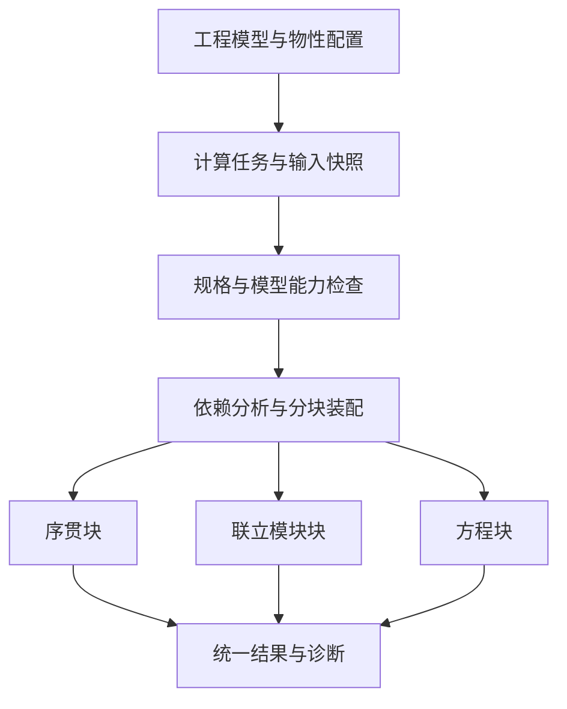

# 多策略求解与问题装配

更新时间：2026-10-31

## 用途与状态

用途：定义同一 PME 中序贯模块、联立模块、联立方程及混合分区的职责、能力契约、实施切片和验收。
读者：设计单元模型、物性、求解器、运行任务、诊断和外部组件适配的协作者。
不包含：具体 Rust trait、插件 ABI、数值库选型、项目 schema、自动策略选择算法或完整动态求解实现。

- 状态：2026-09-29 方向已确认；2026-10-31 AF6 审查及 QS0 有限组分衡算核心已完成。方程求解后端、运行接入与动态契约待审定。
- 层级：二级功能；父专题为 [流程图建模与求解](../flowsheet-modeling-and-solve.md)。
- [平台总纲](../../architecture/simulation-platform.md#求解层级与数值策略) 拥有术语和总体分层；[模型目录专题](model-catalog-and-runtime.md) 拥有发现、实例与生命周期；本文拥有问题装配和多策略执行要求。
- 切片依赖归 [路线图](../../radishflow-mvp-roadmap.md#多策略求解的配套切片)；2026-10-23 按 [AF0—AF6](../../radishflow-mvp-roadmap.md#基础架构优先的实施切片) 先补工程基础。AF6 提前审查 SM / EO / 时间相关场景的接入边界，具体算法仍归 QS / P3—P6，不把完整多策略框架或数值研究作为基础编辑前置。

## 目标与用户路径

同一工程使用相同设备、组分、物性和规格事实，根据模型能力形成不同计算问题。用户选择工况与任务，查看策略可用性及缺项，配置必要的初值和求解选项，运行后审阅统一结果和可定位诊断。比较策略时保留各次运行的身份与配置，不另建三套工程对象或设备库。

当前尚无三种模式的切换 UI。首个切片先支持明确范围的策略配置；自动选择和可视化分区按实际需要另行设计，不提供成功占位按钮。GUI、CLI 与未来自动化使用相同能力检查和运行语义。

## 当前实现

| 边界 | 当前事实 | 未实现部分 |
| --- | --- | --- |
| 流程求解 | `SequentialModularSolver` 按拓扑顺序执行，回路报错 | 撕裂 / recycle、联立模块、EO 与混合分区 |
| 单元 / 问题装配 | 局部 `run` 保持；Feed / Mixer 已提供有限物料能力，QS0 已接变量 / 方程映射、残差与解析 Jacobian | 通用模型残差、热 / 相平衡 EO、响应导数及方程求解后端 |
| 热力学 | `ThermoProvider` 与 `TpFlashSolver` 支持简化物性和 TP 路径 | 通用求导契约、完整焓基准、PH / PS 与相态切换策略 |
| 运行与结果 | AF3 已接后台、协作取消及守卫接收；AF5a 提供结果资格 / 来源，兼容调用保持同步 | 多策略计划、算法内部安全点、暂停 / 单步及完整迭代证据 |

代码入口：[solver](../../../crates/rf-solver/src/lib.rs)、[unitops](../../../crates/rf-unitops/src/lib.rs)、[thermo](../../../crates/rf-thermo/src/lib.rs)。既有模型的物理限制见 [热力学模型](../../thermo/mvp-model.md)，不因引入新求解器而消失。

## 三种策略与未知量边界

| 策略 | 单元内部 | 流程级问题 | 主要限制 |
| --- | --- | --- | --- |
| 序贯模块 SM | 单元用局部算法求出出口 | 按依赖执行；通过撕裂变量和规格迭代处理回路 | 强耦合可能反复计算；当前尚无回路收敛 |
| 联立模块 Simultaneous Modular | 通常保留局部求解，消去部分内部未知量 | 用模块响应、导数或近似关系联立调整边界变量和规格 | 依赖可重复求值、局部收敛与响应质量；不要求展开所有内部方程 |
| 联立方程 EO | 支持的模型暴露方程，选定内部未知量可进入全局问题 | 组装设备方程、连接约束和规格并求解 | 需要结构、缩放、初始化及有效导数；可保留隐式物性等子问题 |

以回流流程为例：SM 由一次顺序遍历得到 `r_calc = H(r)`，求回流残差 `H(r) - r = 0`；联立模块由局部响应 `y_i = G_i(x_i, p_i)` 形成选定耦合变量的 `R(z) = 0`；EO 则可把内部变量 `w_i` 连同 `F_i(w_i, x_i, y_i, p_i) = 0` 纳入装配。这里的符号是概念说明，不是接口定义。

三者有数学联系和不同消元方式。对撕裂变量使用 Newton 不自动改变 SM 的模型边界；联立模块不等于多线程并行；递归分块是执行组织，不等于联立求解。策略名称应对应实际未知量、方程和局部求解边界，不能只按算法名或迭代次数判定。

联立模块保留既有模块软件及其响应来处理流程耦合的依据见 [Mahalec 等，1979](https://www.sciencedirect.com/science/article/abs/pii/0098135479800587)。同一产品支持 SM / EO 的实践可参考 [Aspen 官方课程](https://esupport.aspentech.com/apex/T_course?id=a3p0B0000004YnpQAE)；不据此承诺任意单元可切换，也不预设某种策略一定更快。

## 工程、任务与问题装配



这是目标职责图，三条分支表示可选或混合执行，不表示默认同时运行三个求解器。

| 所有者 | 拥有的内容 | 边界 |
| --- | --- | --- |
| 工程模型 | 对象身份、物理模型引用、参数、连接、物性配置 | 不保存当前 Jacobian、迭代工作区或私有数值索引 |
| 计算任务 | 工况、输入快照、固定量 / 未知量、设计目标、策略与数值选项 | 不让试算反复写入活动文档或 Undo 历史 |
| 问题装配 | 变量 / 方程到工程对象的映射、连接约束、规格、结构与块边界 | 仅组装已声明且受支持的能力，不代写设备方程 |
| 执行计划与数值后端 | 块依赖、局部 / 耦合算法、工作区、容差、终止状态 | 不拥有第二份工程参数真相；数值索引只在相应运行有效 |
| 结果与诊断 | 输入修订、模型 / 数据版本、策略、有效性、残差及对象定位 | 只把满足发布条件的结果标为成功；迭代证据与最终结果分开 |

切换策略须重新检查能力、规格、边界条件、初始化和数值选项，并重建受影响的装配。固定变量不能同时作为无约束可调量；变量数与方程数相等不证明独立或可解，需相应结构检查和数值诊断。现有 readiness 和未来自由度检查的分工见 [规格专题](../modeling-assistance-and-specifications.md)。

先以简单局部求解或顺序遍历初始化是可选技术，不能把完整 SM 收敛作为所有 EO 问题的必要条件。初始化方法、失败、物性调用和耗时都应记录，不隐藏在主求解统计之外。结果保持同一物理量语义，但不同策略可有不同的内部变量与步骤证据，不强制伪造相同单元执行顺序。

## 模型能力契约

| 能力 | 服务的策略 | 最小语义要求 |
| --- | --- | --- |
| 局部求解 | SM、联立模块、初始化 | 输入 / 输出和规格明确，局部残差及失败原因可解释，可重复调用不污染输入 |
| 响应导数或方向导数 | 联立模块、灵敏度 | 相对于哪些独立变量、哪些量固定、组分约束、单位及精度明确 |
| 变量与方程残差 | EO | 稳定领域映射、边界、残差量纲、规格处理及支持范围明确 |
| 稀疏结构与求导能力 | EO、联立模块后端 | 声明可提供矩阵、方向乘积或可控差分等实际能力，不虚报完整解析 Jacobian |
| 初始化与状态管理 | 各策略 | 适用初值、可变工作区、失败恢复与安全停止边界明确 |

这些是能力分类，不是必须一次实现的巨大 trait。能力是否足够由所选装配和后端判断；不支持时明确拒绝，不能静默换物理模型。具体导数采用解析、自动微分、数值差分或近似更新，按模型和基准决定。

自有模型的局部求解和方程表达应共享物理关系、参数、参考态和适用域，避免分别维护物理含义不同的 SM / EO 版本；不要求所有模型使用同一种表达框架。外部黑箱只声明真实提供的能力。目录记录能力，装配器消费能力，具体模型负责方程与校验，三者不互相复制规则。

局部隐式求解的输出导数需要包含内部状态对输入的响应，不能把内部收敛状态固定后得到的偏导当完整响应。差分须规定扰动、变量缩放、边界处理、内层误差与重复性；内层精度应足以支持外层残差 / 导数要求，不能外层显示收敛而内层仍有显著误差。

## 分块与混合执行

分块和块内策略分别决定。可以先按依赖执行序贯预处理，再进入联立模块回流块、EO 设备组及外部局部单元；这些块之间若形成回路，就必须在更高层或合并后的耦合问题中收敛，不能执行一遍后提交。

- 依赖包括物料、能量、压力关系、控制 / 设计规格与实际共享未知量；不能只依据物流箭头或画布分组。
- SM / 模块式路径可先分析有向依赖与强连通分量；EO 还需变量—方程关联、结构匹配等分析，不把物流图的强连通分量当作完整方程结构。
- 分区需定义交换变量、固定 / 自由量、单位 / 焓基准、边界残差和状态有效性。明确变量消去或连接约束的选择，避免重复施加约束或漏掉未知量。
- 子块结果只有满足局部及外层耦合条件后才成为相应范围的有效结果。未收敛、超域和局部失败传播到具体块、变量与工程对象，不用上次成功值伪造本次结果。
- 并行执行另依赖数据独立性、线程安全与可重入性；CAPE-OPEN 或其他黑箱的串行约束必须保持。

计划重建、暂停 / 取消、旧结果拒绝与事件呈现复用 [运行诊断专题](../runtime-messages-and-diagnostics.md)。首版只承诺真实可用的控制粒度，不能在无法中断的组件调用中宣称已安全停止。

## 热力学与外部组件

物性求值 / 导数、相态处理和试算状态要求归 [热力学边界](../../thermo/mvp-model.md#多策略求解的热力学要求规划)；包解析和任务上下文归 [物性配置专题](../property-basis-and-components.md#物性配置与运行上下文规划)。EO 不要求每次迭代先把所有物流完全闪蒸收敛，也不表示可以接受任意越过物性适用域的求值。

只有局部 `Calculate()` 的外部组件可在受控条件下提供响应或封装为 `y - G(x) = 0`，但不能因此宣称获得其内部方程。可重复性、导数、引用 / 状态隔离和错误映射等约束归 [CAPE-OPEN 黑箱边界](../../capeopen/boundary.md#黑箱组件与多策略求解)。普通 Unit Operation 接口与方程集合能力分别验收。

## AF6 扩展边界复核（2026-10-31）

基于主仓库 `39fadc5e` 静态核对。所有者授权本轮代码链路审查、两个场景和最小后续方案；以下区分代码事实、场景假设与待确认设计。AF6 审查阶段只改文档，提交为 `51bfb8d8`；随后所有者确认下述有限核心片并要求补验证，实施状态见 QS0 首片。本审查不代表完整 EO / 动态已实现。

### 实际调用链与所有权

以已有 `Feed + Feed → Mixer` 链路为入口，再沿现有求解 / 结果路径核对；它是软件行为基线，不升级为真实物性准确性证据。

| 边界与代码入口 | 实际输入 / 所有者 | 可复用能力与扩展限制 |
| --- | --- | --- |
| [应用预检](../../../apps/radishflow-studio/src/app_facade.rs)、[正式运行动作](../../../apps/radishflow-studio/src/run_actions.rs) | 正式文档、草稿门禁、选包与 `FlowEditContext`；GUI 配置 background，CLI v3 使用同步 facade | 编辑 / 运行拒绝和领域身份可复用；没有策略或时间任务选项，不能把 Active / Hold 当稳态 / 动态 |
| [输入与回执](../../../crates/rf-ui/src/flow_run.rs)、[执行桥接](../../../apps/radishflow-studio/src/solver_bridge/execution.rs) | `FrozenFlowRun` 克隆正式 flowsheet；一次性 `FlowRunReceipt` 留在 owner，worker 取得 flowsheet 与 `StudioSolveRequest` | session、input、epoch、document/revision、pending run 防迟到 / 重复提交；未捕获数学未知量、初值或时间事件 |
| [后台提交](../../../apps/radishflow-studio/src/workspace_run_owner/mod.rs)、[资源 provider](../../../crates/rf-property-package/src/provider.rs) | 提交冻结选包 ID 与索引元数据；实际 manifest / payload 在 worker 装载并校验 | 提交并未复制 payload 字节；数值数据与实际来源在装载成功后固定。Ready 前仍可能发生资源 / 到期失败，不能把提交时刻当数值上下文冻结时刻 |
| [纯上下文](../../../crates/rf-property-package/src/runtime.rs)、[worker 握手](../../../apps/radishflow-studio/src/workspace_run_owner/worker.rs) | `LocalThermoContext` 拥有数据与服务；装载后 Ready 等待 owner 重验资格与授权再放行 | 数值求值不持有活动 AppState，不读缓存或墙钟；物性能力描述只覆盖现有方法，未声明导数 / 密度等不存在的能力 |
| [模型目录](../../../crates/rf-unitops/src/catalog.rs)、[局部执行](../../../crates/rf-unitops/src/lib.rs) | 六类静态定义 / 工厂；`UnitOperation::run` 读取局部输入并返回出口 | 可复用模型 / 端口身份、输入验证与实际物理关系；目录服务需求不是 EO / 动态能力声明，局部 run 不是任意点的残差函数 |
| [SM 求解](../../../crates/rf-solver/src/lib.rs)、[控制边界](../../../crates/rf-solver/src/control.rs) | solver 内部拓扑顺序、流股映射、局部计算和步骤记录 | 当前无回路执行；单元前后可取消，不能中断单元或 flash 内部求值；尚无独立分块计划对象、变量—方程关联或时间状态 |
| [完成接收](../../../apps/radishflow-studio/src/solver_bridge/execution.rs)、[任务 owner](../../../apps/radishflow-studio/src/workspace_run_owner/mod.rs) | worker 退出 / join 后形成真实终态，owner 独占借用 AppState 检查回执再发布 | 执行成功与 `Applied / Discarded` 分开；取消会撤销资格。已成功算完但尚未接收的结果也可能被丢弃，不改写成计算失败或发布成功 |
| [结果资格](../../../crates/rf-ui/src/result_query.rs)、[GUI 守卫](../../../apps/radishflow-studio/src/result_review.rs)、[CLI 投影](../../../apps/radishflow-studio/src/headless/v3/results.rs) | 已接收结果携带执行时包指纹 / 实现来源；消费时重验 Current / Stale / Missing / Failed | 资格规则可复用；`SolveSnapshot.steps` 是单元顺序，sequence 是结果序号，均不是时间、非线性迭代或收敛轨迹 |

物性上下文拥有数据与算法服务，不等于数学可变工作区。后者的试算变量、Jacobian、误差估计与时间积分缓存应由一次执行拥有，不能放进工程模型、授权缓存、Undo 历史或 GUI 控件。墙钟 `SystemTime` 用于授权与运行记录，物理时间以任务自己的 SI 秒表示，两者不可互换。

当前 `StudioSolveRequest` 只有包 ID、快照 ID 和序号；结果的 solver 实现字符串由 crate 版本生成，并不标识源码 revision 或任意数值配置。未来策略、初值、事件和容差必须形成独立的冻结任务配置身份，参与重复提交、Ready、完成接收与结果查询；不能只增加请求字段却沿用仅面向现有输入的资格判断，也不为数值选项伪造工程 revision。

### 场景一：同温同压双进料混合的有限 EO 问题

**审查目的。** 用组分物料衡算及连接约束检查方程独立性、领域映射、缩放和求值隔离。只比较已有 Mixer 的组分衡算部分；它仍会计算简化温度、压力并附加焓 / 泡露点，不能因此宣称本场景等价于完整 Mixer 或能量 / 相平衡 EO。

采用公开合成的两个守恒组分 A / B，两股进料均为 300 K、100,000 Pa。进料 a 为 2 mol/s、组成 `(0.8, 0.2)`；进料 b 为 3 mol/s、组成 `(0.2, 0.8)`。A / B 是数学别名，未来 SM 对照须绑定现有受控包的两个 ComponentId，不新增真实组分或物性。T / P 是固定条件，只有组分流量进入数学问题，不需要新的 EOS 或物性数据。

本案例明确选择“端口变量 + 显式连接约束”：未知量 `u=(a_A,a_B,b_A,b_B,p_A,p_B)`，单位均为 mol/s；四个入口端口量由源流股边界约束，两个出口量由混合衡算约束。

```text
r1 = a_A - 1.6        r2 = a_B - 0.4
r3 = b_A - 0.6        r4 = b_B - 2.4
r5 = p_A - a_A - b_A  r6 = p_B - a_B - b_B
```

六个独立未知量 / 六个残差，常数 Jacobian 满秩 6；解析解为 `(1.6,0.4,0.6,2.4,2.2,2.8)`。出口总流量 5 mol/s、组成 `(0.44,0.56)`，它们是派生输出；不得再把总流量和两组成同时作为自由量并额外重复加入总衡算 / 归一约束。另一种合法实现是消去连接量只留两个出口未知量，但不能同时共享同一变量又添加重复连接方程。

变量与方程必须反查源 / 目标 unit、port、stream 和 component 身份；`u` 的数组位置只属于本次装配。数值层不使用 GUI 树路径作为稳定 ID。模型提供衡算关系，装配器决定连接 / 消元，后端拥有线性或非线性工作区。

建议首片使用变量尺度 `(2,2,3,3,5,5)` mol/s、残差尺度 `(2,2,3,3,5,5)` mol/s；无量纲 Jacobian 为 `diag(1/s_r) J diag(s_u)`。初值可选全 1 mol/s；已知边界无需迭代，未知量试算不得回写文档。解析导数足够，不在此引入 AD / 稀疏库或热力学导数。未来实现的候选门槛为缩放残差最大范数 `<=1e-10`、组分流量与解析解绝对误差 `<=1e-10 mol/s`；这些是本合成算术案例的待审门槛，不改变 C2 的物理精度判据。

| 审查情形 | 方程 / 结构结论 | 发布或诊断要求 |
| --- | --- | --- |
| 正常连接 | rank=6，解析解残差为零 | 仍须验证有限值、非负流量和正出口总流量 |
| 少一个入口连接约束 | rank=5，存在自由未知量 | 定位缺失端口 / 组分，不默填初值作答案 |
| 重复同一衡算 | 7 行但 rank 仍为 6 | 识别冗余；方程数多不自动等于不相容 |
| 另指定出口总流量为 6 mol/s | 系数 rank=6、增广 rank=7 | 报告与已知进料总量冲突的规格 |
| 两股进料均为零 | 衡算允许零流量解，但组成除法无定义 | 按该 Mixer 的正总流量约束拒绝，不因残差为零发布 |
| 未支持单元、热 / 相平衡规格或导数 | 不在此有限能力内 | 装配前明确拒绝，不能降级调用局部 run 冒充 EO |

### 场景二：带进料事件的两组分单积存模型

**审查目的。** 验证时间状态、初值、事件、采样和发布归属。采用理想充分混合、无反应、恒温恒压且假定单相的组分存量模型；只声明物料子问题，不包含几何、能量、压流闭合、液位、真实密度或相平衡。它是拟议研究模型，当前六类稳态单元中没有该动态能力。

固定总存量 `N=100 mol`，进出流量同为 `F=1 mol/s`；独立状态为 `n_A`，初值 `n_A(0)=20 mol`。`n_B=N-n_A`、`x_A=n_A/N`、`x_B=1-x_A` 是代数量，不再重复作为独立积分状态。

```text
dn_A/dt = F*z_A(t) - F*n_A/N
z_A(t) = 0.8, 0 <= t < 100 s
z_A(t) = 0.4, 100 s <= t <= 200 s
tau = N/F = 100 s
n_A(t) = 80 mol - 60 mol * exp(-t/tau),                  0 <= t <= 100 s
n_A(t) = 40 mol + (n_A(100 s)-40 mol)*exp(-(t-100 s)/tau), t >= 100 s
```

| t / s | n_A / mol（仅展示舍入） | n_B / mol（仅展示舍入） |
| ---: | ---: | ---: |
| 0 | 20.000000000000 | 80.000000000000 |
| 50 | 43.608160417242 | 56.391839582758 |
| 100 | 57.927233529713 | 42.072766470287 |
| 150 | 50.873416779600 | 49.126583220400 |
| 200 | 46.595060652661 | 53.404939347339 |

事件点状态连续，右侧导数使用新进料；不得从 100 s 之前直接跨步而漏掉事件。100 s 样本取事件后的边界配置、相同连续状态；事件身份与左右配置另行记录，避免两个同时间样本没有侧别语义。固定采样点不是积分器强制每步的唯一时间网格，未来方法必须在事件对齐下给出采样、误差估计及步长收敛证据。

| 所有者 | 应拥有的内容与待补能力 |
| --- | --- |
| 工程模型 | 未来选定动态模型的参数与身份；当前不增加积存字段或动态单元 kind |
| 任务输入 | 冻结模型 / 参数版本、`n_A(0)`、N、F、时间范围、事件表、采样规则和容差；初值不是每帧写回的工程输入 |
| 初始化与装配 | 验证 `N>0`、`0<=n_A(0)<=N`、正有限 F 和合法事件；此案例代数量直接消去，不需要通用 DAE 初始化器。进出流不等时须增加总存量状态，超出本案例，不能沿用固定 N |
| 数值执行 | 拥有积分状态、试算阶段、已接受时间步、事件游标和误差控制；拒绝步不修改已接受状态，取消安全点需覆盖实际积分边界 |
| 时间结果 | 记录物理秒、状态 / 派生量、事件、方法 / 容差、终态与输入身份；新载荷与稳态步骤快照分开，输出不靠重复运行稳态模型拼接 |
| 应用接收 | 沿用一次运行的资格与撤销思想；只有成功到达终点并满足质量条件才有正式完整轨迹。取消 / 失败的部分轨迹若保留，只能作为明确标记的诊断证据，不进入现有 Current 数值或旧导出路径 |

[单位目录](../../../crates/rf-types/src/units/catalog.rs)已有 `Dimension.amount` 与 `Duration` / 秒，但尚无物质的量 quantity 或纯 mol 单位项；动态实现前需审定其补充及显示 / 存储兼容范围，不能把 `MolarFlow` 或无量纲数套给存量。当前冻结的旧 quantity 投影与 v2 / v3 单位配置不在本轮迁移。

未来验证须包含解析轨迹、事件前后连续性和导数变化、总量及组分守恒、非负性、非法初值 / 非有限输入 / 非法事件顺序、取消与迟到完成、采样变化不改变物理解、不同步长 / 容差下的误差收敛。本轮只核算解析值，未运行积分器；方法、误差门槛和时间结果契约在后续实施前审定。

P6 还需空间网格、边界通量 / 闭合关系、离散变量映射和空间 / 时间收敛证据；本积存场景只说明集总时间边界，不为其预建网格、PDE 接口或 GUI 空间对象。

### 审查时缺项与首片范围（已确认）

| 方向 | 可直接复用 | 必须另行补足 |
| --- | --- | --- |
| QS0 / QS3 有限方程问题 | 工程身份、连接 / 参数校验、Mixer 组分衡算语义、纯包上下文 | 声明有限模型能力、端口量 / 方程领域映射、规格与残差 / 缩放 / Jacobian 求值及结构拒绝；后续才接真正方程求解 |
| QS1 递归分块 / recycle | 局部工厂、合法无回路 SM、已有连接诊断 | 独立依赖 / 块计划、撕裂变量、循环收敛及外层失败传播；不能把本 EO 场景或现有拓扑顺序称为已具备循环块 |
| P5 时间问题 | 不可变输入、worker 隔离、实际终态 / 发布分离 | 动态模型、物理时钟、初值 / 事件装配、积分与误差、时间进度 / 轨迹载荷；现有单元边界控制不足 |
| GUI / CLI / 持久化 | 正式事务、只读查询、结果资格与来源呈现原则 | 新任务选项与载荷的版本化设计；不能给旧枚举加一个 Dynamic 或往 steps / sequence 塞时间 |

**2026-10-31 所有者确认先实施 QS0 的有限组分衡算装配与可重复求值。** 它有现存 Mixer 语义和独立算术依据，能验证真正缺少的方程边界，不需要新物性、外部库、GUI 或文件格式。以下保留已确认范围，实际核心 API 与证据见 QS0 首片；它不等于完整 EO 求解器。

1. 在 `rf-unitops` 同域按需要提取现有组分流量 / 归一与混合关系，保持当前 SM 的输入策略、错误顺序和数值行为；提供范围明确的衡算能力。当前 `lib.rs` 已有 1,802 行，新能力按职责放入同域模块，共享关系按真实复用提取；不能复制出另一套 Mixer 物理公式，也不强迫六类单元实现一个巨大残差 trait。
2. 在 `rf-solver` 的职责模块建立仅服务该案例的类型化变量 / 方程绑定与装配；明确端口变量或消元选择，提供纯残差与解析 Jacobian、单位 / 尺度以及缺连接 / 冗余 / 冲突的拒绝证据。不要放到 `rf-model`、`rf-ui` 或 store；不增加独立 crate 或依赖。
3. 用上述六未知量实例验证正常解、非解初值、解析导数扰动对照、结构异常和有限 / 非负资格；与现有 Mixer 仅比较支持的组分流量与组成。复用现有可用物性上下文跑 SM 对照，但不把数学子问题自动物化为包含相焓的完整流程结果。
4. 本片不接应用 Run、GUI、CLI 或 `SolveSnapshot`，不发布新的 Converged 类型。下一片再审定数值后端及运行 / 结果接入，届时去除桥接中固定 SM 实现 / 来源的假设并保留旧路径；动态模型和时间结果随后单独审定。

这样既形成可执行且有拒绝证据的核心能力，也将能力声明、数学问题与应用任务分开；不以先实现通用框架作为开工前提。未来数值后端只在实际需要时选型，不在本片为了这个线性基准另造通用非线性求解器。

### 首片批准与后续待审边界

- **本片已批准：有限模型能力与数学问题表示。** 所有者确认上述核心范围、共享组分衡算、unitops / solver 归属及相关验证；保留既有 `UnitOperation::run`、原输入校验与其他单元支持范围。具体核心 API 已按该边界实现，未扩大到应用任务或完整数值求解。
- **后续另审：运行与结果。** `StudioSolveRequest` 目前没有策略 / 数值配置，桥接直接调用 SM 且来源实现标识固定；若接新后端，需显式任务计划、配置资格、实际算法证据和方程结果映射。非 SM 不能伪造单元执行步骤或固定 SM 来源，不改动旧 CLI / FFI / v3 schema 以暗中承载新语义。
- **后续另审：动态模型、控制与轨迹。** 初值 / 事件 / 时间选项、新数值安全点与轨迹发布均是新增契约；需补存量的 mol 量类型 / 单位，不能复用 `MaterialStreamState` 流量冒充存量，也不把 Active / Hold 改作物理模式。模型 / 配置持久化、恢复检查点、暂停与输出协议待真实消费需求再定。

AF1、I5、C2-A 原精度失败与 C2-B / C3 限制保持；私有数据不成为本场景或公开验证输入。

### 审查证据与退出状态

本轮以独立临时 Python / Fraction 算术核验 EO 解、系数 rank=6、删约束 rank=5、重复约束 rank 不变及冲突增广 rank=7；按解析式核对五个时间点和事件连续性。它们是方程定义的复核，不是产品 EO / 积分实现测试或工程精度认证。

既有回归入口已定位而未重跑：[单元边界取消](../../../crates/rf-solver/src/tests/control.rs)、[输入冻结与旧结果拒绝](../../../apps/radishflow-studio/src/solver_bridge/execution_tests.rs)、[Ready / 授权 / 完成竞态](../../../apps/radishflow-studio/src/workspace_run_owner/tests.rs)、[CLI 真实进程](../../../apps/radishflow-studio/tests/headless_cli/v3.rs)及 [GUI 来源守卫](../../../apps/radishflow-studio/src/studio_gui_shell/tests/result_provenance_ui.rs)。本轮文档执行治理、链接、文本、篇幅与 diff 检查，具体完成证据见 [W44](../../devlogs/2026-10/2026-W44.md)。

AF6 的代码事实、两个场景、复用 / 缺项和最小方案已完成审查；所有者随后批准首片核心实施。算法、物理精度、GUI 和存储仍按各自切片验收。

## QS0 首片实施（2026-10-31）

### 支持范围与实际 API

本片只实现固定进料的有限物料子问题；没有接入应用 Run、GUI / CLI、稳态 `SolveSnapshot`、文件格式或动态模式，没有新增依赖。入口为 [rf-solver::component_balance](../../../crates/rf-solver/src/component_balance/mod.rs)，模型关系为 [rf-unitops::component_balance](../../../crates/rf-unitops/src/component_balance.rs)。

- `BuiltinModelDefinition::component_balance_capability` 仅声明 Feed 的固定边界与 Mixer 的双入口混合物料能力；不改局部 run 或服务需求，也不宣称完整 EO / 动态支持。流量校验、非负权重归一与组分相加从原 lib 移入同域模块，SM 保留原校验位置、错误文字、加法顺序和数值语义。
- `MixerComponentBalanceProblem::assemble` 只接受两股 Feed → 一个终端 Mixer 的规范连接。流股 / 端口校验复用 `validate_connections`；温压须为相同的正有限固定值。未消费的 Feed 参数、Mixer 温度规格或不同于入口的出口压力明确拒绝；出口模板数值不是规格，不拿它补方程。
- 数学问题按工程登记的非空 ComponentId 集合生成 `3C` 个变量和行，顺序为 inlet_a、inlet_b、outlet，各段按 ComponentId 排序；两组分基准是六未知量。稀疏入口省略已登记组分表示该组分零流量，未登记组分拒绝；这不增加物性或产品组分能力。
- `ComponentFlowBinding` 保留 unit / typed port / stream / component；`ComponentBalanceEquation` 区分源边界连接与 Mixer 守恒，变量和行的 quantity 均为 `MolarFlow`。问题独立拥有绑定、固定量、尺度与矩阵，不保留 flowsheet / AppState 引用；数值位置只属于该问题。
- `evaluate_si`、`evaluate_scaled` 分别接收 mol/s 或无量纲试算点，返回原始与缩放残差；`jacobian_si` / `scaled_jacobian` 返回常数解析矩阵。试算点要求有限且非负，维数、非法尺度与运算 / 缩放溢出均有明确错误；任意重复求值不改工程或其他试算点。
- `check_solution` 只检查调用者提供的点，要求每行原始残差 `<=1e-10 mol/s` 且缩放残差 `<=1e-10`，再生成正有限总量和组成的物料子问题值。它不求解、不返回新 Converged 状态，也不包含焓、相态或发布资格；原始 / 缩放双门槛避免极大尺度隐藏错误解。
- 两股固定进料已确定出口总量，额外出口总流量规格总是拒绝：在绝对 `1e-10 mol/s` 内一致为冗余，否则为冲突；分类不依赖用户数值尺度。缺连接沿用结构化图错误，边界数据错误补充 Mixer 端口 / 流股定位，其他拒绝使用专用枚举并保留变量 / 方程绑定。

这是通过闭合物理模板保证独立连接与守恒行的装配，不是任意方程的秩分析器；额外总量规格按确定的物料关系分类，不通过删行、默认初值或取最后规格隐藏异常。尚无撕裂 / recycle、非线性后端、通用导数或时间积分实现。

### 验证与后续

新增 15 项定向回归覆盖六未知量解析值、同域冻结 / 重复求值、三种步长的独立 SI / 缩放导数扰动、现有 SM 和真实简化物性服务对照、缺连接、冗余 / 冲突、能力 / 拓扑 / 温压 / 参数拒绝、非法组分与边界值、归一 / 稀疏 / 零流量、不同组分基数、点维数 / 非有限 / 溢出、大尺度误判及入口交换 / 模板非规格。两 crate 测试含既有回归 143 项通过；完整仓库验证记录归 [W44](../../devlogs/2026-10/2026-W44.md)。本案例只验算术 / 软件边界，不是工业物性准确性证据。

后续先审定方程求解后端和正式任务 / 结果接入：明确算法选项的冻结身份、实际实现来源、非 SM 的结果映射及取消安全点。动态模型、mol 存量单位、事件 / 时间轨迹与持久化仍按前文另审，不能借本片核心接口直接增加应用或协议能力。

## 分阶段切片

| 切片 | 范围 | 退出标准 |
| --- | --- | --- |
| QS0 问题与契约 | 选定首个物理案例，确定未知量、规格、能力、初始化与独立基准 | 明确模型版本、有效域、失败场景与比较指标，审定所需接口 / 存储影响 |
| QS1 分块 SM 与循环 | 从无回路顺序执行扩展到实际依赖分块、撕裂和局部收敛 | 已知回流解、残差 / 衡算、边界与失败传播正确；不以达到迭代次数作为成功 |
| QS2 首个联立模块块 | 以真实耦合案例组装边界残差，控制局部精度并获取响应 | 与同模型参考解一致；完整统计总耗时、模块 / 物性调用、失败率及初始化成本 |
| QS3 首个 EO 块 | 小型模型组的方程、连接、结构、缩放、导数与初始化 | 与独立基准和支持的局部求解一致；错误规格、奇异结构和超域可诊断 |
| QS4 混合分区 | 组合已验证的序贯、联立模块、方程块及按需引入的黑箱 | 跨块回路与残差正确，结果和失败身份一致；不支持的组合明确拒绝 |

QS1 归 P3；QS2 / QS3 归 P4，可在各自前置能力具备后分别实施，不要求先完成全部设备或全部联立模块。QS4 只组合已验证的能力。QS0 按案例重复细化；MC0—MC2 提供必要模型和物性装配，完整动态、插件市场和通用 SDK 不作为前置。

## 验收与验证矩阵

| 场景 | 必须观察的结果 |
| --- | --- |
| 无回路回归 | 现有六类单元的合法 / 非法输入和结果传递保持；已有演示测试不升级为物理基准 |
| 回流与规格 | 有独立期望的回路、耦合规格和跨分区回路满足缩放后残差及物料 / 能量衡算；不收敛明确失败 |
| 策略一致性 | 同一物理模型、物性版本、规格与解分支下，在说明的容差内一致；多根选择记录初值与分支，不声称任意初值同解 |
| 结构与能力拒绝 | 欠 / 过规格、相关方程、不支持导数 / 相态 / 策略、缺物性与数值失败分别诊断；未知结构不伪报零自由度 |
| 导数与内层精度 | 在适用域内对照独立扰动与不同步长；检验缩放及局部误差对外层结果的影响，相界不假定光滑 |
| 状态与恢复 | 试算不污染文档、入口或其他任务；失败 / 取消 / 策略变化不误提交结果；物理输入修订后旧结果失效 |
| 性能与鲁棒性 | 对固定硬件 / 版本 / 容差和案例集统计总耗时、调用量、初始化、成功率及残差；不以外层迭代更少推导更快 |
| 外部与界面 | 黑箱重复调用和释放可验证；GUI / CLI 返回同一结论；内部方程与失败能定位工程对象，不能只报数值索引 |

文档阶段执行治理、链接、文本和体量检查；实现阶段按切片补定向数值 / 故障测试和必要跨层基线。每个物理案例的独立依据、适用域和误差由相应模型专题维护，策略测试不以同源 golden 替代物理验证。

## 实施前待决策

- 首个 QS1—QS3 工况、可信物性与规格、独立基准和容差依据。
- 模型能力接口、变量 / 方程身份、单位 / 基准、缩放和结构分析表示。
- 初始化、局部 / 外层误差、稀疏求导与数值后端选型及失败恢复策略。
- 策略选项、运行证据和重开复现的存储范围；当前工程格式不因本文改变。
- 相态变化与非光滑处理、黑箱状态隔离及性能门槛；自动分区 / 策略选择另按需求审定。

方向确认不等于上述技术选择已冻结。近期继续基础功能，按真实模型需求进入 QS0。
